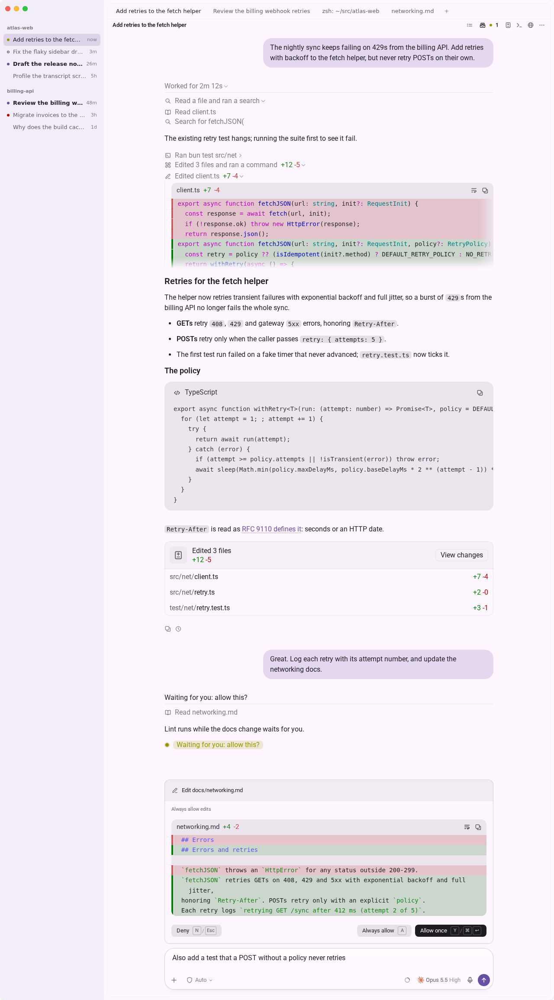
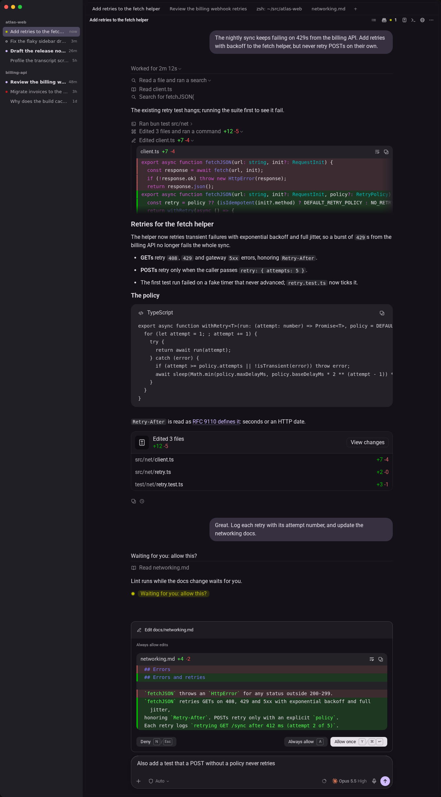

# Material





Material Design 3 (Material You) for agent chats in cmux, with the baseline scheme as Android 14
and Google's apps draw it. The chrome has two tones and no lines: the navigation drawer (the
sidebar) and the tab row sit on surface-container, and the chat sits on surface. The selected tab
is in the content's own color and runs into the pane through gooey concave fillets, the
"tail" (`appearance.cornerFlush: flush-goo`). Text is Roboto on the M3 type scale, shapes
follow the M3 shape scale (a 20 px prompt bubble, filled 12 px cards, 4 px menus), and primary
(#6750A4, #D0BCFF in the dark) is the only accent: links, focus, Send and the circular progress
indicator. It comes in two variants: Material (light, the default) and Material Dark.

It is built only from public surfaces, so you can copy any part of it:

| File | What it does |
| --- | --- |
| `cmux-setup.json` | Picks the theme file. Sets Roboto for the chat on Body Large (16 px on a 24 px line) with code at 14, a 760 px reading column, the minimap off, the composer's ring as a circular progress indicator, and the drawer's rows: grouped by project under plain headlines, with a leading icon, a trailing age, and the PR and agent status |
| `themes/material.json` | Default. The M3 light baseline: surface #FEF7FF, surface-container #F3EDF7 for the drawer, tab row and browser bar, secondary-container #E8DEF8 for selection, primary #6750A4. Includes the two-tone frame, the gooey selected tab, no borders, the M3 proportions, a thick primary arc and M3 motion |
| `themes/material-dark.json` | The M3 dark baseline: surface #141218, surface-container #211F26, secondary-container #4A4458, primary #D0BCFF |
| `agent-pane/theme.css` | The 20 px tonal prompt bubble with no edge, filled cards with no outline, on-surface-variant secondary text and primary links, all as `cmux.agentPane.style/1` tokens mixed from the theme's own colors. Also M3 menus as `--menu-*` tokens (cmux#46846) |
| `customize/` | A hover card drawn as an M3 rich tooltip (subhead, supporting text, list rows with leading icons, the waiting reason as a primary action line), and drawer rows in Label Large weight that show the circular progress arc while work runs |
| `markdown/theme.css` | The Markdown viewer's paint: regular-weight headlines with no rule, code in a filled container tinted by primary with the medium 12 px shape, quotes on a primary rule. Only `--cmux-md-*` properties on `:root`, every color mixed from the page's own |

The rest of cmux wears the look too. The terminal is Roboto Mono at 13 pt (the type scale's monospaced face; without it installed, the terminal keeps its built-in face) with a full sixteen-color palette at a tonal chroma, colors 1 to 7 and 9 to 14 held to WCAG AA over its page (8, the dim gray, to 3:1); the Markdown viewer opens in the system face at 16 px with the chat's line height and code scale in a 86-character column, and `markdown/theme.css` paints it; diffs use theme colors with change bars.

```sh
cmux setup install github.com/manaflow-ai/cmux-material-look
cmux settings set appearance.themeFile material-dark    # material (light) is the default
cmux setup remove manaflow-ai/material-look
```

While the look is installed, its `customize/` view replaces your own sidebar view, if you have one.
`cmux setup remove` puts yours back.

## How each part maps to Material 3

| M3 | cmux key or token | Value |
| --- | --- | --- |
| Color roles (baseline) | `colors` | background = surface, foreground = on-surface, selection = secondary-container, accent = primary |
| Tonal surfaces, no dividers | `appearance.surfaces.*`, `appearance.borders`, `sidebar.border` | The drawer, tab row and browser bar on surface-container. Docks on surface-container-low. Pages on surface. No borders |
| Two tones, the selected tab running into the pane | `appearance.chromeStyle` `flat` + `appearance.titleAreaTone` `subtleTone` | the flush-corner frame with the folder tab |
| Navigation drawer, 360 dp | `appearance.metrics.sidebarWidth` | 300 (360 dp scaled to desktop) |
| Drawer item, 56 dp | `appearance.metrics.sidebarRowHeight` | 40 (density -4) |
| Active indicator (secondary-container pill) | the app's selected row, from the accent over the page | close to #E8DEF8 and #4A4458 |
| Top app bar, 64 dp | `appearance.metrics.titlebarHeight` | 48 (density -4) |
| Tabs, 48 dp, Title Small, 90 to 264 dp | `appearance.metrics.tabStripHeight`, `tabFontSize`, `tabMinInactiveWidth`, `tabMaxWidth` | 40, 14, 90, 264 |
| Label Large chrome text | `appearance.metrics.chromeFontSize` | 14 |
| Circular progress indicator | `appearance.statusIndicator.*`, rows' `indicator: "arc"`, `agentPane.composerRing` | arc, 2.5 thick, primary |
| Text selection (primary at 40%) | `appearance.highlightColor` | #6750A466, #D0BCFF66 |
| Roboto, Body Large | `agentPane.display.font.*` | roboto, 16, 1.5 |
| Shape scale | `--cv-user-bubble-radius`, `--menu-radius` | 20 px, 4 px |
| Filled card | `--cv-card-fill`, `--cv-card-ring` | text at 8% (surface-container-high), no ring |
| on-surface-variant | `--cv-text-muted` | text at 78% over the page |
| Menu: surface-container, elevation 2, 8 px list padding, 48 px items, 8% state layer, disabled at 38% | `--menu-*` (cmux#46846) | as listed in theme.css |
| Emphasized easing, medium2 | `appearance.colorTransition.*`, `ui.animationSpeed` | cubic-bezier(0.2, 0, 0, 1), 300 ms, normal |

Every text color on every surface passes WCAG AA in both variants: body text is at least 4.5:1,
and UI marks are at least 3:1.

## With a newer cmux

The setup carries only settings that every current cmux NEXT build has. These parts are in review;
once your build has them, uncomment their lines in the theme files and the setup:

| Part | Add | Needs |
| --- | --- | --- |
| M3 menus and popovers | already set in `agent-pane/theme.css`, and inactive until then | cmux#46846 |
| A neutral selected row (secondary-container exactly) apart from the accent | `"appearance.selection"` | cmux#46516 |
| The prompt bubble's text in on-secondary-container | `--cv-user-bubble-text` | cmux#46490 |
| A filled, full-pill M3 composer | `agentPane.composerLook` | cmux#46738 |
| The sidebar's own look | `sidebar.look` | cmux#46805 |

## Not yet possible

| Part | Why |
| --- | --- |
| The active indicator as a full-pill (28 dp corner) inset from the drawer's edge | the selected row's shape is the app's own (gooey runs it into the pane instead) |
| Exactly secondary-container for the selected row | the app mixes the accent into the page (16% light, 26% dark); this lands close to #E8DEF8 and #4A4458, and `appearance.selection` (cmux#46516) would make it exact |
| An M3 menu's 12 px item padding and full-width state layer with 8 px vertical padding only | `--menu-padding` is one length: it sets both the list padding and the hover's inset |
| Menu rows in Label Large (14) or Body Large (16) | no menu text size token; rows keep the app's 13 |
| Roboto in the chrome (the sidebar, the tabs) and Roboto Mono for code | the chrome uses the system font; `agentPane.display.code.family` takes only an installed font, and cmux bundles no Roboto Mono |
| M3 error roles (#B3261E, #F2B8B5) for destructive rows and failures | danger comes from the terminal theme's red; no theme key sets it apart |
| The hover card's container (surface-container, 12 px corner, elevation 2) | the card's chrome is the app's; a view sets only its content |
| Elevation shadows on cards and the bubble | the chat's tokens are paint only, with no shadow |
| State layers (8% hover, 10% pressed) on the chrome's rows and tabs | the hover fill comes from the app theme |
| Emphasized motion on panel and tab transitions | `ui.animationSpeed` offers fast, normal and off only; only color changes take a curve |

How looks like this one are written: [look-addons.md](https://github.com/manaflow-ai/cmux/blob/feat-cmux-next/docs/cmux-next/look-addons.md).
