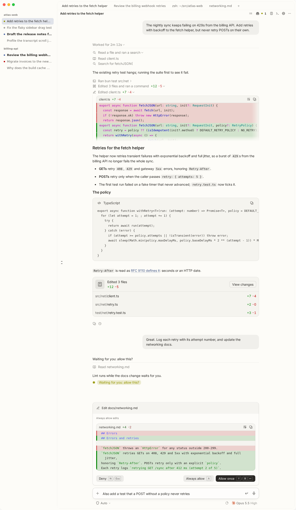
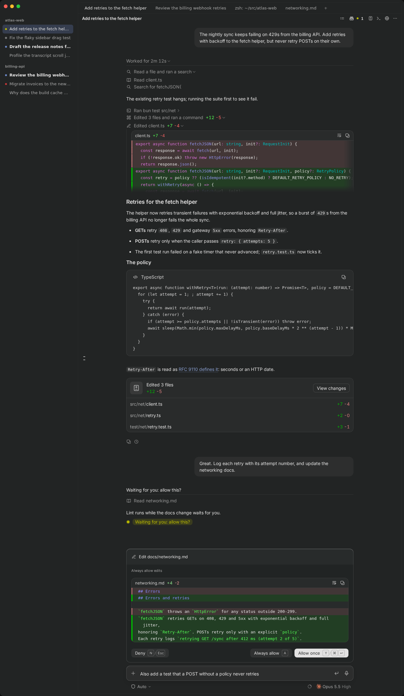

# Omnibar





Browser chrome for agents and terminals: one band, one colour, one root corner. This is Omnibar
v0.2, the look that goes with the design proposal of the same name (RFD 0033). It changes no
default. The design system the debate settled on is Instrument v0.1; Omnibar stays beside it as
the plain one-colour browser band.

cmux holds many live sessions at once, the way a browser holds many live pages. Omnibar draws it
that way: a tab strip and a toolbar at fixed heights, one chrome colour with a neutral highlight on
the selected tab and row, hairlines where two regions meet, no glass, no goo. A second pair of themes adds one quiet tone
to the sidebar and the tab strip. Every
corner comes from the address field's 8 pt. It ships Light (the default) and Dark, in Hush's
colours flattened to one tone, and both again with the tone.

It is built only from public surfaces, so you can copy any part of it:

| File | What it does |
| --- | --- |
| `cmux-setup.json` | Picks the theme file; the address field at 28 pt with 8 pt corners and 14 pt text, no shadow; the chat in the system face at 14 px on a 1.5 line, code at 0.92, a 720 px column; the sidebar as a vertical tab strip: one-line rows with an icon, the title and the session's state |
| `themes/omnibar.json` | Default, Light. Every surface `#FDFCF8`, text `#2A2825`, selection `#E9E5DC`, accent `#4A65A3`, hairline `#E2DED3`, no glass |
| `themes/omnibar-dark.json` | Dark. Every surface `#222424`, text `#E3E2E2`, selection `#3D4040`, accent `#6682C2`, hairline `#373A3A` |
| `themes/omnibar-two.json`, `themes/omnibar-two-dark.json` | The same look with a tone: the sidebar and the tab strip one step darker than the page (`#F4F2EC`, `#1B1D1D`), same hue, 1.09:1; the hairline stays |
| `agent-pane/theme.css` | A prompt bubble with 14 px corners (the text at 6%), cards at 4% with a 10% hairline, secondary text as solid ink (the text mixed 76% and 70% into the page, never see-through), links in the accent a step toward the text, and menus as the address field's popup (pending, below): `cmux.agentPane.style/1` tokens only, every colour mixed from the theme's own |
| `markdown/theme.css` | Semibold headings with no rule, code on a 4% fill with 8 px corners, quotes on a hairline. Only `--cmux-md-*` properties on `:root` |

## The numbers

Measured from the source of the two open-source browsers this look comes after; the proposal
(RFD 0033) cites each one.

| Value | Omnibar | Rule |
| --- | --- | --- |
| Control height (toolbar button, address field, sidebar row) | 28 pt | one height for everything you click in the chrome |
| Band height (tab strip, toolbar) | 36 pt | the control plus 4 above and 4 below |
| Root corner (address field, button, row) | 8 pt | the address field's |
| Chip inside the field | 6 pt | 8 less the 2 pt between them |
| Pane, menu and popup corner | 12 pt | 8 plus the 4 pt between them |
| Tab width | 192 at most, 96 selected at least, 56 otherwise | the selected tab always keeps its title and close button |
| Selected tab and row | the one second tone | a neutral highlight, never the accent |
| Hover fill | the text at 6% (Light), 10% (Dark) | still, weak, never coloured |
| Colour change | 200 ms, ease out | nothing springs |

```sh
cmux setup install ./examples/looks/omnibar
cmux settings set appearance.themeFile omnibar-dark    # omnibar (Light) is the default
cmux settings set appearance.themeFile omnibar-two     # the sidebar and tab strip one step darker
cmux setup remove manaflow-ai/omnibar-look
```

## What it measures

From `bun run golden:looks --looks cmux,omnibar --setup ../examples/looks/omnibar`, WCAG contrast
against the page (`#FDFCF8` Light, `#222424` Dark).

| | Light | Dark | Set by the look |
| --- | --- | --- | --- |
| Body text | 14.3 | 12.1 | yes, the theme's `foreground` |
| Secondary text on `--cv-text-muted` (the colour itself) | 6.59 | 7.54 | yes: solid, the text 76% into the page |
| Quietest text on `--cv-text-dim` (the colour itself) | 5.43 | 6.64 | yes: solid, 70% |
| "Worked for 2m 12s" and tool-call labels ("Read client.ts") | 3.80 | 5.01 | no: they read `--cv-activity-text`, the text at 58% see-through |
| The chevron beside a tool-call group | 2.88 | 3.84 | no: a mark, drawn a step under the muted ink |
| "Waiting for you" pill | 2.6 | 5.5 | no |
| Footer "High" | 2.9 | 3.9 | no |

The rows the look does not set are under their floor in Light (text 4.5:1, a mark 3:1). They are the same in every look built
on this ink and are not claimed here; they are fixed in the default's stylesheet, not in a look.

v0.2 changed one thing from v0.1: secondary text was the text at 76% and 70% see-through and is
now mixed into the page at the same shares, so text is the same colour on the page and keeps that
colour on a card or a bubble. One thing reads lighter: the copy and time icons under a reply, whose
crossing strokes used to add up where they overlap, measure 5.35 Light and 6.43 Dark at their
darkest pixel (7.13 and 7.88 in v0.1). The shares stay: a solid 62%, the share proposed in the debate,
is 4.24:1 on this page, under the floor, and lowering the ink would not have reached the rows
that fail.

## What a look cannot set yet

Each of these is a value the system names and the build has no key for. They stay as comments in
the files, naming the change that would add them; none is faked with a selector.

| Value | Wanted | Waiting on |
| --- | --- | --- |
| Tab shape: 8 pt top corners, 4 pt foot | `appearance.tabShape` | cmux#46780 |
| Sidebar row inset 4, padding 8, 8 pt corners | `appearance.metrics.sidebarRow*` | cmux#46861, cmux#47048 |
| Toolbar button 28 square, 8 pt corners, 4 apart, hover 6% and 10% | `appearance.metrics.toolbarButton*` | cmux#46861, cmux#47048 |
| Composer: 40 pt field, 14 pt corners, 28 pt buttons 6 pt in | `agentPane.composerLook`, composer metrics | cmux#46738 |
| Menus: 12 pt corners, 28 pt rows, 8 pt highlight | `--menu-*` | cmux#46846, cmux#47046 |
| Tool-call rows: 12 px label, 12 px mono command on a 16 px line | tool row type tokens | cmux#46778 |
| Tool-call label ink and "Worked for" ink at 4.5:1 or more | `--agent-muted` and `--cv-activity-text` are not `cmux.agentPane.style/1` tokens | none yet |
| "Waiting for you" pill ink, footer ink | no key | none yet |
| The selected row's neutral fill in the test window | the capture tool draws the accent whatever `appearance.selection` says | none yet |
| Button and field corners from one root | corner tokens | cmux#49622 |
| Popup, toast and dialog corners apart from the pane's | no key | none yet |
| Any shadow or elevation step | no key | none yet |
| Comfortable density's 34 pt control in a 42 pt band | drawn by density, not by a look | none yet |
