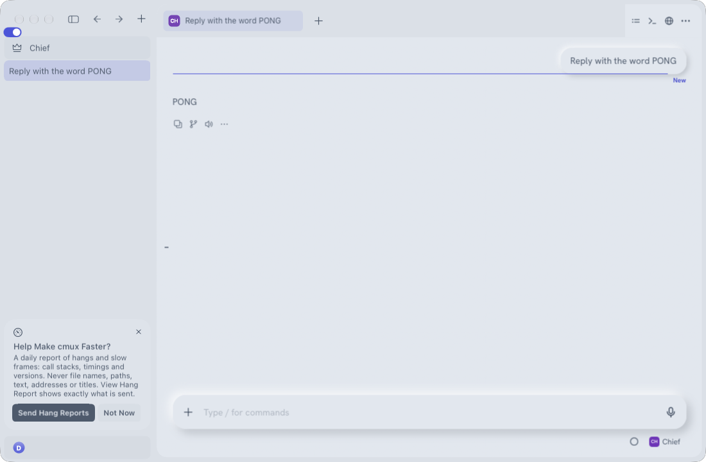
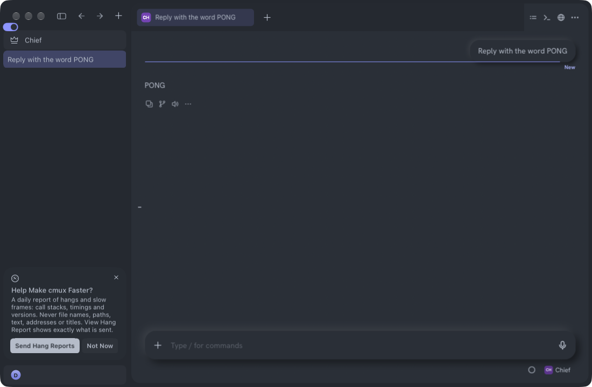
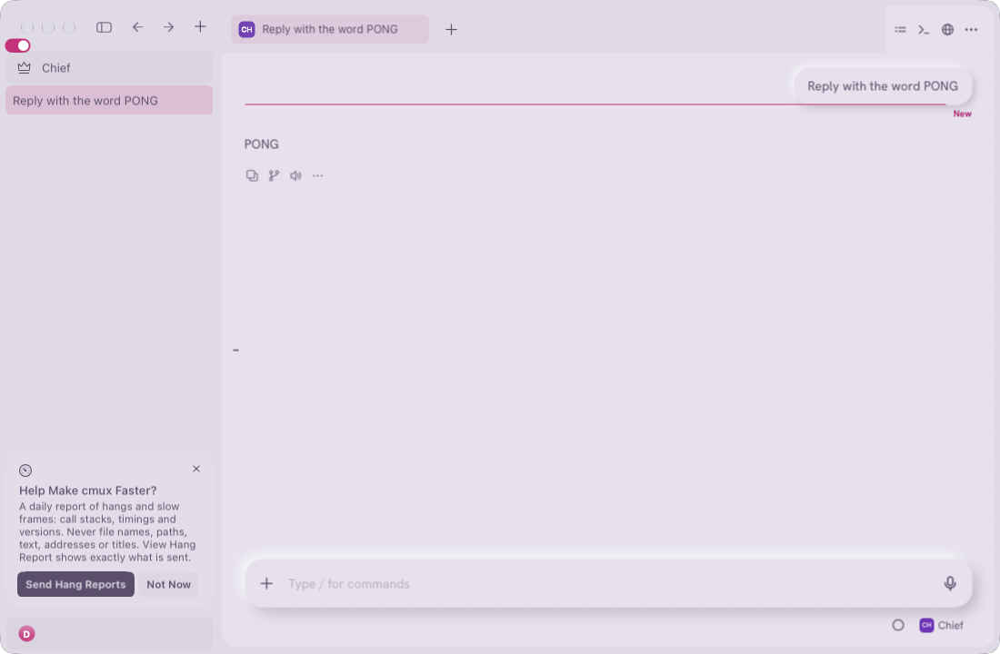
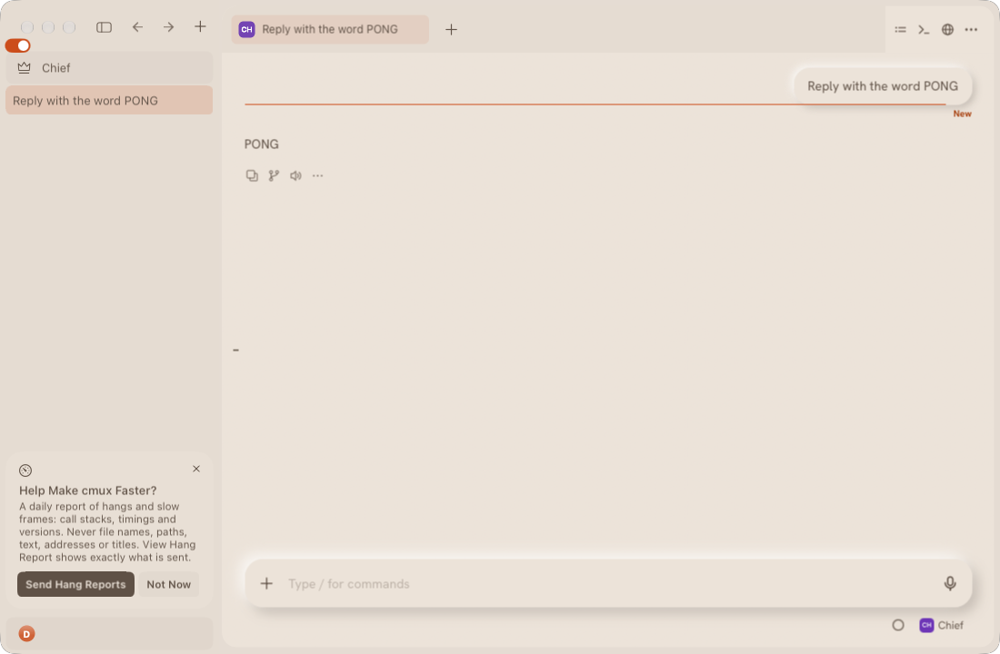
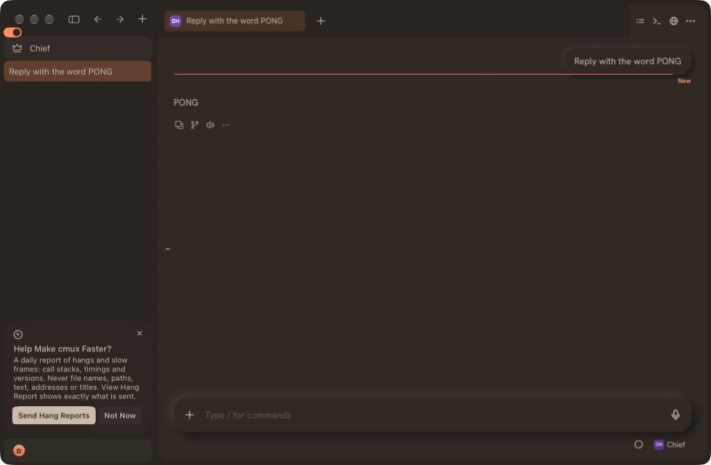

# Plush





| | Light | Dark |
|---|---|---|
| Dusk |  |  |
| Clay |  |  |

Shots from a fresh-home launch of the published nightly (1.0.0-nightly.4499924208601), with one chat opened first, the look installed by `cmux setup install` and each theme file picked in turn. They show the raised prompt box and your message on the one tinted page.

cmux as something soft you could press. One tinted surface runs under everything: the sidebar, the
tab bar and the gaps between panes are that surface a breath darker, and each pane is a card of the
same color raised out of it, with 16 pt corners and an even 10 pt gap all round. Nothing has a
border and nothing is glass: the chat's prompt box and your messages are lifted by a pair of soft
shadows (a light one up and to the left, a dark one down and to the right), inline code is pressed
into the page as a shallow well, and the in-chat notice and the pickers are solid raised cards. The
type is a low-contrast ink, and one saturated accent marks focus, Send, links and the working dot.

It ships three tints, each in light and dark:

| Theme file | Scheme | Page | Ink | Accent |
| --- | --- | --- | --- | --- |
| `plush` (the default) | Light | cool blue-gray `#e2e7ee` | `#536073` | indigo `#4c55d8` |
| `plush-dark` | Dark | `#2a2f37` | `#b0b8c6` | periwinkle `#8d95ff` |
| `plush-dusk` | Light | soft lavender `#e6e1ed` | `#5a4e6a` | raspberry `#c2337a` |
| `plush-dusk-dark` | Dark | `#2c2734` | `#bcb2ca` | pink `#ff72aa` |
| `plush-clay` | Light | warm sand `#ece3d9` | `#5f5146` | terracotta `#d0501f` |
| `plush-clay-dark` | Dark | `#302924` | `#c8bbae` | coral `#ff8d5e` |

```sh
cmux setup install github.com/manaflow-ai/cmux/examples/looks/plush@feat-cmux-next
cmux settings set appearance.themeFile plush-dusk-dark    # plush (light) is the default
cmux setup remove manaflow-ai/plush-look
```

Or as a one-step recipe, `cmux customize use ~/.local/state/cmux/customize/recipes/plush.json`
(the theme files and both stylesheets come with it).

It is built only from public surfaces, so you can copy any part of it:

| File | What it does |
| --- | --- |
| `cmux-setup.json` | Picks the theme file; sets the chat in Hanken Grotesk (`hanken`), a soft round sans, at 15 px with a 1.6 line height and code at 0.9; the Markdown viewer in the system face at the same size; diffs and sidebar group colors from the theme; a round (12 px), lifted address field |
| `themes/*.json` | Six theme files, one per tint and scheme. Each sets the page, ink, accent and selection, the terminal's sixteen colors (solved in OKLCH at one lightness over the page, so every hue reads alike), the floating chrome with no borders, no wallpaper, blur or glass, and the proportions below |
| `agent-pane/theme.css` | The chat's raised and inset shapes: the prompt box (20 px corners) and its queued prompts, your messages (18 px), the in-chat notice (16 px, a solid card, not a frosted pill) and the pickers (14 px) are the page's own color lifted by the double shadow; inline code sits in a well; cards lose their ring; links take the accent. Every color is mixed from the theme's own, so one file serves all six |
| `markdown/theme.css` | The Markdown viewer: code on a faint fill with round 14 px corners, headings with no rule, quotes on a soft accent bar. Only `--cmux-md-*` properties |

Every theme file sets the same proportions: a 40 pt title bar, a 224 pt sidebar with 30 pt rows and
card sections, 13 pt chrome text, a 34 pt tab bar with tonal inactive tabs, panes as floating cards
(`appearance.chromeStyle: "floating"`) with 16 pt corners on an even 10 pt gap, comfortable density,
and a calm 320 ms color change.

## Contrast

Low contrast on purpose, never under the floor: the ink over the page is 5.1:1 to 7.6:1 (body text
needs 4.5:1), the accent 3.4:1 to 6.3:1 (UI needs 3:1), and every ANSI color at least 4.6:1 in light
and 5.2:1 in dark. cmux's contrast guard raises nothing in any of the six files (the recipe tests
check it).

## Pending

| Part | Where | Waits on |
| --- | --- | --- |
| The native toast: flat and solid, not a frosted capsule | a `notifications.toast.style` setting (with a flat style) | pending on cmux #49661, which adds `notifications.toast.style` (`flat`) |
| Opaque, shadowed native menus and popovers | a popover and menu opacity setting | the same pull request, if it adds one |

## Not yet possible

What a look cannot reach yet, so Plush leaves it as cmux draws it:

| Part | Why |
| --- | --- |
| Raised and inset double shadows on the window's own panes, sidebar, tabs and cards | The floating chrome draws one built-in shade; no setting sets a highlight shadow or an inset |
| Corners per surface (tabs, sidebar rows, buttons, menus) | Only `layout.paneCornerRadius` is a setting; the rest of the radii are fixed |
| The selected sidebar row as a pressed-in well | No setting shapes the row selection |
| Pill-shaped or raised tabs | No tab shape setting yet |
| The composer's toolbar buttons as small raised keys | The chat stylesheet has no token for them |
| One theme file for both schemes | A theme file's colors apply to both schemes, so each tint is two files |
