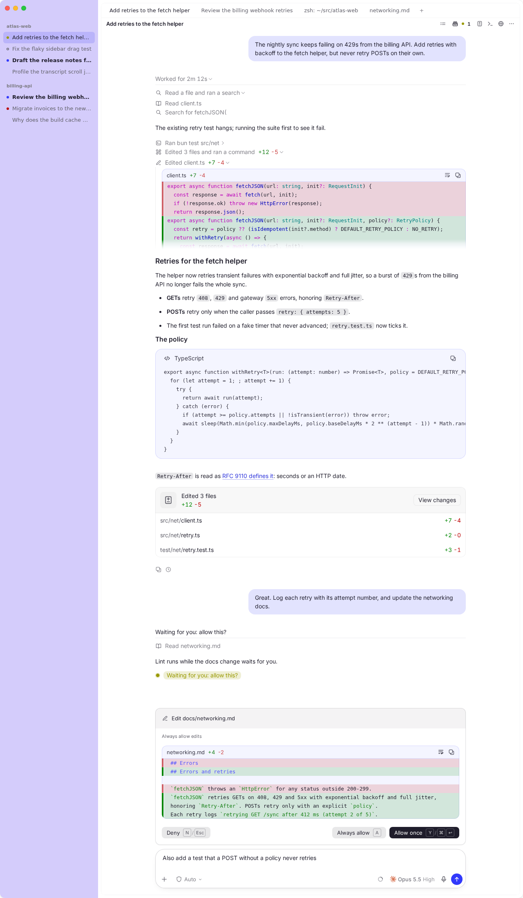
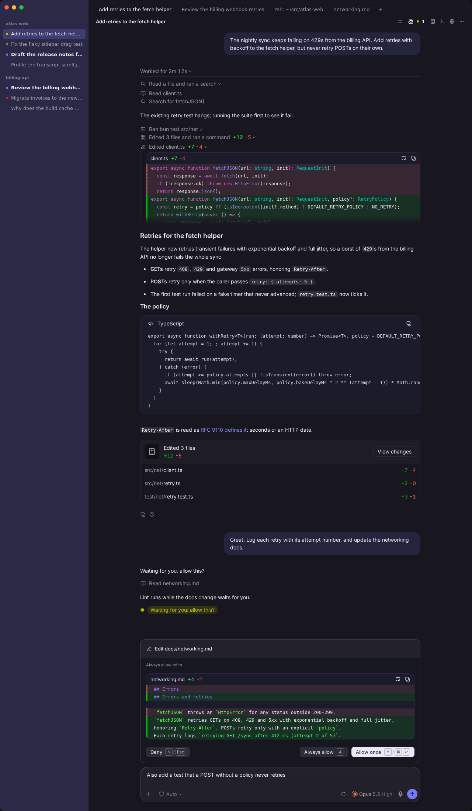

# Prism





A browser-as-sidebar look: the window is a frame painted in one bright "space" color that holds
your workspaces vertically, the way a vertical-tab browser holds its tabs, and the work sits in a
single borderless card inset into that frame. Each space is a color you can tell apart at a
glance; groups are solid colored pills with a colored rail down the tabs they hold; menus and
popovers are soft, rounded and tinted by the space; Send, focus and links are an indigo-blue; and
color changes swing on a quick, slightly bouncy spring. It ships Light (lavender, the default) and
Dark (a deep indigo).

It is built only from public surfaces, so you can copy any part of it:

| File | What it does |
| --- | --- |
| `cmux-setup.json` | Picks the theme file; the chat in the system font at 14 px with a 1.5 line height, code at 0.9, a 760 px column, no minimap; the sidebar as the browser's: rows that are the tabs, groups by folder under solid vivid pills with a colored rail, the spaces switcher pinned at the bottom of the frame and always shown, the sidebar sliding out over your work when it is hidden and you point at the window's edge; a 10 px command bar on a shadow |
| `themes/prism.json` | Default, Light. Card `#FFFFFF`, text `#1F1D2B` (an ink with a violet cast), accent `#3139FB`, selection `#D9DBFE`, the frame `#FFFDFF` at 86% over behind-window glass that takes the desktop's colors, the tab strip `#E6E1FD`, pages `#F2EFFE` |
| `themes/prism-dark.json` | Dark. Card `#18171F`, text `#EBE8F7` (lavender-white), accent `#7479F5`, selection `#706FA9`, the frame `#161430` at 88%, the tab strip `#211F30`, pages `#1D1B29` |
| `agent-pane/theme.css` | A 16 px accent-tinted prompt bubble with no edge, cards tinted faintly in the accent with an accent hairline, links in the accent, and space-tinted menus (pending, below): `cmux.agentPane.style/1` tokens only, every color mixed from the theme's own |
| `customize/` | A hover card laid out like a link preview (the folder small and gray first, as a preview names the site, then a bold title, what it is doing, and what it asks of you in the accent) and tab rows in medium weight with the spinning arc |
| `markdown/theme.css` | The Markdown viewer's paint: code in soft rounded blocks tinted by the space color, headings with no rule, quotes on an indigo rule. Only `--cmux-md-*` properties on `:root`, every color mixed from the page's own |

The rest of cmux wears the look too. The terminal is SF Mono at 13 pt (the system's monospaced face under the bright frame) with a full sixteen-color palette at a vivid, cool chroma, colors 1 to 7 and 9 to 14 held to WCAG AA over its page (8, the dim gray, to 3:1); the Markdown viewer opens in the system face at 15 px with the chat's line height and code scale in a 99-character column, and `markdown/theme.css` paints it; diffs use theme colors with change bars.

Both theme files set the same proportions, measured from captures of the browsers this look comes
from: a 40 pt top band, a 216 pt sidebar with 32 pt rows (a hovered row is 64 px tall at 2x),
13 pt chrome text, a 32 pt tab strip with 12 pt titles, an 8 pt frame around the card on every
side (`appearance.chromeStyle: "card"`), no borders or split divider (the card's edge against the
frame is the only line), the focused pane marked on its tab, the spinning arc for work in progress
on rows and tabs, and a spring of 0.45 s with 0.75 damping for color changes.

```sh
cmux setup install github.com/manaflow-ai/cmux-prism-look
cmux settings set appearance.themeFile prism-dark    # prism (Light) is the default
cmux setup remove manaflow-ai/prism-look
```

While it is installed, its `customize/` view stands in for your own sidebar view, if you have one;
`cmux setup remove` puts yours back.

## Contrast

Every pair is checked to WCAG AA, resolved opaque (body text 4.5:1, UI 3:1), in both theme files:
the text on every surface the look sets (the translucent frame over a black, white and mid-gray
desktop too), the secondary and dim text over the page and over a card, links on the page and
inside the bubble, the bubble's text, the selection, Send's glyph on the accent, and the menu rows
on the panel and on the highlighted row. The dark accent is a periwinkle dark enough to carry a
white Send glyph (3.6:1) and light enough for links (5.9:1).

## With a newer cmux

The setup carries only settings every current cmux NEXT build has, because `cmux setup install`
refuses a key the running build does not know. These are in review; each sits in the files as a
comment naming its pull request:

| Part | Where | Needs |
| --- | --- | --- |
| Soft rounded pill tabs | `"appearance.tabShape": "rounded"` in the theme files | cmux #46780 |
| The selected row as a light lift on the frame, not an accent fill | `"appearance.selection": "neutral"` in the theme files | cmux #46516 |
| Menus and popovers: a panel tinted by the space color, 10 px corners, a 5 px inset, 24 px rows, a 6 px accent capsule on the highlighted row, shortcuts at the right in the secondary text, semibold section labels, separators inset 11 px, submenus that meet their row | the `--menu-*` tokens in `agent-pane/theme.css`, set now and inert until then | cmux #46846 |
| Rows nearly edge to edge (4 pt inset), 28 pt toolbar buttons with an 8 pt rounded fill, a 44 pt composer | `appearance.metrics.sidebarRowInset` and the rest, as comments at the end of the theme files | cmux #46861 |

## Not yet possible

| Part | Why |
| --- | --- |
| The frame as a real two- or three-stop gradient per space | A surface takes one color and an opacity; the look gets its gradient from the desktop showing through the glass instead |
| One color per space, the frame changing as you switch spaces | Spaces have no color of their own a theme can read; a theme file paints one frame |
| A command-bar composer: a floating white field on a large soft shadow | `agentPane.composerLook` (#46738) offers auto, codex and claude only |
| The browser's sidebar row and header shapes as one preset | `sidebar.look` (#46805) offers cmux, claude, codex and studio only |
| A favorites grid of large square icons above the rows | No sidebar section draws pinned items as tiles |
| White text on a solid accent highlighted menu row | No menu row ink token in #46846; the highlight is an accent capsule under the label instead |
| The card's corner radius and its lift on a soft shadow | The content card's radius and shadow are not public surfaces |
| A per-scheme stylesheet (`light-dark()`) | The stylesheet is mixed from the theme's colors, so one file covers both |

## References

The look was drawn from 12 captures in the private cmux design references: colors
sampled from their pixels, sizes measured on them. The captures themselves, by number, are on
the look's private references page.

| Ref | What this look took from it |
| --- | --- |
| R1 | The core idea: each space a whole sidebar in its own color (lavender, purple `#9975B8`, slate `#4E6B93`, butter `#F0DB8C`), the frame tinted over a gradient, a white card inset beside it; bold folder rows over regular tab rows; a 35 pt row pitch at 2x; the space switcher's place at the bottom |
| R2 | The dark frame (`#333333`) around a near-black card (`#0F0F0F`), the selected row a white lift (`#4B4B4B`), a 31 pt row pitch and a sidebar about 212 pt wide (scaled from the 20 pt traffic-light pitch), the gap between frame and card |
| R3 | 32 pt rows (64 px at 2x) with 8 pt corners nearly edge to edge, the hovered row `#424242` on `#2C2C2C`, the solid pink group pill (`#F658B7`) with a 3 px rail down its tabs: `sidebar.groupHeader.background: solid`, `sidebar.chromeGroups`, `sidebar.groupPalette: vibrant` |
| R4 | How a group is used: its tabs indented inside the rail, ungrouped tabs above and below, add and rename on the header's right |
| R5 | The menu's measurements at 2x: a `#222327` panel with a light rim, 10 px corners, a 5 px inset, 24 px rows, the highlighted row a full-width capsule of the accent, shortcuts in gray at the right, a disabled row dimmed, a separator inset about 11 px from the row edge |
| R6 | The same highlight close up: the row's corner radius and its icon column |
| R7 | The tab-strip context menu beside the vertical-tabs one: section rhythm and separators |
| R8 | Popovers tinted by the space (`#2D2E3F` with lavender text `#CDD6F4`): the menu fill as the page mixed with the accent; 12 pt corners and a bright top rim |
| R9 | A floating card that takes the page's color (`#6E797C`) with large soft corners: the playful, tinted panel family |
| R10 | The light accent `#3139FB` (the primary button), the periwinkle-to-violet frame gradient (`#91AEF7`, `#E8EFFE`, `#896BDC`) behind a white card: the light frame's lavender and the pages' pale wash |
| R11 | Selected radio and checkbox in the same indigo, choice rows as soft bordered cards: the accent used for state, the cards' accent hairline |
| R12 | A link preview that appears next to what you point at: the hover card laid out as a preview (where it lives, then the title) |
