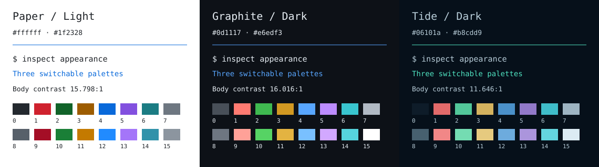
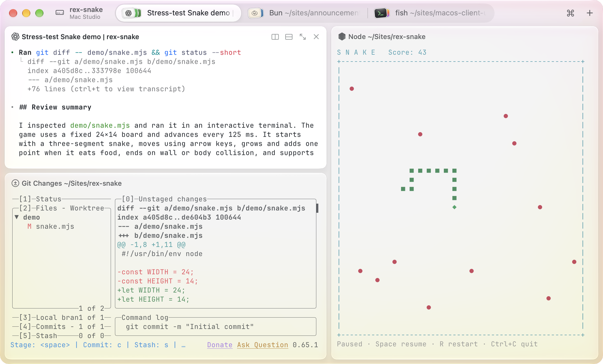

# Measured appearance pack

Three switchable terminal palettes derived from the official release's
color evidence. Paper is light; Graphite is its dark companion; Tide is a blue-green
dark alternative. All assigned hex colors come directly from three selected source
records. The pack contains no vendor implementation, fonts, icons, or generated
256-color palette tables.



## Install or preview

```sh
cmux setup install github.com/manaflow-ai/cmux/examples/looks/rex/appearance@lane/rex-feature-looks
```

The setup selects Graphite. Switch with `cmux theme use rex-paper` or
`cmux theme use rex-tide`. Remove the setup with `cmux setup remove manaflow-ai/rex-appearance`.
From the repository root, preview it with the commands below, then use
`cmux customize apply` to keep it or `cmux customize discard` to restore the previous look.

```sh
cmux customize use examples/looks/rex/appearance/profile.json
cmux customize check
```

The setup installs the three theme files and a chat stylesheet that gives links the active accent color.

## Mapped surfaces

| Source field | Theme-file mapping | Complete terminal-format mapping |
| --- | --- | --- |
| `source.background` | `colors.background`; agent-pane surface | `background` |
| `source.foreground` | `colors.foreground` | `foreground` |
| `source.cursor` | `colors.cursor` | `cursor-color` |
| `source.cursorText` | Not exposed by theme-file colors | `cursor-text` |
| `source.selectionBackground` | `colors.selection` | `selection-background` |
| `source.selectionForeground` | Not exposed by theme-file colors | `selection-foreground` |
| `source.ansi[0..15]` | `colors.0` through `colors.15`, unchanged | Sixteen `palette` entries |
| `source.ansi[4]` (Paper, Graphite), `source.cursor` (Tide) | `colors.accent`; companion links | No extra palette entry |

[terminal-themes/](terminal-themes/) contains full terminal-format counterparts,
including both text colors absent from the theme-file API. For a terminal-only
installation, copy the chosen file to `~/.config/ghostty/themes/` under its existing
name, then select that name in the terminal theme picker. Existing explicit
terminal color overrides can take precedence. These counterparts preserve the
source values in the file; runtime use of cursor/selection text must be read back
on the target build. Do not mistake a `ghostty` block inside a cmux theme JSON for
an unrestricted terminal config: its reader also drops those two text-color keys.

The cmux JSON variants are self-contained and use `Builtin Light` / `Builtin Dark`
as their bases; they do not require installing the terminal-format counterparts.
They set all sixteen ANSI slots explicitly. App chrome derives additional colors
and contrast treatments from this palette, so its every pixel is not an original
source token.

## Measurements

Ratios use WCAG 2 relative luminance on opaque sRGB colors, rounded to three
decimals. Each channel is linearized with `c / 12.92` at `c <= 0.04045`, otherwise
`((c + 0.055) / 1.055)^2.4`; luminance weights are 0.2126, 0.7152, and 0.0722.
Contrast is `(lighter + 0.05) / (darker + 0.05)`.

| Variant | Source record | Background / foreground | Body | Accent on page | Source selection pair | Source cursor pair |
| --- | --- | --- | ---: | ---: | ---: | ---: |
| Paper | `merino-light` | `#ffffff` / `#1f2328` | 15.798 | 5.192 | 15.798 | 3.525 |
| Graphite | `merino-dark` | `#0d1117` / `#e6edf3` | 16.016 | 7.492 | 16.016 | 3.487 |
| Tide | `abyssal-trench` | `#06101a` / `#b8cdd9` | 11.646 | 11.935 | 10.766 | 11.935 |

Paper ANSI slots 11–15, Graphite slots 0 and 8, and Tide slots 0 and 8 are below
4.5:1 against their backgrounds. The Paper and Graphite source cursor-text pairs
also fall below 4.5:1. They are retained as measured rather than silently adjusted.
This is not an assertion that every source color or every app state meets AA.
The selection/cursor columns describe source pairs, not a runtime guarantee from
the more limited theme JSON API. [measurements.json](measurements.json) records
all six source colors, all sixteen ANSI colors, every ANSI contrast ratio, source
record identifiers, and SHA-256 receipts.

## Evidence and limits

The supplied release is `0.1.0-snapshot.2077` (build 2077), source identity
`3ea01c01f5f8adde64bdca1f372009b8ef2a15c3`, as recorded in the [official disk image](https://blob.superlogical.com/public/rex-app/snapshot-arm64/Rex-0.1.0-2077.dmg). The input color file is:

```text
Rex.app/Contents/Resources/
  SuperUI_SuperDesignTokens.bundle/Contents/Resources/themes.json
```

Only three records' explicit sRGB source values were mapped. Display P3 values,
the generated extended palette, native materials, blur, and color-management
behavior are not reproduced. The samples above illustrate exact assigned colors;
they are not captures of cmux or the source application.



The [original window image](https://www.superlogical.com/rex-screenshot@2x.webp) is retained with its hash in the measurements.
It shows a light window with distinct pane headers and grouped content. It informs
visual separation, not the palette selection: the screenshot's active theme,
material blending, and display profile are unknown. There is no claim that Paper
is the screenshot's theme. No color was inferred from antialiased text or glass.
The reference image remains third-party reference material, not a bundled wallpaper.

The mapping uses [theme-file documentation](../../../../docs/cmux-next/theme-recipes.md),
the [customization guide](../../../../skills/cmux-customization/SKILL.md),
the [settings schema](../../../../schemas/settings/settings-schema.json), and
the [theme-color reader](../../../../cmux-tui/crates/cmux-config/src/theme_file/colors.rs).
The companion stylesheet follows the public paint-token pattern used by existing
looks; its loading path is documented in the
[agent-pane README](../../../../webviews/src/agent-session/acpmux/README.md).
