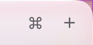
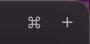

# Session launcher

The New Tab page opens a terminal in the current workspace, creates a workspace on this Mac, or lets you choose a connected remote machine by name. New Session on Host opens the command palette at New Workspace on Machine. Pick a named machine there to create the workspace. Add Remote Host opens the native connection flow.

## Install or preview

```sh
cmux setup install github.com/manaflow-ai/cmux/examples/looks/rex/new-tab@lane/rex-feature-looks
```

To remove the installed layer, run `cmux setup remove manaflow-ai/rex-new-tab`.
To preview from the repository root, run the following commands, then choose
`cmux customize apply` or `cmux customize discard`.

```sh
cmux customize use examples/looks/rex/new-tab/profile.json
cmux customize check
```


The source image shows the resting control. The shipped app contains the labels “New Tab in Session”, “New Local Session” and “New Session on Host”. The order and grouping here are choices for this profile. The native strip menu and its exact pressed appearance are distinct from this New Tab view. The private map records the source build and observations. [Feature map](https://github.com/manaflow-ai/cmuxterm-hq/blob/main/docs/research/competitor-maps/rex.md)

Enable **Run actions** in Settings → Apps for the launch buttons. The profile selects the web New Tab page so the custom launcher also opens when your previous configuration used the native page.

| Light source toolbar | Dark source toolbar |
| --- | --- |
|  |  |

Both crops show the closed control. In the full-size images the + glyph occupies 21 × 21 pixels at (2057, 35). The source does not give its click target. [Original light image](https://www.superlogical.com/rex-screenshot@2x.webp) · [Original dark image](https://www.superlogical.com/rex-screenshot-dark@2x.webp)
