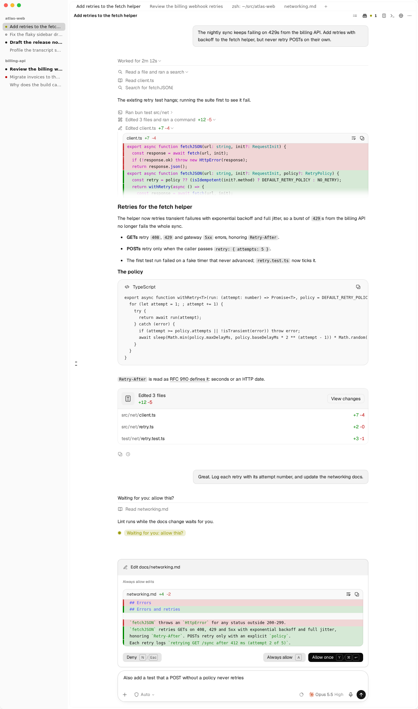
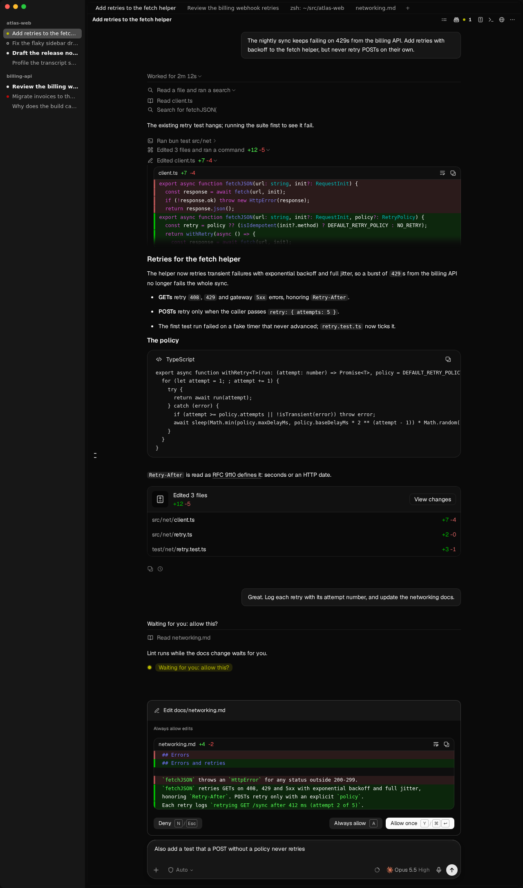

# shadcn





[shadcn/ui](https://ui.shadcn.com) as it ships today (v4, the new-york style, the neutral base color),
on every surface of cmux: Geist type, black and white with no hue, crisp 1 px hairlines, panes as
outlined cards with no shadows, a quiet sidebar grouped like the `sidebar-07` block, tabs as a muted
`TabsList` track, a muted prompt bubble with a hairline and the 10 px `--radius`, and fast,
restrained motion. It ships light (`shadcn`, the default) and dark (`shadcn-dark`).

Every color is one of shadcn's own tokens and every size one of its components' (the theme files
name each on its line):

| shadcn | Light | Dark | In cmux |
| --- | --- | --- | --- |
| `--background` | `#ffffff` | `#0a0a0a` | the chat, terminal, Settings, pages |
| `--foreground` | `#0a0a0a` | `#fafafa` | text |
| `--primary` | `#171717` | `#e5e5e5` | accent: Send, focus, the status dot |
| `--muted` / `--accent` | `#f5f5f5` | `#262626` | the tab strip's track, selection |
| `--muted-foreground` | `#737373` | `#a1a1a1` | secondary chat text (the text at 62%) |
| `--border` | `#e5e5e5` | white at 10% | every hairline (the text at 10%) |
| `--sidebar` | `#fafafa` | `#171717` | the sidebar and docks |
| `--destructive` | `#e7000b` | `#ff6467` | the terminal's red, which the app's danger red comes from |
| `--radius` | 10 px | | the prompt bubble; menus 8 px (`rounded-md`), menu rows 6 px (`rounded-sm`) |
| `SIDEBAR_WIDTH` 16rem, `SidebarMenuButton` h-8 | 256 px, 32 px | | sidebar width, row height |
| `TabsList` h-9, `text-sm` | 36 px, 14 px | | tab strip height, tab and chrome text |
| `transition` | 150 ms, `cubic-bezier(0.4, 0, 0.2, 1)` | | color changes; `ui.animationSpeed` fast |

It is built only from public surfaces, so you can copy any part of it:

| File | What it does |
| --- | --- |
| `cmux-setup.json` | Picks the theme file; sets Geist for the whole chat at 14 px and 1.6, code at 0.875 in Geist Mono, a 768 px (`max-w-3xl`) column; the sidebar compact and grouped by folder under plain section headings, one fact line (the branch); HoverCard's 700 ms open delay; the browser's address field as a shadcn `Input` (8 px corner, 36 px, no shadow) |
| `themes/shadcn.json` | Default, light: shadcn's `:root` tokens, `card-outlined` panes, the proportions and the motion |
| `themes/shadcn-dark.json` | The same in shadcn's `.dark` tokens |
| `agent-pane/theme.css` | The prompt bubble, outlined cards, muted text and underlined foreground links with `cmux.agentPane.style/1` tokens only, every color mixed from the theme's own; and the menu tokens (pending) for shadcn's `DropdownMenu` |
| `customize/` | A shadcn `HoverCard`: a semibold title with the status as an outline `Badge`, the task as its description, and `text-xs` muted lines with small icons; rows in regular weight with a dot while work runs |
| `markdown/theme.css` | The Markdown viewer's paint: semibold headings, the second level over a hairline, code on the muted fill with the 10 px radius, quotes on a 2 px border. Only `--cmux-md-*` properties on `:root`, every color mixed from the page's own |

The rest of cmux wears the look too. The terminal is Geist Mono at 13 pt (the monospaced twin of the chat's Geist; without it installed, the terminal keeps its built-in face) with a full sixteen-color palette at a neutral chroma, colors 1 to 7 and 9 to 14 held to WCAG AA over its page (8, the dim gray, to 3:1); the Markdown viewer opens in the system face at 16 px with the chat's line height and code scale in a 100-character column, and `markdown/theme.css` paints it; diffs use muted colors with change bars; sidebar group colors are grays.

```sh
cmux setup install github.com/manaflow-ai/cmux-shadcn-look
cmux settings set appearance.themeFile shadcn-dark    # shadcn (light) is the default
cmux setup remove manaflow-ai/shadcn-look
```

While it is installed, its `customize/` view stands in for your own sidebar view, if you have one;
`cmux setup remove` puts yours back.

## With a newer cmux

These are written in the files as comments (theme and setup keys) or set already and inert
(stylesheet tokens) until the build has them:

| Part | Where | Needs |
| --- | --- | --- |
| The selected tab as a raised, rounded card on the muted track (`TabsTrigger` `data-[state=active]`) | `"appearance.tabShape": "rounded"` in the theme files | cmux #46780 |
| The selected sidebar row in shadcn's gray `--sidebar-accent`, while Send stays the primary | `"appearance.selection": "neutral"` in the theme files | cmux #46516 |
| Menus and popovers as `DropdownMenu` / `ContextMenu`: 8 px corner, 4 px padding, hairline, `shadow-md`, 32 px rows with a 6 px hover fill, foreground medium labels, edge-to-edge separators, muted shortcuts, red destructive rows, 50% disabled | `--menu-*` in `agent-pane/theme.css` (set) | cmux #46846 |
| The prompt's text color on the bubble | `--cv-user-bubble-text` in `agent-pane/theme.css` (set) | cmux #46490 |
| The composer as a `Textarea` in a hairline card | `"agentPane.composerLook"` in `cmux-setup.json` | cmux #46738 |
| The sidebar as `sidebar-07` | `"sidebar.look"` in `cmux-setup.json` | cmux #46805 |

## Not yet possible

| Part | Why |
| --- | --- |
| Geist Mono everywhere | `agentPane.display.code.family` names it, but a setup cannot ship a font face; without Geist Mono installed, code keeps the chat's mono |
| shadcn's 64 px (`h-16`) header | `appearance.metrics.titlebarHeight` stops at 56; the look uses the collapsed header's 48 (`h-12`) |
| The `focus-visible` ring (3 px `--ring` at 50%) on controls | no ring width or color knob; focus shows on the tab |
| Inline code as shadcn's `bg-muted` chip with `rounded` corners | inline code has no paint token |
| Sidebar group labels at `text-xs` in `sidebar-foreground/70` | `sidebar.sectionLook: quiet` and `groupHeader.background: sections` give plain headings, but their size and color are not settable |
| A per-scheme bubble fill (`--muted` is 4% of the text in light, 12% in dark) | a stylesheet token cannot tell the schemes apart; the bubble takes 5% of the text in both, with the `--border` hairline carrying its edge |
| Menus' destructive row hover in `destructive/10` | the hover fill is one token for every row |
| The native right-click menus (sidebar, tab, pane) | they are AppKit menus, which the `--menu-*` tokens do not reach |

How looks like this one are written: [look-addons.md](https://github.com/manaflow-ai/cmux/blob/639a429492936ae3b4f0d4a1e6d7fbf66e708520/docs/cmux-next/look-addons.md).
