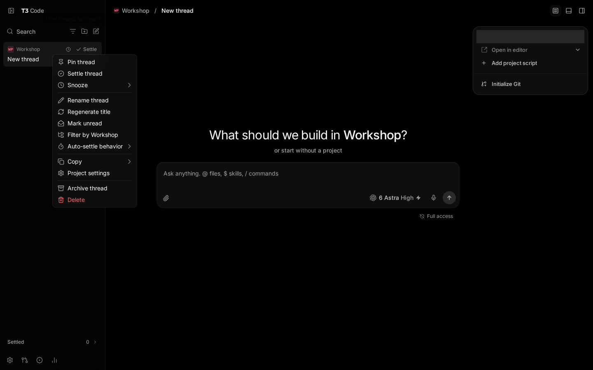
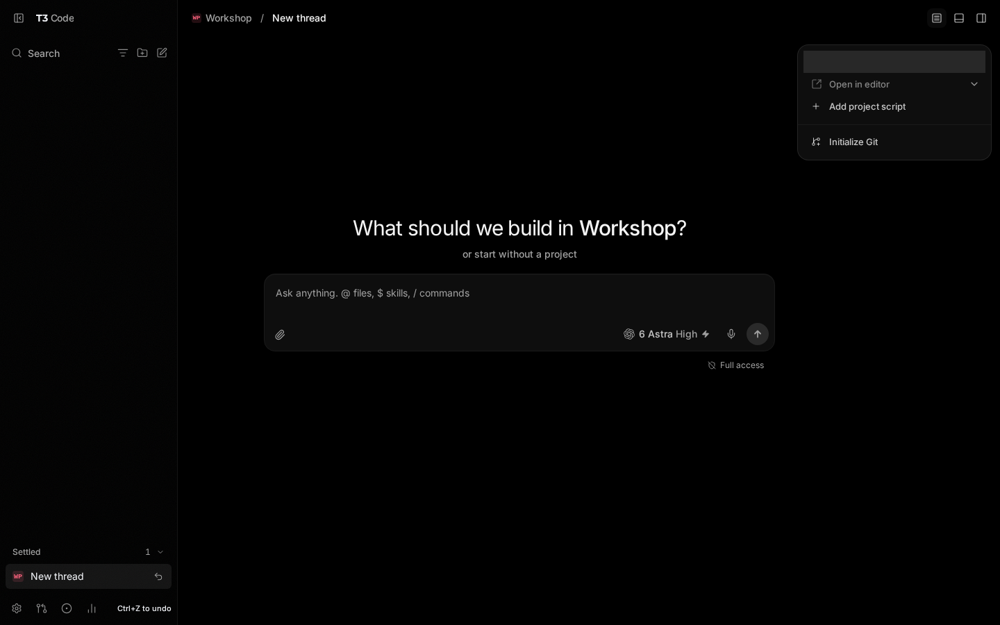

# Settled and archived chats

A finished chat whose answer you have read folds into **Settled (N)**. Expand the shelf to revisit it. Its next turn brings it back to the active list. In the command palette, **Archive Settled Chats** archives the eligible rows together. A single chat also has **Archive Chat**. Use the sidebar archive to restore a workspace.

The reference thread menu has separate **Settle thread** and **Archive thread** commands. The source capture shows one manually settled thread in the expanded shelf. The cmux fold uses read and completion state. Per-thread manual settling, inactivity timers and merged-PR rules in the source app have different triggers.




## Install

```sh
cmux setup install github.com/manaflow-ai/cmux/examples/looks/studio-app/archive
```

From this folder, preview with `cmux customize use profile.json`. Finish with `cmux customize apply` or `cmux customize discard`.
