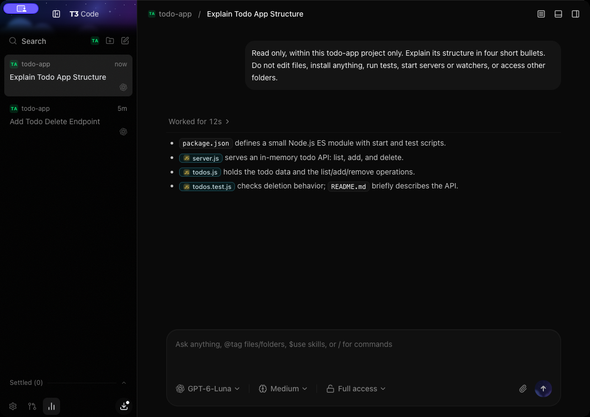

# Conversation display



The source capture shows a completed demo conversation in the desktop app on October 15, 2026. The 0.1.11 web release retains a 46 rem comfortable column. At the default 16 px root size this is 736 px. The corresponding empty-thread web measurement at 1440 × 900 also gave a 736 px composer.

Install this feature from the branch containing these examples.

```sh
cmux setup install github.com/manaflow-ai/cmux/examples/looks/studio-app/display@feat-cmux-next
```

To preview from a checkout, run `cmux customize use examples/looks/studio-app/display/profile.json`. Use `cmux customize apply` to keep it or `cmux customize discard` to close the preview.

## Mapping

The profile centers the conversation in a 736-point column. System text at 14 points uses a 1.625 line height. The 0.925 code scale gives approximately 13-point code. The user's message has a lightly tinted fill and 16-point corners. Replies use the native message presentation. The normal transcript view folds work details. The changed-files card starts collapsed and covers the current turn.

The source caps the user bubble at 80% of the column. cmux owns the bubble width, file-link treatment and wording of work summaries. This preset maps the comfortable width. The source also offers a wider 72 rem column and a full-width mode.

[Column widths](https://github.com/pingdotgg/t3code/blob/v0.1.11/apps/web/src/index.css) · [User message layout](https://github.com/pingdotgg/t3code/blob/v0.1.11/apps/web/src/components/chat/TimelineUserMessageRow.tsx) · [Type defaults](https://github.com/pingdotgg/t3code/blob/v0.1.11/packages/contracts/src/settings.ts)
