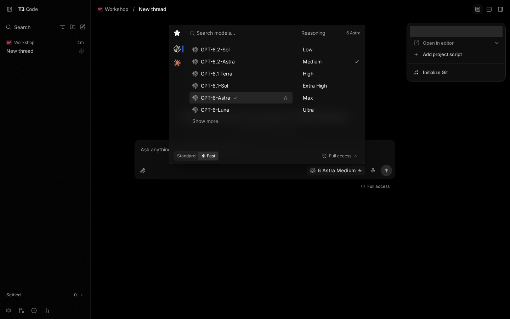

# Model and reasoning picker

In the source, entering `6.2` filters the Codex list to two models. Selecting High updates the trigger immediately. This setup requests a searchable model list and an adjacent reasoning column, using options supplied by the active harness. The available models, levels and service tiers depend on the session. The source also offers favorites.



## Install

```sh
cmux setup install github.com/manaflow-ai/cmux/examples/looks/studio-app/model-picker
```

From this folder, preview with `cmux customize use preview.json`. Use `cmux customize apply` to keep it or `cmux customize discard` to return. The composer contribution requires a build supporting `cmux.composer.model.picker/1`.

[Reference capture and feature map](https://github.com/manaflow-ai/cmuxterm-hq/blob/main/docs/research/competitor-maps/t3code.md)
