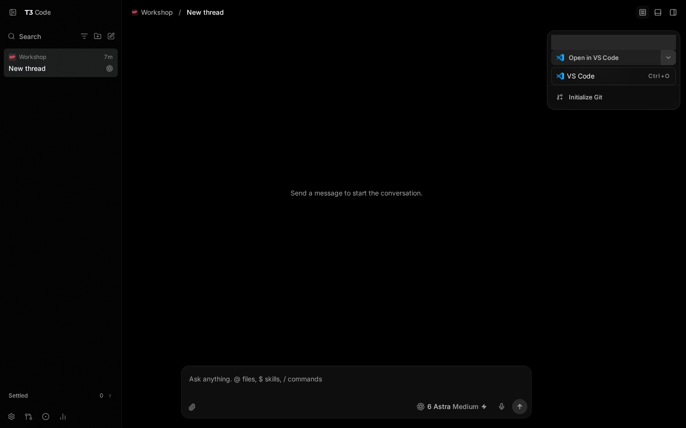
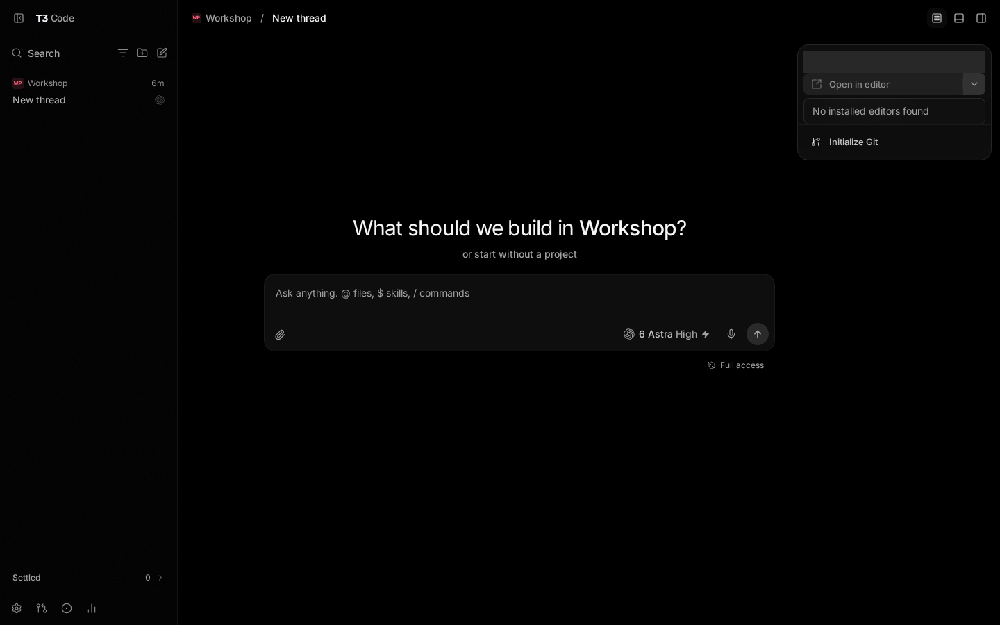

# Open in editor

Open Session Info and click **Open in VS Code**. The host opens the selected tab’s local working directory in the installed desktop editor. Its native action reports an unavailable folder or missing application. Enable **Run actions** for My views in Settings → Apps.

The source has a split control in thread details. Its arrow lists detected editors and the primary button reopens the last successful choice. This customization targets the requested desktop editor directly. Remote SSH targets and editor discovery remain specific to the source control.

The Linux capture host first showed an empty list, then detected portable VS Code 1.147.0. Clicking the editor entry and the primary button produced no error toast or visible editor window. A separate direct launch exited with status 133 because the Electron sandbox helper could not run with its installed ownership and mode.





## Install

```sh
cmux setup install github.com/manaflow-ai/cmux/examples/looks/studio-app/open-in-editor
```

From this folder, preview with `cmux customize use profile.json`. Finish with `cmux customize apply` or `cmux customize discard`.
