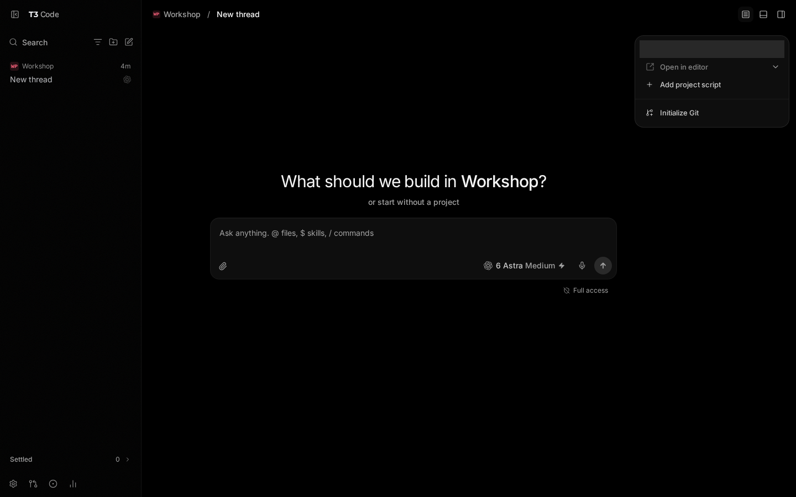

# Thread workspace, keys and motion

The [thread workspace](../whole) look with the app's feature set: its keyboard flows, its sidebar rows,
its composer chips and centered empty thread, its minimap and its instant panels. It carries the
whole look's theme, views and chat stylesheet, so it installs on its own.



## Install or preview

```sh
cmux setup install github.com/manaflow-ai/cmux/examples/looks/studio-app/profile
```

Remove it with `cmux setup remove manaflow-ai/studio-app-profile`; your own settings and keys come back.

## Keys

The chat keys apply while a chat has focus, so a terminal keeps cmux's Command-K, Command-D and
Command-J chords.

| Key | Does | cmux action |
| --- | --- | --- |
| Command-K | Command Palette | `commandPalette` |
| Command-J | Show or hide the terminal | `toggleQuickTerminal` |
| Command-D | Diff beside the chat | `openDiffViewer` |
| Shift-Command-J | Preview beside the chat | `agentPane.togglePreview` |
| Command-N, Shift-Command-O | New thread | `palette.newAgentChat` |
| Shift-Command-M | Model | `agentPane.switchModel` |
| Shift-Command-E | Effort | `agentPane.setEffort` |
| Shift-Command-A | Access mode | `agentPane.composer.switchMode` |
| Shift-Command-X | Folder or worktree | `agentPane.composer.chooseFolder` |
| Shift-Command-H | Computer | `agentPane.composer.chooseComputer` |
| Shift-Command-[ and ] | Previous and next thread | `prevSidebarTab`, `nextSidebarTab` |
| Shift-Command-S | Settle a finished thread | `markWorkspaceDone` |
| Shift-Command-P | Pin a thread | `palette.toggleTabPin` |
| Shift-Command-D | Dictation | `palette.toggleDictation` |
| Command-U | Context usage | `agentPane.composer.showContextUsage` |
| Command-/ | Search the shortcuts | `palette.searchShortcuts` |

Command-B (sidebar), Command-1 to 9 (threads), Command-[ and ] (back and forward), Command-F and
Shift-Command-F (find) are cmux's defaults already.

## Feature checklist

62 features: 25 matched, 30 partial, 7 missing.

| Feature | Status | How, or the gap |
| --- | --- | --- |
| Toggle thread sidebar with mod+B | matched | Command-B (`toggleSidebar`), a cmux default. |
| Command palette on mod+K | matched | Command-K opens the Command Palette in a chat (`commandPalette`). |
| Composer control chords (mod+shift+M model, E effort, A access, X worktree, G branch, H host) | partial | Shift-Command-M model, E effort, A access mode, X folder or worktree, H computer. Gap: no branch picker action for Shift-Command-G. |
| Thread navigation keys (mod+shift+[ ] previous/next, mod+1..9 jump, mod+[ ] back/forward) | matched | Shift-Command-[ and ] step through threads (`prevSidebarTab`, `nextSidebarTab`); Command-1 to 9 and Command-[ ] (focus history) are cmux defaults. |
| New thread keys (mod+N / mod+shift+O new, mod+shift+N local, mod+alt+N without project) | partial | Command-N and Shift-Command-O start a chat (`palette.newAgentChat`), and the sidebar has a New thread row. Gap: no key for a chat without a project. |
| Every key rebindable, with when-clauses, in Settings > Keybindings | matched | `keybindings.json` takes `when` clauses (this profile scopes its keys with `agentPaneFocused`), and Settings > Keybindings rebinds any key. |
| Focus next region with F6 | missing | Gap: no action cycles the sidebar, composer and panels; `focusSidebar` and `nextSurface` are the nearest. |
| Thread sidebar: group by project, timestamps, PR badge, running indicator | matched | The look's project section and rows with project, branch, PR and status; `sidebar.showTimestamps`. |
| Sidebar top nav rows (New thread, Search) | matched | `sidebar.nav`: New thread and Search. |
| Gray selected thread row and styled sidebar menus | matched | `appearance.selection` `neutral` keeps the selected row gray under the violet accent; `sidebar.drawnMenus` draws the right-click and more menus so the look's menu style applies. |
| Pin threads and reorder them by drag | partial | Shift-Command-P pins (`palette.toggleTabPin`); drag reorders. Gap: pinned threads do not float into a group of their own. |
| Settle finished threads (mod+shift+S) and archive | matched | `sidebar.settleFinished`; Shift-Command-S settles (`markWorkspaceDone`); `agentPane.archiveChat` archives. |
| Snooze a thread | missing | Gap: no action hides a thread until later. |
| Open a thread beside the current one / side chats | partial | Side chats and `splitRight` put two chats side by side. Gap: no right panel that opens a thread without splitting the workspace. |
| Fork / branch a conversation | matched | Fork Conversation (`palette.forkAgentConversation`, Option-Command-Y). |
| Copy thread reference / PR number (mod+shift+C, mod+shift+K) | missing | Gap: no action copies a chat reference or its PR number. |
| Thread undo (mod+Z restores an archived or settled thread) | missing | Gap: no undo for archive or settle; `reopenPreviousSession` reopens closed sessions only. |
| Diff panel toggle (mod+D) beside the chat | partial | Command-D opens the diff in a chat (`openDiffViewer`). Gap: it opens as a pane, not a docked right panel the key hides again. |
| Per-turn diffs and checkpoints (revert to a turn) | matched | The chat shows each turn's changed files and counts; `agentPane.editedFiles.scope` `turn`. |
| Review guide, 'mark file viewed', find in diff | partial | Hunk review and PR review in the changes view. Gap: no per-file viewed state, no review order, no find scoped to the diff. |
| One-click commit, push and create PR | matched | Commit, Push and Create PR in the changes view. |
| Linked PR, issues and GitHub stacks per thread | partial | The PR badge on each thread row. Gap: no linked issues or stacked PRs on a thread. |
| Source-control providers beyond GitHub (GitLab, Bitbucket, Azure DevOps, Forgejo) | missing | Gap: PR, review and badges are GitHub only. |
| Per-thread git worktree (new worktree chat, previous worktree) | partial | Shift-Command-X picks the folder or a new worktree. Gap: no previous-worktree key. |
| Branch picker in the thread toolbar (mod+shift+G) | partial | The composer picks a branch or base. Gap: no action to bind Shift-Command-G to. |
| Worktree branch naming and location in project settings | partial | Worktrees use cmux's defaults. Gap: no per-project page for branch names and worktree location. |
| Project scripts (run setup or dev scripts from the toolbar) | missing | Gap: no button that runs a project's setup or dev script. |
| Terminal drawer under the thread (mod+J), split and new tab inside it | partial | Command-J shows and hides the quick terminal (`toggleQuickTerminal`). Gap: it is the window's terminal, not a drawer under the thread with its own splits and tabs. |
| In-app preview browser toggle (mod+shift+J) | matched | Shift-Command-J shows the preview beside the chat (`agentPane.togglePreview`). |
| Right panel with tabs (mod+alt+B toggle, mod+T new, mod+W close, mod+shift+T reopen) | partial | Command-T, Command-W and Shift-Command-O work on workspace tabs. Gap: no right panel per thread. |
| Plan mode toggle | partial | /plan, the + menu's Plan row and `agentPane.composer.togglePlan`; the studio chip row puts the mode chip under the box. Gap: no plan key of the app's own to mirror. |
| Proposed plan card with Implement, download and collapse | partial | The approved plan shows with its approval. Gap: no download, no implement-in-a-new-thread choice. |
| Slash command menu (/compact, /clear, /goal, custom commands) | matched | Type / for agent and built-in commands, /compact and /goal included. |
| $ skills and @ file mentions in the composer | partial | @ mentions files; skills are in the / menu. Gap: no $ trigger. |
| Image and file attachments (paste, drag, HEIC conversion, large paste becomes a file) | partial | Paste, drag and images; `agentPane.attachmentView` `strip`. Gap: the large-paste-becomes-a-file rule, size limits and video were not checked. |
| Rich-text Markdown composer, styled as you type | partial | Gap: the composer is plain text with chips; Markdown is not styled as you type. |
| Follow-up Queue vs Steer, edit queued messages, opposite action on mod+Enter | partial | Queue or steer a follow-up and edit queued messages. Gap: no default keys for steer-first, edit-queued or send-in-background. |
| Prompt stash (mod+S) and recall | partial | Stashed drafts come back from their chip. Gap: no stash action to bind Command-S to. |
| Edit an earlier prompt, quote a response, suggested next prompt | matched | Edit a prompt, quote a reply, suggested next prompt. |
| Voice dictation (mod+shift+D) | matched | Shift-Command-D (`palette.toggleDictation`); `agentPane.showDictation`. |
| Centered empty-thread composer (draft hero) | matched | `agentPane.emptyChatComposerPosition` `center`. |
| Composer placeholder 'Ask anything, @tag files/folders, $use skills, or / for commands' | matched | `agentPane.composerPlaceholder` (the r29 parity capture read T3 Code's box; the earlier 'Ask for changes, send follow-ups, or attach images' was not its text). |
| Model picker with provider rail, keyboard nav, custom models | partial | Shift-Command-M; the look's `cmux.composer.model.picker/1` view adds model search; `agentPane.composerLook` `studio`. Gap: no left provider rail with arrow-key provider switching. |
| Reasoning effort picker, plus bindable increase/decrease effort | partial | Shift-Command-E opens effort. Gap: no increase or decrease effort action. |
| Change model or provider mid-thread (hand a Claude thread to Codex) | matched | Switch the harness or model inside a chat. |
| Multiple accounts per provider and account switching | matched | Add and switch accounts per chat. |
| Breadth of agent providers | partial | Claude and Codex among others. Gap: not every provider the app lists is built in. |
| Access modes: Supervised / Auto-accept edits / Auto / Full access, per thread | partial | Shift-Command-A opens the mode menu (`agentPane.composer.switchMode`). Gap: modes are the agent's own, not four normalized ones. |
| Inline approval card with keys; subagent approvals in parent thread | matched | The permission card with Option-Command-1 to 4; subagent approvals show in the parent chat. |
| Managed policy that caps allowed access modes | missing | Gap: no admin policy limits which access modes a person can pick. |
| Thread status indicators (working, needs approval, unread, done) | matched | `sidebar.workspaceRow.agent.agentStatus`; the chat's status line. |
| Running tool label shimmer and work-log steps | partial | `agentPane.display.thinking.shimmer` `continuous`, `shimmerPeriod` 2200 and `shimmerBand` 72: the app's 4.5rem band every 2.2 s. Gap: cmux's band moves smoothly; the app's steps 30 times a pass. |
| Context-window meter | matched | The context ring in the composer; Command-U opens it here. |
| Usage and limits page (mod+U) | partial | Command-U shows context usage (`agentPane.composer.showContextUsage`). Gap: no standalone usage page. |
| Timeline minimap | matched | `agentPane.display.minimap` `compact`. |
| Find in chat (mod+F), project search (mod+shift+F), file picker (mod+P) | partial | Command-F and Shift-Command-F. Gap: Command-P is Go to Workspace; no file picker action. |
| Open in favorite editor (mod+O) | partial | The look's Session Info section opens the folder in an editor. Gap: no action to bind Command-O to. |
| Themes, theme picker (mod+alt+A), theme editor, custom CSS | partial | The look's theme file, chat stylesheet and views. Gap: no theme picker key and no visual theme editor. |
| Panel animations setting (0-400 ms, default 0) | partial | `ui.animations.panes` false: panels open in one frame, the app's default. Gap: no millisecond slider; the look's motion tokens time chat transitions only, not panels. |
| Remote access from phone and web clients | partial | The iPhone app, remote control and cloud machines. Gap: no browser client served by the desktop app. |
| Notifications when a thread finishes or needs input | matched | Notifications on finish and on permission asks; Shift-Command-U jumps to unread. |
| Hover card for threads | matched | The look's `cmux.hovercard/1` view. |
| Proportions: sidebar type size and thread column width | matched | `appearance.metrics.chromeFontSize` 12 (the app's 12 px sidebar rows; was the density default) and `agentPane.display.width` 768 (the app's max-w-3xl column; was 736). Needs a recapture to confirm. |

## Motion checklist

23 motions: 15 matched, 2 partial, 6 gap.

| Motion | The app | Status | How, or the gap |
| --- | --- | --- | --- |
| Popover open/close (scale 0.98 + fade) | 150 ms | matched | The look's `--cmux-motion-micro: 150ms` (agent-pane/theme.css). |
| Menu (dropdown/context) open/close | 150 ms | matched | The look's `--cmux-motion-micro: 150ms`. |
| Tooltip appear | 150 ms | matched | The look's `--cmux-motion-micro: 150ms` (cmux's default is 120 ms). |
| Sidebar open/close (mod+B) | 0 ms | matched | `ui.animations.panes` false: one frame, as the app's default. |
| Right panel / diff panel open/close | 0 ms | matched | `ui.animations.panes` false. |
| Terminal drawer open/close (mod+J) | 0 ms | partial | The quick terminal; no drawer to animate. |
| Sidebar thread selection highlight | 0 ms | matched | cmux's default motion already matches. |
| Thread switch: panel state snaps | 0 ms | matched | `ui.animations.panes` false. |
| Row and button hover (background) | 0 ms | matched | `ui.animations.feedback` false: hover backgrounds change at once. |
| Button press | 150 ms | gap | cmux: 0 ms; no motion token times it yet (docs/cmux-next/look-addons.md, Motion). |
| Switch toggle thumb | 150 ms | gap | cmux: unmeasured; no motion token times it yet (docs/cmux-next/look-addons.md, Motion). |
| Streaming assistant text appearance | 0 ms | matched | `agentPane.display.streaming` `instant`: text shows as it arrives, no fade. |
| Work-log / step row enter | 180 ms | gap | cmux: 120 ms; no motion token times it yet (docs/cmux-next/look-addons.md, Motion). |
| Thread list reorder (row moves) | 0 ms | matched | `ui.animations.sidebar` false. The app's list has no row motion (source, 2026-11-27); the 150 ms here before was Tailwind's default transition, which its rows do not use for moves. |
| Thread list insert (new row) | 0 ms | matched | `ui.animations.sidebar` false. |
| Thread list remove (row leaves) | 0 ms | matched | `ui.animations.sidebar` false. |
| Composer growth while typing | 0 ms | gap | cmux: unmeasured; no motion token times it yet (docs/cmux-next/look-addons.md, Motion). |
| Composer resting / draft-hero to docked transition | 0 ms | matched | `agentPane.emptyChatComposerPosition` `center`; instant, as the app's default. |
| Send message | unmeasured | gap | cmux: 0 ms; no motion token times it yet (docs/cmux-next/look-addons.md, Motion). |
| Collapsible height fold (tool groups, details) | 200 ms | matched | The look's `--cmux-motion-settle: 200ms` (cmux's default is 180 ms). |
| Working status pulse / spinner | 2000 ms | partial | `appearance.statusIndicator.style` `dot`: a pulsing dot, as the app's. Gap: cmux's dot dims to 0.35 smoothly; the app's to 0.5 in 6 steps. |
| Running tool label shimmer | 2200 ms | matched | `agentPane.display.thinking.shimmerPeriod` 2200, `shimmerBand` 72. |
| Sidebar update pill | 180 ms | gap | cmux: unmeasured; no motion token times it yet (docs/cmux-next/look-addons.md, Motion). |
