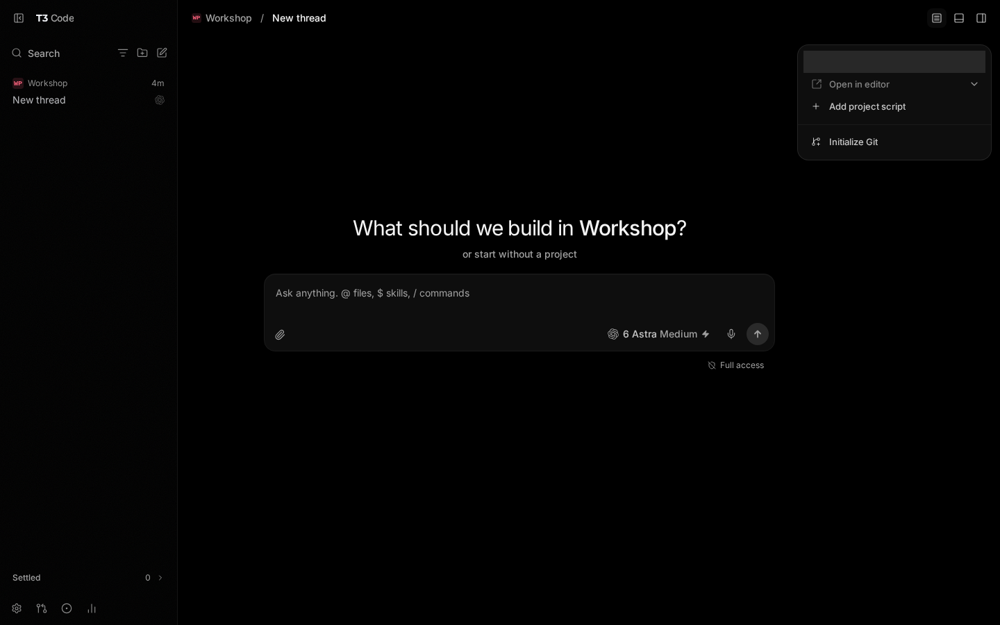

# Thread sidebar



The reference is a 0.1.11 open-source agent web app at 1440 × 900. The left column occupies 256 px including its divider. The first thread starts at x = 8 and measures 239 × 60 px. Its top line pairs the project with the last activity time. Its second line holds the thread title. The row has a 6 px radius.

Install this feature from the branch containing these examples.

```sh
cmux setup install github.com/manaflow-ai/cmux/examples/looks/studio-app/sidebar@feat-cmux-next
```

To preview from a checkout, run `cmux customize use examples/looks/studio-app/sidebar/profile.json`. Use `cmux customize apply` to keep it or `cmux customize discard` to close the preview.

## Mapping

The theme uses a 256-point sidebar, a one-point divider, six-point corners, a one-point gap, 36-point single-line rows and a 60-point subtitle-row token. Density inherits the compact preset for other tokens. The sidebar displays chats and projects, timestamps, search and hover actions. Agent workspace rows can show directory, branch, pull request and activity. Hovering a workspace shows the project and age, title, status and available branch, pull request, environment or agent facts. Colors follow the active system appearance.

The source can expand metadata-bearing cards to 78 px, group rows into project folders, and draw a separate 36 px row for shelved threads. cmux chooses its row renderer by item kind and density. This preset uses native chat and workspace rows. The SDK exposes workspace hover content and metadata but has no custom per-chat card grid for repositioning its title and project, or per-state row height. The screenshot shows the source app.

[Versioned sidebar width](https://github.com/pingdotgg/t3code/blob/v0.1.11/apps/web/src/components/threadSidebarWidth.ts) · [Thread row variants](https://github.com/pingdotgg/t3code/blob/v0.1.11/apps/web/src/components/sidebar/SidebarThreadRow.tsx)
