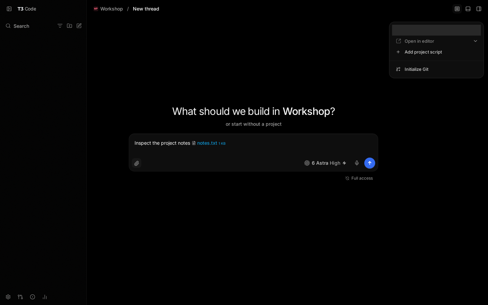

# Thread composer

The source places a paperclip on the left of its 40 px footer. The model, microphone and Send sit on the right. This setup exposes the current chat’s attachment action and keeps dictation visible. Attachments use the native strip. The host controls the field height, button spacing and send behavior.



## Install

```sh
cmux setup install github.com/manaflow-ai/cmux/examples/looks/t3code/composer
```

From this folder, preview with `cmux customize use preview.json`. Use `cmux customize apply` to keep it or `cmux customize discard` to return. The composer contribution requires a build supporting `cmux.composer.toolbar/1`.

[Reference capture and feature map](https://github.com/manaflow-ai/cmuxterm-hq/blob/main/docs/research/competitor-maps/t3code.md)
