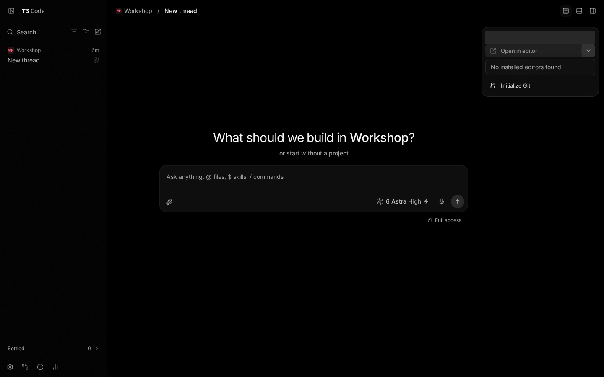

# Open in editor

Open Session Info and click **Open in VS Code**. The host opens the selected tab’s local working directory in the installed desktop editor. Its native action reports an unavailable folder or missing application. Enable **Run actions** for My views in Settings → Apps.

The source has a split control in thread details. Its arrow lists detected editors and the primary button reopens the last successful choice. The Linux capture shows its empty editor list. This customization targets the requested desktop editor directly. Remote SSH targets and editor discovery remain specific to the source control.



## Install

```sh
cmux setup install github.com/manaflow-ai/cmux/examples/looks/t3code/open-in-editor
```

From this folder, preview with `cmux customize use profile.json`. Finish with `cmux customize apply` or `cmux customize discard`.
