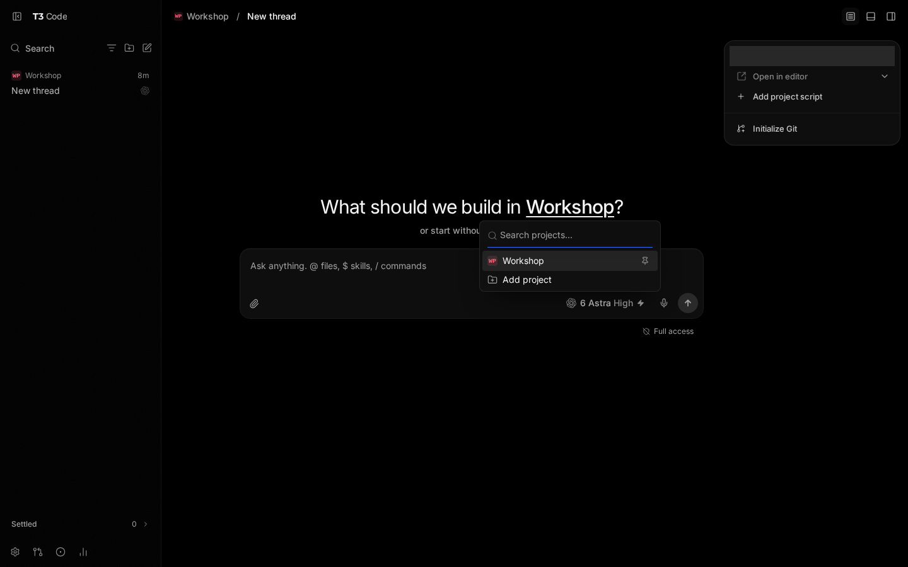

# Project picker

Open **Choose project…** in the sidebar. Type a name or path, then choose a result to start a new chat in that folder. Each row includes the path so similarly named projects are distinguishable. **Add project…** opens the native folder chooser. This setup also exposes the sidebar Projects section and the menu chevron beside **+**.

The source picker opens from the empty draft’s project name, can retarget that draft, and lists **Add project** beneath the matches. The cmux customization starts a fresh chat from the sidebar and uses folders available to the current host. The source app also offers pinning and cross-environment project grouping.

The view reads the project catalog with `project:read`. Enable **Run actions** for My views in Settings → Apps to launch a project.



## Install

```sh
cmux setup install github.com/manaflow-ai/cmux/examples/looks/t3code/project-picker
```

From this folder, preview with `cmux customize use profile.json`. Finish with `cmux customize apply` or `cmux customize discard`.
