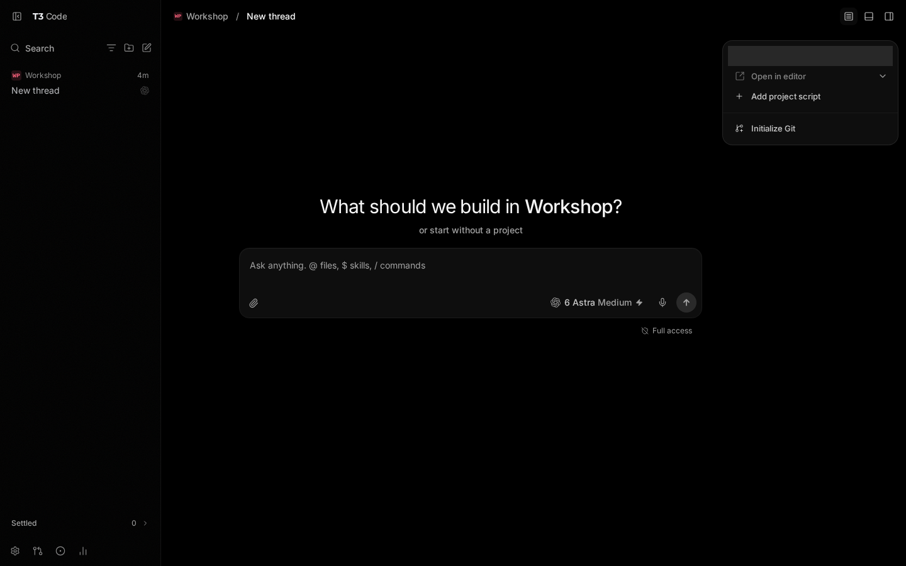

# Thread workspace

A 256-point sidebar keeps project and thread details visible next to a 736-point conversation. Hover a thread for its details, use the project section to start a chat in another directory, and open a local working folder in VS Code from Session Info. The composer exposes Attach files, dictation and a searchable model picker. The active harness supplies models, reasoning levels and available speed choices.



## Install or preview

```sh
cmux setup install github.com/manaflow-ai/cmux/examples/looks/t3code/whole
```

From this folder run `cmux customize use preview.json`. Choose `cmux customize apply` to keep the preview or `cmux customize discard` to restore the previous generation.

The package combines the feature views in one manifest. Its composer requires the `cmux.composer.model.picker/1` interface. Session Info opens the active local directory in an installed editor. Finished-chat settlement uses the host's lifecycle rule. The source also supports PR-triggered settlement and seven-day inactivity, a snoozed shelf, and per-thread overrides.

[Reference captures and interaction map](https://github.com/manaflow-ai/cmuxterm-hq/blob/main/docs/research/competitor-maps/t3code.md)
