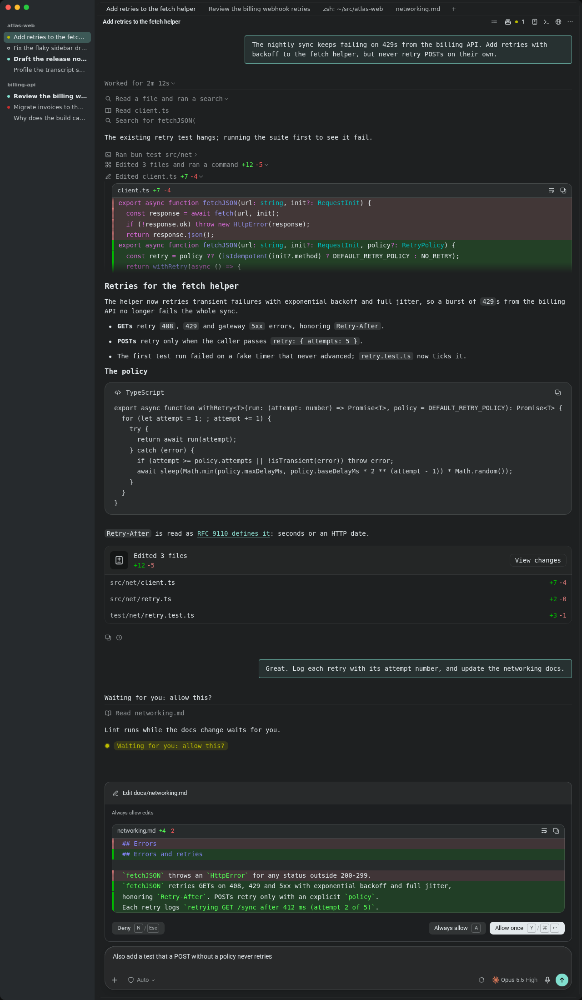
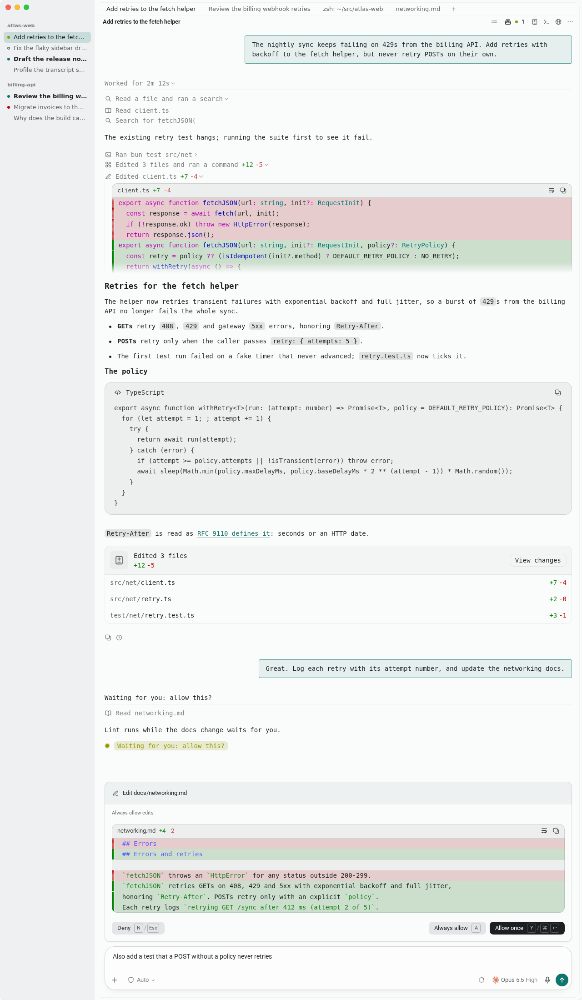

# Tachyon





cmux as a modern block terminal: output reads as cards, the chrome is two tones of graphite (the
top bar, tab strip and sidebar a step lighter than the content), and one vivid teal marks what is
selected and live: the prompt you sent (a teal-ringed block, the way a selected command block is
drawn), the active tab, the cursor, links and Send. The whole chat is monospaced; work in progress
is a mauve arc. The sidebar is a flat list of sessions, each row carrying its folder, branch and
agent state. It ships Dark (the default) and Light.

It is built only from public surfaces, so you can copy any part of it:

| File | What it does |
| --- | --- |
| `cmux-setup.json` | Picks the theme file; sets the chat monospaced (the `mono` preset) at 14 px with a 1.5 line height, code at full size, a wide 1040 px column, no minimap; the sidebar as a session list: no folder groups, every row expanded to folder, branch and agent state, detailed status marks, a hover card after 300 ms; a plain 6 px command field |
| `themes/tachyon.json` | Default, Dark. Content `#1E2021`, chrome and sidebar `#262A2D`, text `#E3E9EC`, teal `#81DFCF`, selection `#2B4A46`, dividers `#3B3D3F`, a mauve `#D7B7D2` working arc, and a full sixteen-color terminal palette (`ghostty`) tuned to the graphite |
| `themes/tachyon-light.json` | Light. Content `#FAFBFB`, chrome and sidebar `#EEF0F1`, text `#1D2023`, deep teal `#0F766E`, selection `#C6E6E2`, a plum `#8E4A87` working arc, and a terminal palette dark enough to read on white |
| `agent-pane/theme.css` | Your prompt as a selected block (the accent at 9% inside a 70% accent ring, 4 px corners), cards as raised graphite blocks with a light edge, secondary text in a prompt line's gray, links in the accent, and terminal menus (pending, below): `cmux.agentPane.style/1` tokens only, every color mixed from the theme's own |
| `customize/` | A session hover card that puts the status first as a small tinted chip, then folder and branch, the title and task in the monospaced face, what it waits on in the accent, and the agent and age last; rows in regular weight with the thin arc |
| `markdown/theme.css` | The Markdown viewer's paint: code as raised graphite blocks with a teal cast and 4 px corners, headings over a hairline, quotes on a teal rule, the way output reads as cards. Only `--cmux-md-*` properties on `:root`, every color mixed from the page's own |

The rest of cmux wears the look too. The terminal is JetBrains Mono at 13 pt (a modern terminal face with tall lowercase and clear zeros) with its own sixteen-color palette, unchanged; the Markdown viewer opens in the monospaced face at 14 px with the chat's line height and code scale in a 110-character column, and `markdown/theme.css` paints it; diffs use theme colors with + and - marks; sidebar group colors come from the theme's palette. Its `customize/` view also adds a **Prompt** line to Session Info: the folder, the branch in the accent and the agent, monospaced, as a terminal prints it before each block.

Both theme files set the same proportions, measured from the references: a 36 pt top bar, a
248 pt session sidebar with 34 pt rows, 13 pt chrome text, 12 pt tab titles in a 34 pt strip
whose tabs share it evenly, split panes that abut on a 1 pt divider (`appearance.chromeStyle:
"two-tone"`, no gutter), the focused pane shown by its tab, compact density, and fast,
ease-out color changes (120 ms) because a terminal never makes you wait.

```sh
cmux setup install github.com/manaflow-ai/cmux-tachyon-look
cmux settings set appearance.themeFile tachyon-light    # tachyon (Dark) is the default
cmux setup remove manaflow-ai/tachyon-look
```

While it is installed, its `customize/` view stands in for your own sidebar view, if you have one;
`cmux setup remove` puts yours back.

## References

The look was drawn from 10 captures in the private cmux design references: colors
sampled from their pixels, sizes measured on them. The captures themselves, by number, are on
the look's private references page.

| Ref | What this look took from it |
| --- | --- |
| R1 | The selected block: a 1 px teal ring (`#8AC4CC`) around a teal wash (`#0C1C1D` on a near-black page), the active tab's teal underline (`#78CED1`); this is the prompt bubble's ring and tint and the accent. Its block menu: an opaque panel, roomy rows, a separator inset about 8 px, which set the menu tokens |
| R2 | The two tones: chrome and sidebar `#262A2D`, content `#1E2021`, the selected row `#43474A` with a `#5A5E61` edge, the divider `#3B3D3F`; text `#E3E9EC`, secondary `#AFB5B7`, dim `#83878A`; diff green `#79C29C` and red `#C16E6F` (the palette's 2 and 1). Proportions: a 36 pt top bar, a 248 pt sidebar. The input pinned to the bottom with a chip row under it (the composer gap) |
| R3 | How the sessions are used: the task name dominant, folder and branch under it, a change count at the right; so `sidebar.density: expanded` with directory, branch and agent state. The horizontal tabs above share the strip evenly at about 34 pt |
| R4 | The hover card's order (a status chip first, folder, a monospaced title, the agent last in gray) for `customize/main.js`; the in-progress mauve `#D7B7D2` for the working arc; the card `#303437` with a light edge |
| R5 | The file picker's selected row tinted with the accent, rows edge to edge, for the menu highlight; the full-width bottom input with its tool row (the composer gap) |
| R6 | Cards a step above the page (`#1E2125`) with secondary lines in a soft gray and a blue "View more" link: the card fill and ring, and what needs you in the accent on the hover card |
| R7 | Pages as flat cards with a 1 px edge on a dark field and no shadow; the UI sans (Roboto) for the chat's chrome font |
| R8 | The app's own menus keep shortcuts in a gray column at the right (the shortcut token); its gradient brand card was left out |
| R9 | Terminal tabs that split the strip evenly, so a wide `tabMaxWidth` with equal minimums |
| R10 | Output as raised blocks on a darker page, separated by fill rather than lines: the card fill at 6% with a light edge |

## Contrast

Every pair is checked to WCAG AA, resolved opaque (body text 4.5:1, UI 3:1), in both theme files:
the text on every surface the look sets, the secondary and dim text over the page and over a card,
links on the page and inside the prompt block, the prompt block's text and its ring, Send, the
working arc on the sidebar, tab strip and chat, the selection, every menu row, and the terminal's
foreground, cursor, selection and ANSI colors 1 to 7 and 9 to 14 (8, the dim gray, at 3:1).

## With a newer cmux

The setup carries only settings every current cmux NEXT build has, because `cmux setup install`
refuses a key the running build does not know. These are in review; each sits in the files as a
comment naming its pull request:

| Part | Where | Needs |
| --- | --- | --- |
| Square tabs, the active one underlined | `"appearance.tabShape": "block"` in the theme files | cmux #46780 |
| A neutral raised card for the selected sidebar row, the teal kept for blocks | `"appearance.selection"` in the theme files | cmux #46516 |
| Block and context menus: 4 px corners, 30 px rows nearly edge to edge, an accent-tinted highlight, gray shortcuts and labels, 8 px separator inset | the `--menu-*` tokens in `agent-pane/theme.css`, set now and inert until then | cmux #46846 |
| Three-line session rows, square toolbar buttons, a hairline under the top bar, a taller bottom input | `appearance.metrics.*` comment lines at the end of the theme files | cmux #46861 |

## Not yet possible

| Part | Why |
| --- | --- |
| A full-width input pinned to the bottom with a chip row under it (attach, voice, change count, folder, branch) | `agentPane.composerLook` (#46738) offers auto, codex and claude only |
| A session-list sidebar preset | `sidebar.look` (#46805) offers cmux, claude, codex and studio only |
| A link color of its own (a sky blue beside the teal) | The stylesheet may only mix the theme's text, accent and page; links take the accent |
| The selected block's faint teal gradient | The prompt tint is one flat color |
| A diff count (+34 -9) on every row | No row fact carries line counts; branch and agent state stand in |
| A per-scheme stylesheet (`light-dark()`) | The stylesheet is mixed from the theme's colors, so one file covers both |

How looks like this one are written: [look-addons.md](https://github.com/manaflow-ai/cmux/blob/639a429492936ae3b4f0d4a1e6d7fbf66e708520/docs/cmux-next/look-addons.md).
