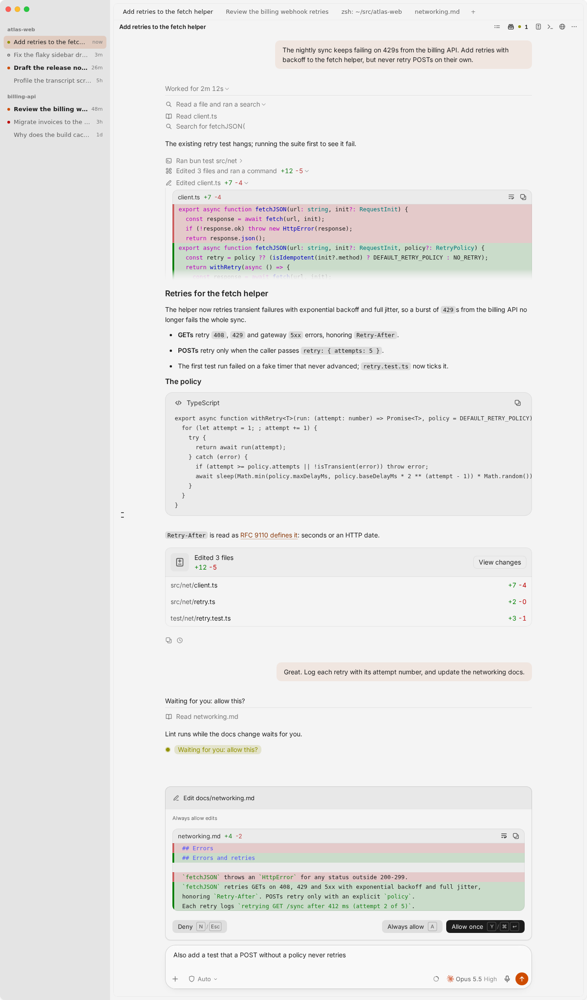
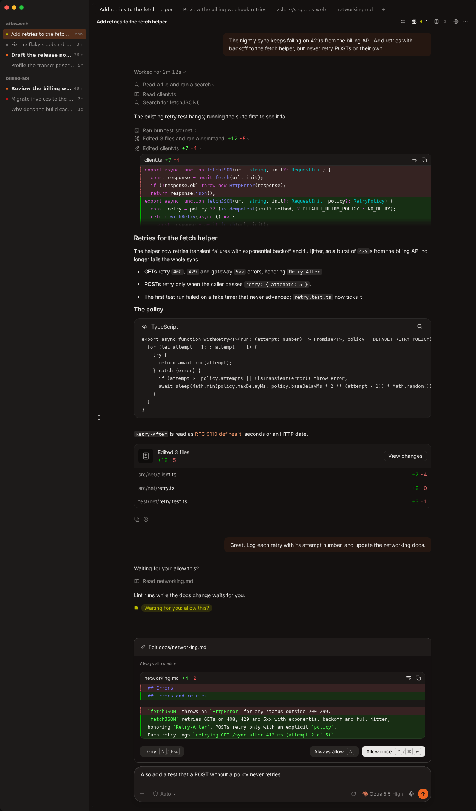

# Tandem





cmux as an agent workspace: you and your agents work side by side in one window. Every chat and
tab is one line in one sidebar, with its age at the right and what waits on you first; the
workspace is a soft gray card beside it with Settings, pages and files on white sheets; the chat
runs wide with a compact tick minimap for long runs of tool calls; the composer's ring shows your
plan's usage; and one signal color, an orange, marks what the agent may do on its own: the
approval policy, Send, the focused tab. Menus are roomy pickers (32 px rows, gray section labels,
gray shortcuts, a second gray line under a choice). It ships Light (the default) and a warm Dark.

It is built only from public surfaces, so you can copy any part of it:

| File | What it does |
| --- | --- |
| `cmux-setup.json` | Picks the theme file; sets the chat in Inter at 14 px with a 1.5 line height, code at 0.9, an 800 px column and the compact minimap; the composer ring on plan usage; the sidebar as one line per chat or tab with its icon and age, newest first under quiet headings, rich status marks, the pull request, the waiting-on-you bell, profile and search at the foot; a task-timeline hover card; a rounded address field that opens into an elevated sheet |
| `themes/tandem.json` | Default, Light. Workspace `#F4F4F4`, ink `#1C1C1C`, orange `#E8590C`, selection `#FBD5BD`, the sidebar `#F3F3F3` at 90% over a frosted desktop, Settings, pages, files and diffs on white, docks `#ECECEC`, a `#DEDEDE` hairline |
| `themes/tandem-dark.json` | Dark. Workspace `#141110`, ink `#EAE8E6`, orange `#EC6420`, selection `#8F6E5A`, the sidebar and docks `#151312`/`#1B1918`, Settings and pages `#1B1918`, a `#2C2927` hairline, opaque |
| `agent-pane/theme.css` | A 10 px prompt bubble warmed toward the accent (8%) with no edge, cards at 4% with an 8% hairline, secondary ink as dark as reads at 4.5:1, links in the accent a long step toward the ink, and roomy picker menus (pending, below): `cmux.agentPane.style/1` tokens only, every color mixed from the theme's own |
| `customize/` | A hover card laid out like a task card (a status and age line, the title, the task, the steps under way and where they happen as icon lines, what waits on you in the accent) and one-line rows with the dotted loader while an agent works |
| `markdown/theme.css` | The Markdown viewer's paint: white sheets. Code on a soft gray with 8 px corners, headings with no rule, quotes on the signal orange. Only `--cmux-md-*` properties on `:root`, every color mixed from the page's own |

The rest of cmux wears the look too. The terminal is SF Mono at 13 pt (the system's monospaced face beside Inter) with a full sixteen-color palette at a warm chroma, colors 1 to 7 and 9 to 14 held to WCAG AA over its page (8, the dim gray, to 3:1); the Markdown viewer opens in the system face at 15 px with the chat's line height and code scale in a 104-character column, and `markdown/theme.css` paints it; diffs use theme colors with change bars; sidebar group colors come from the theme's palette.

Both theme files set the same proportions, measured from the references at their capture scale: a
42 pt toolbar, a 40 pt tab strip with 13 pt titles in tabs about 160 pt wide, a 272 pt sidebar
with 32 pt rows, 13 pt chrome text, the workspace in one rounded card (`appearance.chromeStyle:
"card"`) with a 6 pt gutter, a 1 pt divider, hairline section breaks (`sidebar.sectionLook:
"lines"`), the focused pane marked on its tab, the dotted (braille) loader on rows and tabs, and a
200 ms ease-in-out for color changes.

```sh
cmux setup install github.com/manaflow-ai/cmux-tandem-look
cmux settings set appearance.themeFile tandem-dark    # tandem (Light) is the default
cmux setup remove manaflow-ai/tandem-look
```

While it is installed, its `customize/` view stands in for your own sidebar view, if you have one;
`cmux setup remove` puts yours back.

## Contrast

Every pair is checked to WCAG AA, resolved opaque (body text 4.5:1, UI 3:1), in both theme files:
the ink on every surface the look sets (the frosted sidebar over a black, white and mid-gray
desktop too), the secondary and dim ink over the workspace and over a card, links on the workspace
and inside the bubble, the bubble's text, the selection, the accent as a control and the glyph on
Send, and the menu rows, labels and shortcuts on the panel and on the highlighted row. The policy
orange as sampled (`#FF6900`) reads at 2.6:1 on the gray workspace, under the 3:1 a control needs,
so the light accent is a deeper `#E8590C` and the dark one `#EC6420` (a white glyph on it at 3.3:1).

## With a newer cmux

The setup carries only settings every current cmux NEXT build has, because `cmux setup install`
refuses a key the running build does not know. These are in review; each sits in the files as a
comment naming its pull request:

| Part | Where | Needs |
| --- | --- | --- |
| Chat tabs as rounded capsules on the strip | `"appearance.tabShape": "rounded"` in the theme files | cmux #46780 |
| The selected chat or tab as a raised neutral row, not an accent capsule | `"appearance.selection": "neutral"` in the theme files | cmux #46516 |
| Picker menus: 10 px corners, a 6 px inset, 32 px rows, a gray 6 px inset highlight, 12 px medium gray section labels, gray shortcuts and second lines, separators inset 8 px, submenus 4 px beside | the `--menu-*` tokens in `agent-pane/theme.css`, set now and inert until then | cmux #46846 |
| Rows inset 8 pt on a 36 pt pitch, a 50 pt row with a subtitle, 28 pt toolbar buttons with an 8 pt corner, the composer as a 44 pt capsule | the `appearance.metrics.*` comment lines at the end of the theme files | cmux #46861 |

## Not yet possible

| Part | Why |
| --- | --- |
| The composer as a white capsule with + at the left and the mic or Send at the right, the location, policy, model and effort as quiet chips under it, the policy chip in orange | `agentPane.composerLook` (#46738) offers auto, codex and claude only; no composer chip color token |
| A near-black Send beside an orange policy chip | One accent colors Send, focus and the policy alike |
| An underlined active tab (a short bar under its title) | `appearance.tabShape` (#46780) offers block, rounded and gooey only |
| Bookmarks, chats and tabs as three sections of one sidebar | `sidebar.look` (#46805) offers cmux, claude, codex and studio; sections come from `groupBy` |
| White menus and cards raised over the gray workspace | Menu fills are mixed from the theme's page and ink, so they can only sit a hair off the workspace |
| A "Ready to merge" header pill in green with its Merge button | No pane header action color surface |
| A per-scheme stylesheet (`light-dark()`) | The stylesheet is mixed from the theme's colors, so one file covers both |

## References

The look was drawn from 28 captures in the private cmux design references: colors
sampled from their pixels, sizes measured on them. The captures themselves, by number, are on
the look's private references page.

| Ref | What this look took from it |
| --- | --- |
| R1 | The window's proportions at 1 pt per pixel: a 280 pt sidebar, a 42 pt toolbar, the content as a card with a rounded corner beside it; three quiet sidebar sections over hairline breaks (`sectionLook: lines`) |
| R2 | New Tab and Home on the workspace gray with the composer as a white capsule at the center, the policy and project chips under it |
| R3 | The workspace `#F4F4F4`, the near-black `#171717` composer button, the policy in orange (`#FF6900`) under the input, the subscription prompt beside the composer (`composerRing: planUsage`), the 44 pt capsule composer |
| R4 | The menu: about 8 to 10 px corners, a `#DEDEDE` hairline, 32 pt rows, a gray inset highlight (`#E2E2E2`) with rounded corners, a check at the right, a separated footer row; the sidebar `#C4C4C4` over the desktop and its white selected row with a hairline |
| R5 | Execution policy as the one orange control beside the input: the orange accent, and what waits on you in the accent in the hover card |
| R6 | A menu that opens upward from the composer with a trailing value ("Guard") and a submenu chevron, separators inset about 8 px from the panel edge |
| R7 | The tab context menu's grouping, split and close sections (a native menu, which the menu tokens do not reach: listed as such) |
| R8 | Chats and tabs as one-line rows in one column on a 36 pt pitch, the selected row a white raised capsule inset 8 pt (`workspacesAsTabs`, `selection: neutral`, the #46861 inset and gap) |
| R9 | Hiding the sidebar frees the whole column (no icon rail): `sidebar.style: standard` |
| R10 | The assistant as a narrow panel beside a page with a removable context chip: the chat beside a browser pane in one card |
| R11 | The address field opening into a wide elevated sheet with a gray highlighted first row: `browser.omnibar.cornerRadius: 10`, `shadow: true` |
| R12 | Settings as a white sheet in a card with a 6 to 7 pt gutter (`columnGap: 6`), grouped bordered rows with gray descriptions, the selected option ringed in orange |
| R13 | Task cards with a small gray "Working for 3m 46s" line over a bold title and gray step lines: the hover card's layout, and the frosted sidebar over the desktop |
| R14 | The capsule composer with a Search and Ask switch and quiet chips under it (the composer-look gap) |
| R15 | Gray section labels ("Permission", "Folder Access") in a medium weight, icon rows, a gray inset highlight, a full-width separator before a toggle row |
| R16 | Number shortcuts in gray at the right and the chord as a gray key cap beside the label: `--menu-shortcut-color` |
| R17 | A choice with a second gray line ("Runs on your computer"): `--menu-subtitle-color` |
| R18 | A decision card: a plain question, a gray explanation, the choices as gray pills: what waits on you as the hover card's last, highlighted line |
| R19 | Narrative in the ink, steps in gray with an icon each: the secondary ink and `hoverCards.layout: timeline` |
| R20 | Settings on white with a separate navigation column and grouped bordered rows: `surfaces.settings` white |
| R21 | Choices shown as small previews, the chosen one ringed in orange: the orange as the selection edge |
| R22 | Files and Markdown on white sheets beside a gray tree: editor, diff and Markdown surfaces white in Light |
| R23 | Internal pages (history) on white with rounded cards and gray secondary lines: `surfaces.internalPage` white |
| R24 | A compact audit table, monospaced dates, green and red marks: the detailed status marks in the sidebar |
| R25 | The dark palette (workspace `#13110F`, sidebar `#1B1918`, selected row `#272523`, ink `#EAE8E6`), the prompt bubble warmed toward the accent (`#271E1D`), a 254 pt sidebar of one-line workspaces with their age at the right (`showTimestamps`) under "Pinned" and "My workspaces", chat tabs about 160 pt in a 40 pt strip with the active one underlined (`focusIndicator: tabs`), the dotted loader by a working tab (`statusIndicator.style: braille`), the transcript's tick minimap (`minimap: compact`), the large card composer, "Ready to merge" in green (a listed gap) |
| R26 | First run: a branch and setup checklist as icon lines in the transcript, a "Done" card one step off the page (`--cv-card-fill` at 4%), the secondary ink `#A4A09D` |
| R27 | A workspace row with a second line (place and age) on a 53 pt pitch: the 50 pt row with a subtitle (#46861); profile, archive and settings at the sidebar's foot (`showProfileControl`, `showSearchButton`) |
| R28 | A dismissible card on the sidebar with one light primary button: cards on the dark sidebar a step lighter, the hairline at the ink's 8% |
