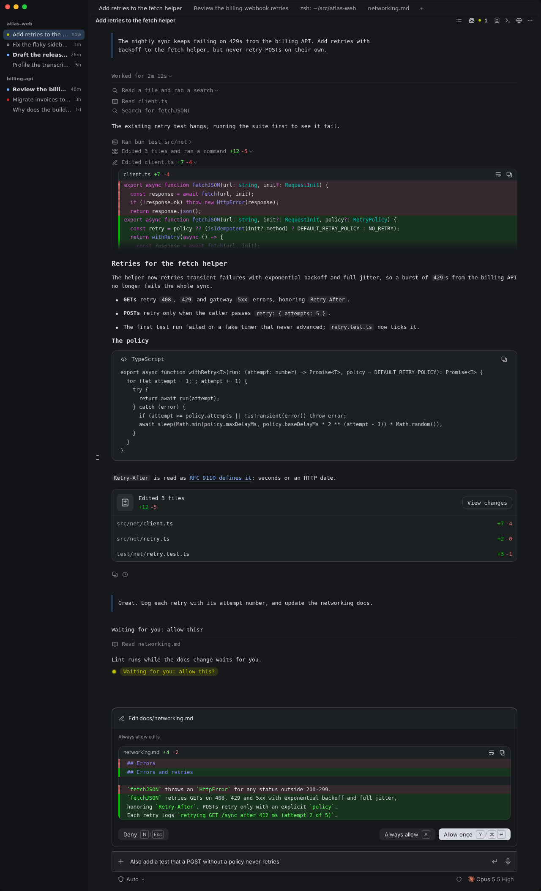
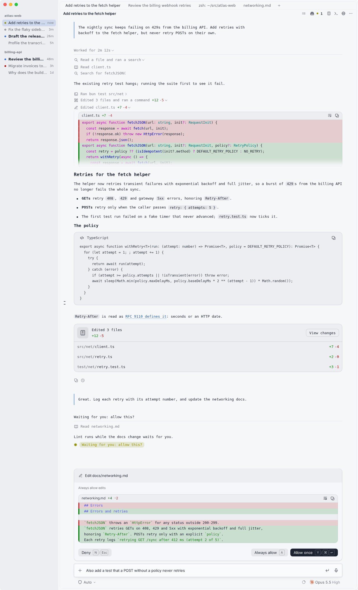
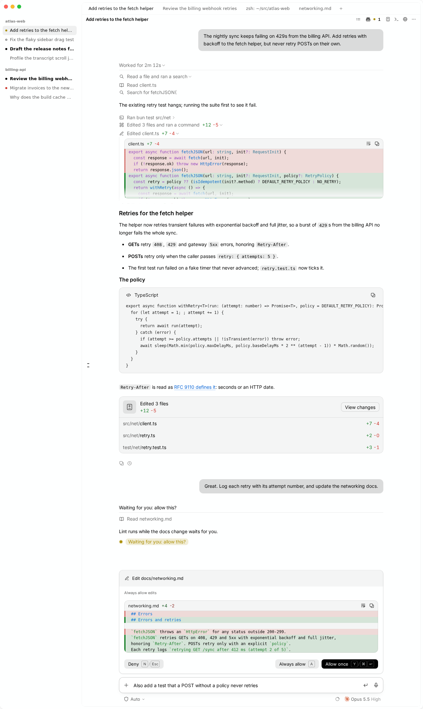
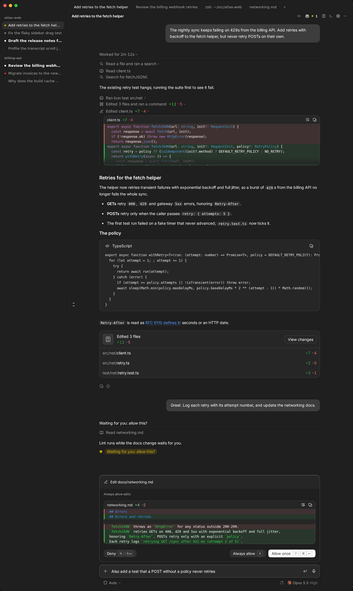

# Workbench v1

A dense, code-first look for agent threads in cmux, after a code-first agent app with a thread
sidebar: a cool neutral dark, compact rows grouped by project with each chat's sub-sessions as a
tree, a monospace-leaning chat in a wide column, prompts as flat rows marked by an accent rule, and a
square docked message box.




## Design intent

Workbench v1 optimizes for scanning a lot of agent work at once: many threads across projects in view, long code-heavy replies read without scrolling sideways. Density is compact everywhere (24 pt sidebar rows, compact chrome, 13 px chat). Type leans monospace: replies in the mono preset on a tight UI face, code at nearly full size. It sets all three chat layout keys: `agentPane.display.layout.messages` `flat`, `.composer` `square`, `.header` `full`.

## What game cmux plays under this look

Under Workbench, cmux plays the operator's console: many agents running at once across many repos, and the person's job is to steer them, not to read prose. Everything is tuned for throughput: the sidebar is a tree of threads by project with branch and age on every row, so a stuck or finished agent is visible without opening it; the transcript is flat rows on the leading edge, so a prompt reads as a command in a log rather than a message in a conversation; replies and code are monospace-leaning and wide, so diffs and paths line up; the message box is square and docked like a terminal prompt. Color stays out of the way except for one blue that marks focus and your own turns.

## Whom it serves

Lawrence: he wrote most of the Rust core and lives in code, branches and many concurrent agent threads, so a dense, mono, project-grouped view fits how he already works.

## Screenshots

Drawn by the `golden:looks` harness (`webviews/scripts/gallery/golden-looks.ts`, run 45026447442 on
the fleet), one mock app window per scheme: sidebar, tab strip, agent pane and composer, on the same
worked turn. The default look is beside each for comparison.

| Scheme | Workbench v1 | Default look |
| --- | --- | --- |
| Light |  |  |
| Dark |  |  |

Per surface:

- Agent pane and composer: shown above, light and dark, drawn by the webviews the app uses.
- Sidebar and tabs: shown above only as the harness's mock, which draws the row text, timestamps and
  palette but not sidebar density, grouping, the session tree or the native tab bar's metrics. The
  native Swift sidebar and tab bar need a Mac (`golden:looks --native`); missing from this VM.
- Settings: missing. No harness on this VM draws the Settings window.
- Agent pane close-ups (`compare.mjs worked-turn --open --look`): missing; the script needs the
  reference prototype checkout (`--reference`), which the fleet runner does not have.

## What this look could not set

- The composer's own look and where the message box sits in an empty chat: `agentPane.composerLook` and `agentPane.emptyChatComposerPosition` are in review (#45843).
- Tab shape (capsule or square tabs): `appearance.tabShape` is in review (#46780).
- The selected sidebar row's fill (neutral or accent): `appearance.selection` is in review (#46516).
- Sidebar row inset, padding and gap, toolbar button size and corners, the header divider, the composer's padding and minimum height: in review (#46861).
- Which facts sit on which line of a sidebar row: `sidebar.workspaceRow.lines` validates but is not drawn (#42244).
- A whole sidebar look (row shape, header style) beyond density and content: `sidebar.look` is in review (#46805).
- The color of your own prompt's text: `--cv-user-bubble-text` is in review (#46490).
- Menus and context menus: the `--menu-*` tokens are in review (#46846).
- Font family per surface: only the chat (`agentPane.display.font.ui`, `.preset`, `.proseFamily`), the Markdown viewer (`markdown.font.preset`) and the terminal (`terminal.fontFamily`) take one; the sidebar, tab strip, header and Settings stay on the system face.
- The prompt bubble's width: the chat's row estimate assumes 70%, so no setting or token changes it.
- Buttons in the composer's toolbar and the model picker: no setting or interface draws them.
- Corner radius across the app (panes, cards, buttons): only the prompt bubble (`--cv-user-bubble-radius`) and the message box (`agentPane.display.layout.composer`) take a corner.
- Avatars or sender labels beside messages, and a reply drawn as a card of its own: the message layout key moves only your prompt (`bubbles`, `flat`, `card`); the reply is always plain prose.
- Sidebar row height per kind and a monospace sidebar or tab font: the sidebar and tabs have no font family key.
- A light theme that keeps the dark sidebar (a two-tone light look): one theme file colors both.

## What it reshapes

| Part | How |
| --- | --- |
| Chat layout | `agentPane.display.layout.messages` `flat`, `.composer` `square`, `.header` `full` |
| Chat type | `agentPane.display.font.preset` `mono` at 13 px, `font.ui` `system-ui-tight`, `code.scale` 0.95, `width` 960, `minimap` `compact`, `harnessPlacement` `compact` |
| Sidebar | `sidebar.density` `compact`, `groupBy` `folder`, `sessionTree` on, timestamps, branch and last activity on the row, `controlsOnHover`, `groupHeader.background` `sections` with member counts |
| Chrome | `appearance.chromeStyle` `flat-sidebar-line`, `density` `compact`, a 232 pt sidebar of 24 pt rows, 12 pt chrome text, a 30 pt tab strip (theme file) |
| Color | `themes/workbench.json` (blue-gray near-black, a darker sidebar, one calm blue) and `themes/workbench-light.json` (cool off-white, blue-gray ink); pick the light one with `appearance.themeFile` `workbench-light` |
| The chat's paint | `agent-pane/theme.css`: small corners, crisp card hairlines, links in the accent |
| Sidebar view | `customize/`: a terse hover card that leads with the folder and agent; regular rows with a braille spinner |

With cmux#45843 also set `agentPane.composerLook` and `agentPane.emptyChatComposerPosition`; they
are not keys yet, so this look leaves them out.

```sh
cmux setup install github.com/manaflow-ai/cmux/examples/looks/workbench@feat-cmux-next
cmux setup remove manaflow-ai/workbench-look
```

How looks like this one are written: [docs/cmux-next/look-addons.md](../../../docs/cmux-next/look-addons.md).
