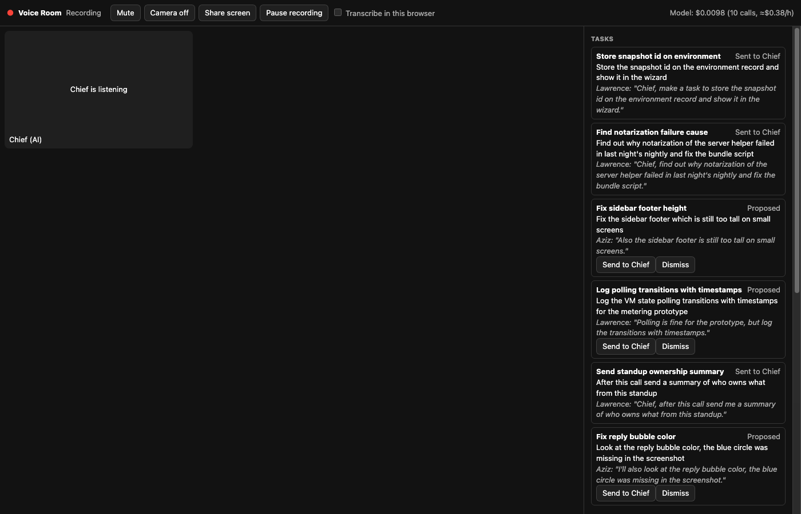

# Voice Room (experiment)

The room server and page behind cmux's Labs **Voice Room** (`labs.voiceRoom`). Design:
[plans/cmux-next/voice-room-DESIGN.md](../../plans/cmux-next/voice-room-DESIGN.md).

```bash
bun src/server.ts            # this Mac only: http://127.0.0.1:4788/
bun src/server.ts --share    # also on the tailnet: https://<this-mac>.<tailnet>.ts.net:4789/ (tailscale serve)
bun test                     # room, memory, dedupe, tasks, server end to end (fake model)
```



Then in cmux: Settings > Advanced > Labs > Voice Room on, Command Palette > **Open Voice Room**.
Guests open the `--share` address in any browser on the tailnet.

| Env | Default | |
| --- | --- | --- |
| `VOICE_ROOM_MODEL_URL` | `$ANTHROPIC_BASE_URL` | any Anthropic Messages endpoint |
| `VOICE_ROOM_MODEL_TOKEN` | `$ANTHROPIC_AUTH_TOKEN` / `$ANTHROPIC_API_KEY` | |
| `VOICE_ROOM_MODEL` | `claude-haiku-4-5` | |
| `VOICE_ROOM_CLAUDE_CODE_COMPAT` | `1` | Claude Code headers for subscription gateways; `0` for the plain API |
| `VOICE_ROOM_CHIEF` | `cli` | `off` logs tasks instead of sending them to Chief |
| `VOICE_ROOM_DATA` | `~/Library/Application Support/cmux/voice-room/default` | `log.jsonl` |
| `VOICE_ROOM_RETENTION_HOURS` | `24` | |
| `VOICE_ROOM_PORT` / `VOICE_ROOM_SHARE_PORT` | `4788` / `4789` | |
