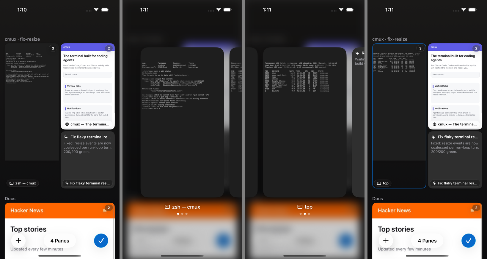
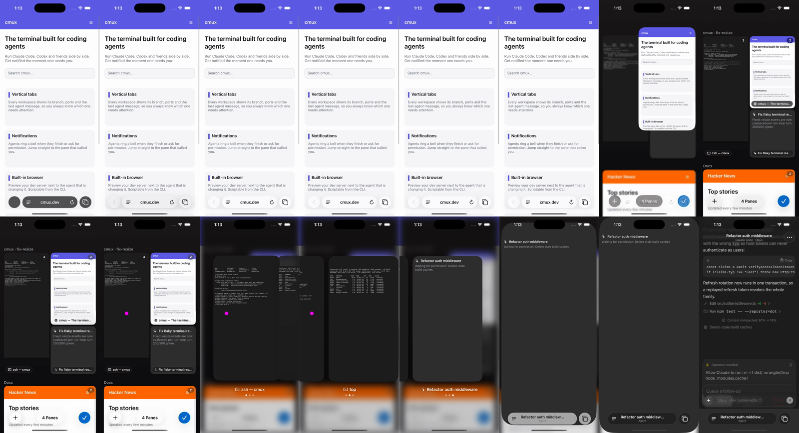
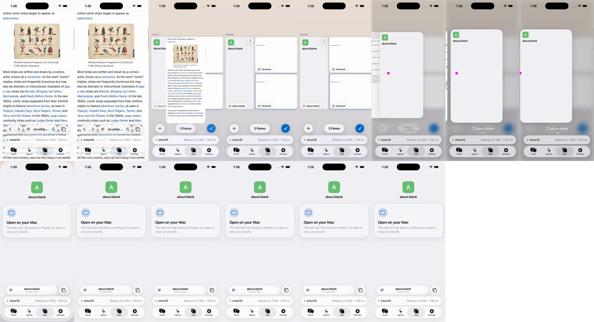
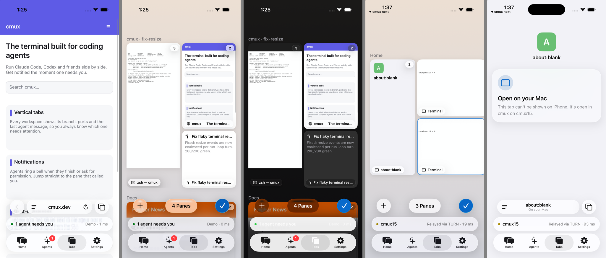
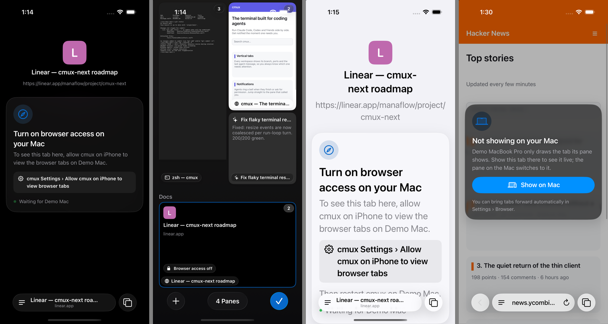
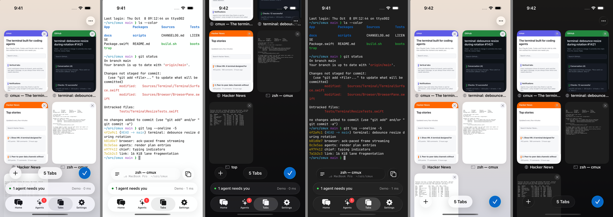
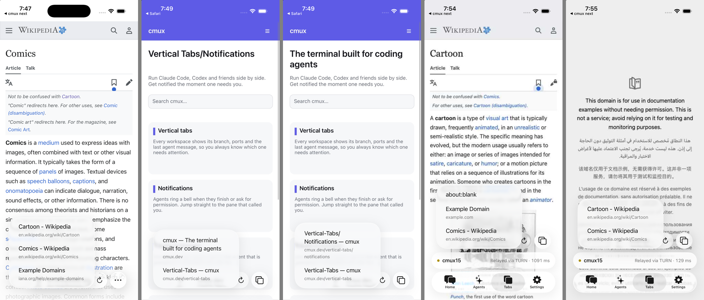

# CNBrowserUI validation (Mobile Safari reference)

Module: `Packages/CmuxNextMobile/Sources/CNBrowserUI`, root `BrowserRoot(connection:)`.
Reference: `ios-next/reference/safari.md`, crops in `reference/safari/` and the
raw captures in `~/nxios-ref/safari/` (iPhone 17 Pro, iOS 27).

The implementation was checked on the remote headless iPhone 17 Pro simulator
(`remote-ios.sh`, slot `browser`), running the Drawer scheme with
`CMUX_NEXT_DEV_SCREEN=browser` on `CNMockHost`. The mock host streams generated
JPEG pages at 8 fps, so the page content differs from the Safari captures. Only
the chrome and motion are comparable.

The shell's `ModuleRoots.browser()` still returned a placeholder when this was
written. The slot build patched that one line in its remote copy only, so the
browser root could be reached. The shell agent needs to make the same change:
`func browser() -> some View { BrowserRoot(connection: connection) }`.

## Method

- **Geometry:** frames come from the AXe accessibility tree (`describe-ui`, in
  points). Glyph ink was measured with a dark-pixel bounding box on 3x
  screenshots, using the same script on the reference `plain_top.png` and
  `collapsed_plain.png`.
- **Motion:** each animation was recorded with `remote-ios.sh video` while AXe
  drove the app.
  - Toolbar springs: the URL label's center y was tracked frame by frame at
    60 fps (dark-ink centroid inside the capsule) in both the reference and
    implementation recordings. A SwiftUI `spring(response:dampingFraction:)`
    was then fitted to each track. This gave cleaner fits than
    `framediff.py --track`, which lost the template over the busy mock page.
  - Larger transitions: `framediff.py` was run for onset and duration. The
    sequences were then aligned on the first changed frame in the relevant
    screen band, and side-by-side contact sheets (reference on top,
    implementation below) were checked frame by frame.
- **Noise:** the simulator recorder drops frames under load. Repeating the same
  collapse gave fitted responses between 0.40 and 0.44 s, so treat ±0.04 s and
  ±1–2 frames as noise.

## Static geometry (light; dark verified in the contact sheet)

| Element | Reference | Measured | Result |
|---|---|---|---|
| Back circle | 34, 792, 48 × 48 | 34, 792, 48 × 48 | pass |
| Address capsule | 90, 792, 222 × 48 | 90, 792, 222 × 48 | pass |
| Page-menu slot | 90, 792, 48 × 48 | 90, 792, 48 × 48 | pass |
| Page-menu glyph ink | 106.7, 810, 16 × 11.7 (3 lines, last ≈ 2/3) | 106.7, 810.0, 16.3 × 12.0 (custom 3-line shape) | pass |
| URL text cap height (17 pt medium) | 12.7 | 12.7 | pass |
| URL text center | x 201, y 816 | x 201, y 816.0 | pass |
| Reload glyph ink | 282.7, 806.3, 14.7 × 18 | 282.7, 806.3, 14.7 × 18.0 | pass |
| Tabs glyph ink | 332.3, 805, 23 × 22.3 | 332.3, 804.8, 23.0 × 22.7 | pass (0.4 pt) |
| Tabs circle | 320, 792, 48 × 48 | 320, 792, 48 × 48 | pass |
| Collapsed label center y | 843.8 | 844.0 | pass |
| Collapsed label scale | 0.74 (69 → 51 pt) | 0.74 (74.7 → 55 pt for "cmux.dev") | pass |
| Collapsed pill | text + 38, h 32, bottom inset 14 | same formula (layout code) | pass |
| Edit field (software keyboard) | 8, kbTop − 56, 330 × 48 | 8, 510, 330 × 48 (kbTop 566) | pass |
| Edit close circle | 346, y, 48 × 48 | 346, 510, 48 × 48 | pass |
| Edit field (hardware keyboard) | 34, 792, 278 × 48 | 34, 792, 278 × 48 | pass |
| Page menu panel | x 90–340, bottom ≈ 839, r ≈ 32 | x 90, w 250, bottom 839 | pass |
| Menu rows / text inset | 42 pt (62 for 2 lines), text at x 155 | 42 pt (≈ 61 for 2 lines), text at x 155 | pass |
| Overview cards | x 16 / 209, 177 × 249.3, r 18 | x 16 / 209, y 114, 177 × 249.3, r 18 | pass |
| Card close | 22 pt at (+151, +4), hidden on the selected card | 22 pt at (+151, +4), hidden on the active card | pass |
| Overview More | 346, 66, 36 × 36 | 346, 66, 36 × 36 | pass |
| Overview + / Done | 38, 788 and 316, 788 (48 pt) | 38, 788 and 316, 788 | pass |
| Favorites tiles | 72 × 72, x 16 / 115.3 / 214.7 / 314 | 72 × 72, x 16 / 115.3 / 214.0 | pass (0.7 pt) |
| Top strip | page color, rows 0–62 | page top-row average color, rows 0–62 | pass |

`toolbar-ref-vs-impl.png` shows four rows: reference expanded, implementation
expanded, reference collapsed, implementation collapsed. `states-light-dark.png`
shows the expanded, collapsed, menu, editing, overview, and new-tab states in
light (top row) and dark (bottom row).

## Motion

| Transition | Reference | Implementation | Result |
|---|---|---|---|
| Collapse (label y 816 → 844) | fit 0.38 / 0.87, settles in 16 frames | fit 0.40 / 0.87 (repeat run 0.44 / 0.84), settles in 17–18 frames | pass (≤ 2 frames, within recorder noise) |
| Expand by tapping the pill | fit 0.44 / 0.85, settles in 17 frames | fit 0.41 / 0.86, settles in 19 frames | pass (2 frames) |
| Expand by scrolling up | spec 0.41 / 0.87 (the reference clip fits poorly, rmse 0.085) | spring 0.41 / 0.87; the label track was too noisy over page content to fit | not measured |
| Side circles on collapse | fade out by ~80–150 ms while sliding inward | 140 ms linear fade, slide with the pill edges, scale 0.8 | pass (visual) |
| Address focus (software keyboard) | field rides the keyboard, rests at ~+13–16 frames, page crossfades at 30–130 ms | field follows the keyboard's own animation through the keyboard safe area, rests at +13–16; crossfade 30–130 ms | pass (`anim-edit.png`) |
| Page menu open | droplet stays capsule-round, blurred lensed rows, rest ~+14 frames | DropletShape stays a capsule until 60% progress; rows scale with the droplet; content opacity 80–200 ms, blur 8 → 0; rest at +14–16 | pass within ~2 frames (`anim-menu.png`) |
| Tab overview open | 402 → 177 wide, 64% at 77 ms, rest ~250 ms | spring 0.22 / 1.0, grid unblurs and scales from 1.06, rest ~+15–20 frames | marginal: the first frames lag 2–3 frames (`anim-open.png`) |
| Tab overview close | 177 → 402, 0.45 / 0.81, about 27 frames | spring 0.45 / 0.81; the card moves on the first frame, while the reference's grid fades for 3–4 frames before its card moves | pass for shape and duration (`anim-close.png`) |
| Close tab in overview | counter changes at once, card fades out, reflow ≈ 0.38 / 0.85 with a diagonal arc | same behavior; settles in ~16 frames | pass (`anim-tabclose.png`) |
| Toolbar swipe | page follows the finger; neighbor at 0.93 scale and blurred; snap 0.4 / 0.9 | same; the label slides with the page | pass (visual, `anim-swipe.png`) |

Changes made from these comparisons:

- The toolbar now uses separate glass shapes. Inside a `GlassEffectContainer`,
  per-shape opacity was ignored, so the side circles never faded.
- The pill label no longer dims on press. The old plain-button highlight made
  it blink during the expand.
- The tab overview and page menu stay mounted so their first frame is not
  delayed. Before this change, the page menu started 4 frames late.
- The address field follows the keyboard safe area instead of keyboard
  notifications, which removed a 4–5 frame lag.

## Interaction checks (mock host)

| Check | Result |
|---|---|
| Frames render edge to edge under the status bar; the strip color follows the page header (purple, blue, green) and becomes white after scrolling | pass |
| Every frame is acked after it is drawn; viewport = view size in points × screen scale, `mobile: true`; resent when the size, page keyboard, or desktop mode changes | pass (code path; mock streams continuously) |
| One-finger drag scrolls the remote page (`browser.touch`) and drives collapse and expand | pass |
| Tap on page content navigates (touch tap) | pass |
| Hardware keys reach the page (Backspace deleted a character); text through the hidden proxy field ("hello" typed into the page search box); Enter submits | pass |
| Address editing: full URL selected, completions ("Switch to Tab" for open tabs plus a search row), Go navigates, the label shows "🔍 query" for searches | pass |
| Page menu: Reload, Show Keyboard, Share (UIActivityViewController), Copy URL, Back/Forward, Request Desktop Website (re-attaches at 980 CSS px), Open on Mac (`browser.activate`), Close Tab | layout pass; Share, Desktop, and Open on Mac were exercised only through the code path |
| Overview: select a card, Done, +, close tab, Close All | pass |
| Toolbar swipe switches to the neighbor tab; swiping past the last tab opens a new start-page tab | pass for the neighbor tab; the past-the-end path is in code only |
| `browser.tab` and `browser.closed` events update the chrome; reload on `connection.generation` | in code; the mock host emits these on navigation, which was observed |

## Gaps and known differences

- **Status bar style:** Safari switches the status-bar glyphs between white and
  black based on page luminance. The module cannot set `preferredStatusBarStyle`
  because the shell owns the hosting controller. In dark mode over a white page,
  the clock is white on white (`states-light-dark.png`, dark collapsed). This
  needs a shell hook, such as a `CNShellChrome` status-bar preference.
- **Editable focus:** the protocol has no editable-focus signal. The soft
  keyboard opens from the page menu's "Show Keyboard". Hardware keys always go
  to the page.
- **Accent color:** the progress bar and the Done button use the cmux
  `highlight` token (#0869CB) instead of Safari's #0088FF, following the
  brief's one-hue rule.
- **Long-press:** the press is acknowledged with haptics, and the held touch
  lets the remote page open its own context menu. There is no local
  link-preview card because the protocol carries no link information.
- **Not built:** the edge-swipe back/forward gesture, the tab overview's search
  and filter controls, the "Private" segment, the mic/voice search, and a
  scroll-to-top expand (the phone does not know the remote scroll offset).
- **Progress bar:** implemented with a 3% minimum, ease-out, and a fill-and-fade
  finish. The mock loads in under a second, so it was not captured on video.
- **Address field selection:** the selected URL shows selection handles. Safari
  shows only the highlight.
- **Scroll-up expand:** the timing was not measured because the label track was
  too noisy. The spring uses the spec values.

## Displaced stream (`browser.detached`)

The host sends `browser.detached {streamId, tabId, reason:"displaced"}` when
another phone takes over a tab's screencast. `BrowserModel.handleDetached`
then does the following:

- Ignores the event unless it names the current stream.
- Cancels the frame task and calls `closeStream` locally. It does not send a
  `browser.detach` RPC, because the host has already ended the stream.
- Stops sending input to the stream.
- Keeps the last frame on screen, dimmed (black at 35%), under a glass banner
  that reads "Viewing on another device" with a "View here" button. The button
  calls `attach` again.

Every other detach path sends the `browser.detach` RPC first and calls
`closeStream` afterwards, as introduced in d345f6003e9.

The mock host now enforces one screencast per tab. A new attachment displaces
the old one and sends `browser.detached` to the displaced link only.

For testing, launching with `CMUX_NEXT_BROWSER_DISPLACE=1` (DEBUG builds only)
makes the app open a second link through the same connector once the first
frame arrives. That link attaches to the active tab, as a second phone would.

`displaced.png` shows two screenshots. On the left is the banner over the
dimmed last frame. On the right is the page after "View here": the stream is
live again, and scrolling collapses the toolbar.

## Tab zoom, card close and the new-tab origin (device recording)

The reference is a real iPhone 17 Pro Max recording,
`~/nxios-ref/safari/user/tab-zoom-device.mp4` (440 × 956 pt, 60 fps, dark
mode). I extracted its frames at 440 px wide, so 1 px = 1 pt. The
implementation was recorded on the 402 pt iPhone 17 Pro simulator in dark
mode. Widths are normalized as progress from card width to screen width
(196 → 440 on the device, 177 → 402 on the simulator). In both recordings, the
zooming rect is the bounding box of bright page pixels on the dark overview.

**What Safari does:** the zooming rect is the tab's window. The page,
including its status strip, is laid out at full screen size, scaled to the
rect's width, top-aligned and clipped by the rect. The rect's corner radius
interpolates between the screen radius and the card radius. Content never
cross-fades.

`ScaledPage` now draws the card, the zooming tab and the swipe cards the same
way, for both live frames and the start page. The zooming tab starts from the
image that the card shows.

| Item | Device | Implementation | Result |
|---|---|---|---|
| Card | 196 × 276 at x 16 / 228, y 122 (safe top 62) | (W − 48) / 2 wide, aspect 1.408, top = safe top + 60, radius 18 × width / 177 | pass |
| Card close | 22 pt circle, 4 pt from the top and right edges, 9.5 pt light cross, fill #F2F2F7 (light) / white 8 % (dark) | Same (`card-close-ref-vs-impl.png`: reference on the left, implementation on the right, 8 px/pt) | pass |
| Open: page to card | Spring fit 0.330 / 0.91, settles in 16 frames, no overshoot | Spring 0.33 / 0.91. Measured fits 0.315 / 0.95 (run 1) and an identical curve in run 2; every frame within ±1 frame except recorder duplicates; settles in 17 frames | pass |
| Close: card to page | Fit 0.335 / 1.00, settles in 23 frames, no overshoot | Spring 0.335 / 1.0. Run 2 fit 0.335 / 1.00, settles in 21 frames. Frames 1–3 trail by about 0.5 frame. Run 1 had one dropped frame at onset (fit 0.44 / 0.89). The last 5 pt no longer jump at the end: the overlay now waits for `completionCriteria: .removed` | pass |
| Card title and close button | Fade out at the start of a close; fade in late on open (by about 16 frames) | Fade out over 0.1 s; fade in over 0.15 s after a 0.22 s delay | pass (visual) |

`zoom-device-vs-sim.png` shows these rows, top to bottom:

1. Device close
2. Implementation close
3. Device open
4. Implementation open
5. Implementation (+) new tab

**New tab (+):** the recording contains no (+) taps. Both tabs (Gmail and
Start Page) exist from its first frame. Every transition in it is a page ↔
card zoom: open at frames 192, 640 and 882; close at 432, 733 and 1101.

The implementation follows the rule from the request. The new start page
grows from the grid slot its card will take (index = tab count; column =
index % 2, row = index / 2). If that slot is off-screen, the grid first
scrolls so it is visible, using the same reveal rule as the active card. The
zoom uses the close spring. Row 5 of the sheet shows tab 4 (right column,
second row) growing from its slot.

I did not validate this rule against Safari. It needs a recording with (+)
taps at different tab counts.

## Round 4: freeze, reversible zoom, pinch, overview bar, no scroll prediction

### Grid freeze (fixed)

**Root cause.** The grid's hit testing required two flags to be clear:

- `creatingTab`, which is cleared only after the host's `browser.create`
  returns. On the real host that takes up to 3 s, and longer when Chrome is
  slow.
- The zoom overlay being nil, which is cleared only in a `withAnimation`
  completion.

Returning to the grid before either happened left the grid unresponsive. This
happens after (+) followed by a quick tabs-button tap, or when completions race
each other.

**Fix.**

- **One state machine.** The zoom is now one state machine, `TabZoomState`: a
  progress value from 0 (page) to 1 (card) on a retargetable spring. Grid,
  bottom-bar and toolbar interactivity are derived from its phase:
  - the grid takes input only when settled on the overview;
  - the page takes input only when settled on the page;
  - while a zoom heads one way, the control that sends it back stays tappable.
- **No completion callbacks gate input.** No animation completion or host
  call gates input any more.
- **Tests.** `CNBrowserUITests/TabZoomStateTests` repeats 20 cycles of (+),
  sometimes interrupted early, then tabs button. It also covers 30 rapid
  toggles, pinch completion and cancel, and pinch handoff. 6 tests pass.
- **Simulator check.** I ran 4 rapid "(+) then tabs" cycles, then a close, an
  open and a reversal. The grid stayed responsive.

### Reversible transitions

The tabs button and Done now retarget the running spring from its current
position. Fit to `~/nxios-ref/safari/user/tab-reverse-device.mp4`, card width
per frame:

- **Spring after a reversal:** response 0.39, damping 0.88 (RMSE 0.5 pt and
  2.2 pt on the two reversals).
- **Velocity after a reversal:** Safari keeps only a small part of the old
  velocity, about 0.2. With full velocity, the spring keeps shrinking for 2
  more frames, which does not match the recording: 7.5 pt RMSE against
  0.5–2.4 pt.

The comparison used a DEBUG trigger, `CMUX_NEXT_BROWSER_REVERSE_MS=140`,
because AXe taps arrive about 11 frames apart and cannot land a second tap 140
ms in.

| | Safari (progress, card = 1) | Implementation |
|---|---|---|
| Return after the reversal (frames +12…+28) | 0.527 → 0.014 | 0.542 → 0.004, within 2.4 pt every frame |
| Before the reversal | 1-tab layout, slower opening (fit 0.39 / 0.84) | 0.33 / 0.91 (the 2-tab recording's fit); runs about 8 pt ahead |

The two Safari recordings disagree on the opening spring: 0.33 / 0.91 with 2
tabs, 0.39 / 0.84 with 1 tab. Safari also shows a single tab as a larger,
centered card (292 pt wide). The implementation does not have that 1-tab
layout yet.

### Pinch

- **Pinch-in on the page.** Once the pinch scale drops below 0.94 and the
  remote page is at its minimum zoom (`pageScale` ≤ 1.02 from the frame
  metadata), the pinch is taken over:
  - the page's touches are cancelled on the host;
  - the page rect follows the fingers (width = screen × scale);
  - on release it completes to the grid past half way or with inward velocity
    over 1.2 progress/s, and springs back otherwise.
- **Pinch-out on a card.** Opens the card the same way.
- **Verification.** AXe has no multi-touch, so the recordings use a scripted
  pinch (`CMUX_NEXT_BROWSER_PINCH=page|card|page-cancel`) that feeds the same
  handlers. The `UIPinchGestureRecognizer` and `MagnifyGesture` themselves need
  a device check. The page pinch followed the fingers to 221 pt, then sprang
  into the card. The card pinch-out grew to 371 pt, then opened. The cancelled
  pinch went to 341 pt and back to 402 pt.

`reverse-and-pinch.png` shows these rows, top to bottom:

1. Safari reversal
2. Implementation reversal
3. Page pinch
4. Card pinch-out

### Overview bar

The tab-count capsule was two nested glass capsules. It is now one 48 pt glass
capsule. The (+) and Done circles were already single glass shapes.

### Local scroll prediction removed; real responsiveness

Frames are now drawn exactly as streamed. `ScrollPrediction` is gone.

A host trace (`CMUX_NEXT_BROWSER_TRACE=1`) on cmux15 showed where the time
goes:

- Touch input reaches Chrome within 1–25 ms of arriving at the host. Chrome
  acknowledges a touch move in about 33 ms.
- Chrome paints frames every 17 ms right after the input.
- With 4 frames of about 55 KB in flight, the phone's acks came back about
  500 ms later. The link is the bottleneck, not Chrome.

Changes, all with environment overrides:

- JPEG quality 65 → 50: about half the bytes in a probe, 44–53 KB per frame on
  Wikipedia in practice.
- Unacked window 4 → 3, so one frame fewer is queued ahead of each new scroll
  frame.
- The phone logs each drag (`dev.cmux.next` / `browser.perf`): frames shown,
  frame rate, largest gap, time from the first touch move to the first frame
  showing the page scrolled, and KB per frame.

Measured on cmux15 with the simulator (6 drags per configuration). "Direct"
went through Tailscale DERP, so both rows are relayed paths.

| Path | Frames/s during a drag | First scrolled frame | KB/frame |
|---|---|---|---|
| Direct (q65, window 4) | 1–14, median about 2 | 0.22–0.98 s | 57–63 |
| Direct (q50, window 3) | 0–14, median about 4 | 0.31–0.89 s, often after release | 44–53 |
| Relay (q50, window 3) | 0–8, median about 4 | 0.25–0.89 s | 48–53 |

These numbers are poor and noisy:

- The simulator Mac's load average was 16–22.
- Another agent restarted the cmux15 host several times during the runs. Some
  runs were discarded because the host process changed mid-run.
- 3–5 other iOS clients were connected to the same host.

The remaining fix is throughput: video encoding (H.264) or smaller and
differential frames instead of full JPEGs. That is beyond this round.

## Round 5: zoom rect, scroll into view (Pro Max)

### Why the rect was wrong (`ours-wrong-rect-device.mp4`)

Frame-stepping the recording shows two failures:

- **(+) zoom started from the wrong place.** In frames 371–390, the page grew
  out of a right-column card two rows up. The new tab's real slot is the
  next left-column slot, below the screen.
- **Unfocus landed off its card.** In frames 305–323, the shrinking page
  landed slightly off the card it should have reached.

The cause was that the endpoint was computed from a *requested* scroll offset,
not from where the grid actually was:

- `prepareOverview` and (+) set a `ScrollPosition` and then used that number.
  The scroll view clamped it, because the new row did not exist yet when (+)
  set it.
- Card frames measured after `.offset` reported the content origin, not the
  card. This was a first attempt at measuring frames, caught on the Pro Max
  simulator.

**Fix.** The endpoint is now `OverviewLayout.card(index)` (the card's frame
in the grid content) offset by the grid content's origin in the screen's
coordinate space. The grid reports that origin with `onGeometryChange`, so it
reflects the real scroll position. It is read every frame, so it stays right
if the grid scrolls or relays out mid-flight.

**New tabs.** (+) inserts a start-page placeholder card at index
`tabs.count` immediately. The zoom grows from that card's frame. The created
tab replaces the placeholder in the same slot.

**Tests.** `CNBrowserUITests/OverviewLayoutTests` (7 cases) asserts:

- the endpoint equals the card's converted frame at offsets 0, 120, 315, 400
  and 508, including cards above or below the screen;
- the endpoint follows the reported origin and not a requested offset;
- Pro Max metrics;
- the reveal rule.

### Safari's scroll-into-view rule (`safari-scroll-into-view-device.mp4`)

**Grid metrics.** On a Pro Max with 7 tabs, card tops in content coordinates
are 122, 437, 752 and 1067 (pitch 315). The maximum offset is 508. Ours is
identical: 196 × 276 cards, the same tops, and `maxOffset` 506.8.

**Measured cases.**

- Unfocus of tab 5 (right column, row 2) from offset 0, frames 414–445: the
  grid jumps to offset 508 before the zoom starts. The card ends with its top
  at 244.
- Unfocus of tab 6 from offset 0, frames 152–184: also 508.
- A card that is already fully visible (frames 612–630): the offset is
  unchanged.

**What the cases rule out.**

- The minimal change ("card plus title just above the bar") would give 193.
- Centering would give about 412.

Neither matches.

**Rule implemented** (`OverviewLayout.offset(revealing:from:)`):

- If the card is already fully visible, keep the offset.
- Otherwise move the card to the first-row position, clamped to the content.

This reproduces all three cases. The recording has no case that separates "to
the first row" from "to the end of the content", because both measured
targets clamp to the maximum. The jump is applied without animation before
the zoom starts, for unfocus and for pinch-in.

Focusing from the grid keeps the grid's offset. Reopening the overview
recomputes it.

### Pro Max simulator check

On the iPhone 17 Pro Max simulator (440 × 956 pt) with 7 tabs and the grid
at the top:

1. Tap tab 5, whose bottom is cut off by the bar. The page grows from that
   card's real partial frame.
2. Unfocus. The grid jumps to 508, and the page shrinks into right column,
   row 2.
3. The card's final top is at 244 pt, the same as Safari (measured on the
   settled frame: the card's dark body spans 243–520).

`scroll-into-view.png` shows three rows, top to bottom: Safari frames
413–437, ours at the matching frames (brightened), and the old wrong rect
from Aziz's recording.

The zoom timing is unchanged from rounds 3–4 (same springs).

## Round 6: controllable pinch, pill tap, back/forward morph

### Pinch to and from the overview

**Detection.** One UIKit `UIPinchGestureRecognizer` covers the whole browser
screen. It never cancels or delays touches. The decision is local:

- **Pinch-in on the page.** It drives the zoom when the scale reaches 0.96,
  if either is true:
  - the last frame shows the page at its minimum zoom (start pages, blank
    tabs and unloaded tabs count), or
  - it happens within 40 ms of the fingers starting to move.

  Otherwise, and for any pinch-out, the gesture goes to the remote page as
  touches.
- **Pinch-out on a grid card.** Passing 1.04 opens that card.
- **Pinch during a running zoom.** It grabs the zoom where it is.

**Tracking.** `PinchTracker` takes the zoom rect as presented when the fingers
came down:

- **Width:** start width × pinch scale.
- **Position:** the page point under the start centroid stays under the
  centroid.
- **Rubber band:** with diminishing returns past the card (up to 0.35 progress)
  and past the full page (up to 0.12).

`TabZoomState` gained a free translation with its own velocity. On release,
progress and translation spring from the tracked values with the tracked
velocities (no discontinuity). The decision uses the projected width: below
75 % goes to the grid, otherwise back; strong inward velocity also decides.

**Unit tests (`PinchTrackerTests`).**

- 1:1 tracking within 0.01 pt at 5 scales.
- Rubber banding.
- Release continuity: same values and velocities, motion continues in the
  same direction.
- Grabbing a running zoom with no jump.
- The release rule.

**Synthetic pinch on the Pro Max simulator.** `CMUX_NEXT_BROWSER_PINCH=page`
replays a scale and centroid path on the display clock through the same
handler. It draws magenta finger dots and outlines the zoom rect in green; a
script compares them per frame.

| Run | Width vs fingers | Page point under the centroid | Release |
|---|---|---|---|
| page | ≤ 2.5 pt (dot-detection noise; most frames ≤ 1.3) | ≤ 1.6 pt | Velocity continuous (dY +4.0 → −1.3 → −9.3 pt/frame under the spring) |
| card (pinch-out) | ≤ 1.1 pt while tracking | ≤ 1.0 pt | Opened |
| grab (pinch during the tap zoom) | Continuous: no jump at the grab | | |

The rect clips at the screen edge past the full-page size, so those frames
are not measured. The feel on ProMotion is for Aziz to judge.
`pinch-tracking.png` shows the page run.

### Collapsed pill tap

**Possible causes** (none was isolated). The collapsed pill was the address
`Button`, beside an `.onTapGesture` and a swipe `DragGesture` on the same
capsule, under interactive glass. The button fires only after SwiftUI settles
which gesture wins.

**Fix.** When collapsed, the pill is now one high-priority zero-distance drag
target that calls `expand` on touch-up. SwiftUI springs start from the
presented value, so the expand also interrupts a collapse in flight.

**Trace (`browser.trace`).** On the simulator, the first frame carrying the
expand is on screen 32 ms (two 16.7 ms frames) after the handler, in 4 of 4
taps. That is the render pipeline's floor: the change is committed in the
next frame and presented on the one after. No frame waits on another gesture.

### Back / forward

The back control is now one glass capsule:

- Its width animates between the 48 pt circle and the back | forward capsule
  with the toolbar spring (0.37 / 0.9). The address capsule slides with it.
- The forward chevron slides in from inside the circle (offset, scale 0.6 → 1
  and fade) instead of popping.
- The disabled tint crossfades over 0.2 s.

There is no Safari capture of this morph, so it is not frame-matched.
`back-forward-morph.png` (frames 163–182 appear, 373–395 disappear) shows it
settling in about 17 frames with no pop.

## Round 6b: spring constants from `browser-springs-verify.md`

Applied in 63854ab308b. `ZoomSpring` is now the only source for the tab zoom;
the dead `overviewOpen`, `overviewClose` and `newTab` tokens are removed.

| Constant | Before | Now (verifier) |
|---|---|---|
| toOverview (open) | 0.33 / 0.91 | **0.37 / 0.875** |
| toPage (close, Done, card, new tab) | 0.335 / 1.0 from rest | **0.39 / 0.99**, launched at **8.5 progress/s** toward the page |
| Reversal | 0.39 / 0.88, keeps 1/5 of the velocity | **One-frame jump** toward the new target (20 pt of card width toward the page, 10 pt toward the grid), then the destination's spring from rest: **0.32 / 1.03** toward the page, **0.36 / 0.86** toward the grid |
| reflow | 0.38 / 0.85 | **0.43 / 0.89** |
| expandScroll / expandTap | 0.41 / 0.87, 0.37 / 0.90 | **0.385 / 0.88**, **0.39 / 0.88** |
| sideOut / sideIn | linear 0.14 / linear 0.18 after 0.12 | **linear 0.10** / **easeOut 0.23 after 0.09** |

**Pinch velocity bug (item 8).** The bug was in the old `PageSurface.pinch`,
which divided the scale by 0.94 but not the velocity. That code was replaced
by the round-6 pinch, which uses the raw `UIPinchGestureRecognizer` scale and
velocity windows from the tracked rect, so it no longer applies.

**Our app re-measured.** I logged the zoom progress per display frame from the
app (`CMUX_NEXT_BROWSER_ZOOM_TRACE=1`, Pro Max simulator, real display
timestamps). I could not reuse the verifier's video pipeline on our
recordings: the simulator recorder's variable frame stamps gave 4–6 pt RMS on
any spring fit, as the verifier also found for simulator footage.

| Transition | Safari (verifier) | Ours | |
|---|---|---|---|
| Open, settle to 0.5 pt | 440–470 ms | 433 ms (29 frames; one 67 ms simulator stall) | Within 1 frame |
| Close, settle to 0.5 pt | 480–500 ms | 467 ms (34 frames) | Within 1–2 frames |
| Close, first frame | Covers 1850–2700 pt/s | 0.139 progress (34 pt) in the first 16.7 ms frame = 2040 pt/s | Matches |

The reversal is covered by unit tests:
`reversalJumpsTowardTheNewTargetThenStartsFromRest` and `closeStartsFast`.
The DEBUG timed reversal did not fire in this trace run, so it has no
on-device frame comparison yet.

**Open y lead (item 9, not changed).** The verifier saw the content's y run
ahead of the width on open and overshoot by about 4 pt, but could not separate
the card frame from the content offset inside it. Our rect drives x, y, width
and height from one progress value. A separate y spring would only be
justified by a device recording of the frame edges. I have left it open until
such a capture exists.

## Round 7: the Tabs screen as the Mac's panes

The Tabs screen (`TabsRoot`, wired into both shells) is now a canvas of the
Mac's panes from `layout.v1`. `BrowserRoot` keeps the tab grid.

**Canvas.** Each workspace is a region under its title, stacked vertically.
Its panes are placed by their normalized rects, scaled to the phone's width
with 6 pt gaps. If a pane would be narrower than 150 pt or shorter than
190 pt, the workspace grows past the screen, so the canvas scrolls both ways.
`PaneCanvasLayoutTests` covers cmux15's split: a 0.4-wide pane on the left
widens the workspace to 390 pt. Each pane card shows its focused tab: a
browser screenshot, a live terminal thumbnail, an agent's latest message, or
a placeholder for a Mac-only tab. A count badge shows how many tabs the pane
has. Tapping a pane zooms into its tab. The zoom lands on the pane's frame,
read through the canvas's reported content origin. Before zooming out, the
canvas jumps so the pane is fully on screen.

**Press and hold** is a UIKit long press (0.35 s, 12 pt) with a medium haptic.
A SwiftUI long-press-then-drag sequence stopped the canvas from scrolling when
a drag started on a pane. The canvas blurs and dims, and the pane's tabs grow
out of the pane's rect as a paged list. The animation uses the overview spring
(0.37/0.875). Sliding scrubs at 72 pt per tab, with a selection haptic on each
tab and a rubber band at the ends. Lifting after a slide calls
`layout.focusTab` and zooms into that tab from its card. Lifting without a
slide leaves the list open: swipe it (1:1, snapping at most one tab per
flick) and tap a card to open it. Tapping outside folds the list back into
the pane.

Mock host recordings use the DEBUG driver
(`CMUX_NEXT_BROWSER_HOLD=pane_a_left:-150`, drawn finger). They show: hold,
the list grows from the pane, scrub to the third tab, release, zoom into the
live agent session.

Live on cmux15 (host with layout.v1, relayed over TURN, Tabs shell): three
panes, with p3 0.4 wide on the left and two terminals stacked on the right.
The canvas extends past the right edge. Holding p3 and scrubbing to its
second tab opened it.

**Mac browser tabs.** A Mac-only tab opens a page with its title, address, a
letter tile, and a Liquid Glass card. With `browser.macStatus` off, the card
says "Turn on browser access on your Mac" and gives the exact setting path. It
adds "Then restart cmux on <host>" when a restart is required, and shows a
live "Waiting for <host>" line. When the host reports `on`, the tab becomes
streamable and the page switches to the live view. The pane card shows a
compact "Browser access off" pill. A Mac tab with `visibleOnMac:false`
renders nothing on the Mac. Its card gets a glass "Show on Mac" button, and
the opened tab dims its last frame under a card that explains the Mac's pane
will switch to it. Settings › Browser "Bring tabs forward on Mac
automatically" skips that tap, and `browser.attach` carries
`bringForward:true`. Screenshots are in dark mode, light mode at Accessibility
Medium text, and the opened hidden tab:

**Tab shell.** In the tab shell the safe area ends at the status accessory.
The floating toolbar, the collapsed pill and the overview bar keep a 10 pt gap
above it. Hiding the tab bar on a page was tried and dropped: the accessory
stays visible and covers the toolbar.

**Open:** cmux15's Mac browser pane (p3) reports `kind:"other"` with no
`reason`. The phone therefore shows the generic "Open on your Mac" card
instead of the browser access banner. The host team needs to classify cmux-next
browser panes as `browser` and fill in `reason`. Terminal card images keep
the light or dark style from when they were requested until the next
`show(_:)` call.

## Round 8: the Tabs tab is the Safari grid again

Correction from Aziz: the Tabs tab is `BrowserRoot`'s Safari tab grid, with
nothing added. The only difference is that terminals are tabs too. Each
terminal is its own card in the same grid, in creation order with new tabs at
the end. The pane canvas, Mac split geometry, workspace titles, tab-count
badges, the hold-to-pick overlay and the card pills are removed. A terminal card is
the TerminalThumbnails image in the same card frame and title row. It opens
into TerminalContent at full page size. The bottom toolbar shows the terminal
title in the address capsule, with TerminalAccessory above it (external
placement). (+) is a plain menu: New Tab / New Terminal. The access banner
and "Show on Mac" remain only inside an opened Mac browser tab. Screenshots:
tab shell light and dark (grid and open terminal), and the grid without a tab
bar, light and dark:

Round 7's pane canvas is superseded.

## Round 9: back/forward history menus

A long press on back or forward opens the system glass context menu from the
button. A tap still goes back or forward. I captured the reference from Mobile
Safari in the simulator: I opened several pages in one tab and long-pressed
back. Safari's rows show the page title with the address under it (no scheme
and no "www."). A page without a title shows only its address. The most recent
page sits next to the button. Ours shows the same rows in the same order. The
back menu lists the previous page first and the forward menu lists the next
page first, and the system puts the first row next to the button. Tapping a
row calls `browser.goToHistory`. The entries come from `browser.history`.
Images, left to right: Safari, then ours on the mock host (back, then forward
after jumping two pages back), then ours live on cmux15 (back, then forward
after jumping to Example Domain).

## Round 10: how Safari brings in the close buttons and titles

**Sources.** I measured `tab-zoom-device.mp4` (iPhone 17 Pro Max, dark mode,
two cards, real `pts_time` per frame). I used the page → grid zoom at
3.18 s, the grid → page zoom at 7.18 s and `tab-reverse-device.mp4`.
`browser-tools/chromefit2.py` finds the zooming card's rect from its Google
"G" logo. It finds every close glyph and title from bright pixels in their
boxes, and normalizes opacity to the settled grid. Times are from the zoom's
first moving frame (3.183 s). The recorder inserted one stray frame of the
finished grid at 3.150 s, which I ignored.

### Page → grid

`X₀` and `T₀` are the zooming card's close button and title; `X₁` and `T₁`
belong to the other card.

| t (ms) | progress | X₀ | T₀ | X₁ | T₁ |
|---|---|---|---|---|---|
| 133 | 0.76 | 0.04 | 0 | 0 | 0 |
| 150 | 0.82 | 0.31 | 0 | 0 | 0 |
| 183 | 0.92 | 0.76 | 0 | 0 | 0 |
| 217 | 0.96 | 0.89 | 0 | 0 | 0 |
| 233 | 0.96 | 0.87 | 0.04 | 0 | 0.03 |
| 250 | 0.98 | 0.86 | 0.32 | 0.07 | 0.20 |
| 267 | 1.00 | 0.94 | 0.51 | 0.25 | 0.42 |
| 283 | 1.00 | 0.98 | 0.62 | 0.51 | 0.61 |
| 300 | 1.00 | 0.94 | 0.71 | 0.77 | 0.63 |
| 333 | 1.00 | 0.97 | 0.79 | 0.79 | 0.79 |
| 367 | 1.00 | 0.98 | 0.93 | 0.90 | 0.86 |
| 417 | 1.00 | 0.99 | 0.89 | 1.03 | 0.92 |
| 517 | 1.00 | 1.0 | 0.98 | 1.0 | 0.98 |

- **The zooming card's close button** rides the card's top-trailing corner at
  its final size the whole way. Its glyph is 9.3 pt wide in every frame, so it
  is not scaled with the card. It fades in with progress, linearly from 0.76
  to 0.96. Its centre settles at (card.maxX − 15, card.minY + 15).
- **All the title rows and the other close buttons** stay hidden until the
  zoom reaches 0.96, about 230 ms after the tap. They then fade in on their own
  clock, not with progress: progress is already 1.0 at 267 ms while they keep
  rising until about 520 ms.
  - **Titles** (both cards) follow `1 − e^(−t/58 ms)`.
  - **Close buttons** follow `1 − e^(−(t−16 ms)/45 ms)`.
  - Nothing staggers between cards; they start on the same frame.
  - The titles rise about 2 pt into place (centroid 415.2 → 413.1); the close
    glyphs do not move or scale.
  - Nothing is blurred apart from the grid's own blur.

### Grid → page

On the first moving frame (+17 ms, progress 0.92) X₀ is 0.05, X₁ 0.48, T₁ 0.65
and T₀ 0. One frame later all of them are 0. Everything leaves at once, a
roughly 33 ms linear fade, whatever the progress. In the reverse recording,
the close button reappears with progress after a reversal back toward the grid.
The titles reappear only once 0.96 is passed again.

### Ours

`CardChrome` implements these rules. `TabZoomDriver` runs it on the display
clock and keeps the clock running until the fade-in ends. It is used by both
shells, since `TabsRoot` and `BrowserRoot` share the grid. During a pinch, the
titles and close buttons follow the same 0.96 rule. Unit tests
(`CardChromeTests`) check the table above within 0.05.

I recorded ours on the iPhone 17 Pro simulator with
`CMUX_NEXT_BROWSER_AUTO=1` and `CMUX_NEXT_BROWSER_ZOOM_TRACE=1`, which logs
progress and both opacities on every display frame:

| | Safari | Ours |
|---|---|---|
| Zooming card close: 0.3 / 0.76 / ≈1 | 150 / 183 / 233 ms | 167 / 200 / 233 ms |
| Titles start (progress 0.96) | 233 ms | 250 ms |
| Titles at +17 / +33 / +50 / +100 / +150 ms after start | .26 / .47 / .62 / .79 / .91 | .25 / .44 / .58 / .82 / .92 |
| Close buttons at +33 / +50 / +67 / +117 ms | .25 / .51 / .77 / .90 | .32 / .53 / .68 / .89 |
| Grid → page, first frame / second frame | .48–.65 / 0 | .49 / 0 |

The start differs by one frame because our zoom spring reaches 0.96 one frame
later. The values after the start are within 0.05, except one close-button
sample at +67 ms, which is off by 0.09; the device data is noisy there.

## Round 11: titles start sooner, a deliberate deviation from Safari

Aziz asked, after trying it on device, for the title rows under the cards to
come in a little sooner. They now start at zoom progress
`CardChrome.titleTrigger = 0.90` instead of Safari's measured 0.96. That is
about 50 ms earlier on a tap (≈ 183 ms after the tap instead of ≈ 233 ms).
The fade curve is unchanged: `1 − e^(−t/58 ms)`, rising 2 pt. Nothing else
changes:

- The other cards' close buttons still start at `CardChrome.closeTrigger = 0.96`.
- The zooming card's close button still follows progress from 0.76 to 0.96.
- Leaving the grid still hides everything within two frames.

A pinch that backs off below 0.90 hides the titles again.
`CardChromeTests` covers both triggers and the unchanged curves.

## Round 12: the terminal zoom blink (P0 dogfood)

**Aziz's recording.** `~/nxios-ref/dogfood/terminal-zoom-blink.mp4`: iPhone
17 Pro Max, build 393e4700aaca, Mac terminals on cmux15. I split it with
real `pts_time` (`browser-tools/winsheet.py`, `blinkcheck.py`).

- **Blank frames on the page around the tabs tap:** the terminal's text
  disappears at 2.000–2.050 s and 2.150–2.183 s, then at 9.000–9.050 s and
  9.200–9.217 s.
- **Opening a terminal from a card:** at 1.423 → 1.440 s the zooming card
  jumps from the card image to a live view with a different layout (the
  prompt mid-screen).
- **Shrinking:** the zoom draws a fresh view, then hands off to the card
  image.

**Root cause.** The page drew a `TerminalContent` and the zoom overlay drew
another one for the same handle, and SwiftUI swapped them in one update.
`TerminalSurfaceRepresentable` reuses the handle's controller only when it has
no parent. At that moment the old one still had one, so every page ↔ grid zoom
built a second Ghostty controller. It started blank (attaching, replaying) and
at a different layout size (`pageBottom` vs `safeBottom`). Swapping back built
yet another one.

**Fix.** One `TerminalContent` for the active terminal stays mounted above the
grid in every phase:
- it is laid out once at the full page size and only scaled, clipped and
  offset;
- on the page it is full screen; during the zoom it follows the zoom's rect,
  with the zooming card's close button;
- on the settled grid it sits on its own card, live and following the scroll,
  with a tappable close button, and the grid's own card for it stays hidden.

A terminal opened from a card keeps its card image over the live view until
the renderer has drawn the host's output (`TerminalHandle.isLive`). The pool
never releases a renderer that is on screen or in a window
(`TerminalRendererCap`, unit-tested). CmuxTabsKit now does the same on its
settled grid, and its data sources get `isContentReady`.

**Verification.** `blinkcheck.py` flags runs of up to 8 frames whose
text-pixel count dips below 80% of the frames on both sides (blank or flash),
and one-frame content swaps. On Aziz's recording it flags the 2.150 s blank;
its threshold misses the more gradual ones (2.000 s, 9.000 s), which the
frame sheets show.

| Recording | Transitions | Flagged |
|---|---|---|
| Aziz, build 393e4700aaca | 3 opens, 3 shrinks | 2.150 blank, plus the visible swaps |
| Ours, mock (`CMUX_NEXT_MOCK_TERMINAL_MIRROR=104x40`, `CMUX_NEXT_BROWSER_AUTO=3`, `CMUX_NEXT_BROWSER_AUTO_TERMINAL=1`) | 3 opens, 2 shrinks | 0 of 426 frames |
| Ours, live on cmux15 (test login, Tabs shell) | 3 opens, 2 shrinks | 0 of 906 frames |
| CmuxTabsKit demo, grid open | 1 | 0 of 147 frames |

The frame sheets show the same text in every frame: from the card image to
the live view when opening (the first open waits for the first draw), and
from the page to the live card when shrinking.

## Round 13: the cards' close button against a device screenshot

Aziz's iPhone 17 Pro Max screenshots, both 1320 × 2868 px at 3x and both in
dark mode: `~/nxios-ref/dogfood/close-x-ours.png` and `close-x-safari.png`.
In both, the cards span x 684–1271 px, which is 196 pt wide.

| | Safari | Ours (before) |
|---|---|---|
| Close circle | 66 px = 22 pt | 66 px = 22 pt |
| Top inset (card top → circle) | 12 px = 4 pt | 12 px = 4 pt |
| Trailing inset | 12–13 px = 4 pt | 12–13 px = 4 pt |
| Cross | 29 px = 9.6 pt, stroke ≈ 6.5 px | 28 px = 9.3 pt, stroke ≈ 5.5 px |
| Fill (dark) | #3E3E3F, opaque | #303030 (8% white over the card) |
| Cross color (dark) | #A7A7A9 | #9A9A9F |
| Card corner (continuous, fitted to the top-left edge profile) | **15.2 pt** | 19.9 pt |

The circle's size and insets were already the same as Safari's. The extra
room Aziz saw around Safari's button comes from its tighter card corner: our
20 pt corner curves in close to the circle. Changes:

- the card corner is now 15.2 pt at 196 pt (base 13.7 pt at 177, still
  scaled with the card), which also changes the zoom's end radius;
- the cross is semibold;
- the dark fill is #3E3E3F and the cross #A7A7A9; light mode is unchanged.

Safari's screenshot also shows a dark copy of the cross, offset −2 pt, −0.7 pt.
I didn't copy it; it looks like a transient artifact.

## Round 14: swipe a card left to close it

**Safari reference.** Mobile Safari on the iPhone 17 Pro simulator (iOS 26,
mini-cmux15), 5 tabs, with AXe drags on a 177 pt right-column card. I
measured the card's edge per frame with real `pts_time`
(`browser-tools/rightedge.py`, `leftcard.py`, `cardtrack.py`).

| | Safari | Ours |
|---|---|---|
| Direction lock | Horizontal drags move the card; vertical drags scroll the grid | Same (the pan only begins when the drag is more horizontal than vertical; the scroller waits for it to fail) |
| Leftward tracking | 1:1 (a 90–135 pt drag moved the card 84–131 pt) | 1:1 (a 110 pt drag moved it 100 pt; AXe's last step is lost) |
| Rightward | Rubber-banded: 100 pt of finger moved the card ≈ 35 pt; always springs back | `120·(1 − 1/(0.55·dx/120 + 1))` ≈ 35 pt at 90 pt; never closes |
| Fade / scale while dragging | None | None |
| Slow release | Back at −84, −105, −123 pt; closed at −132, −140 pt, so the threshold is ≈ 72% of the card width | `offset ≤ −0.72 × width` |
| Fling | A 60 pt flick closed at ≥ 250 pt/s and not at 200 pt/s | Closes when the velocity is ≤ −225 pt/s |
| Spring back | response 0.56, damping 0.92 (two releases, RMS 0.4 pt) | Same spring. The recordings agree within about 1 frame: 39% / 64% of the way back at 107 / 172 ms, Safari 32% / 59% |
| Close | The card flies off left and fades in ≈ 2–3 frames; then the remaining cards reflow (≈ 0.38 s, the close-button reflow) and the tab count updates | 0.12 s ease-out fly-off with fade, then the same `close` path as the ✕ (`browser.close` / `term.close`) inside the reflow spring. A refused close puts the card back with the toast. |
| Tap / ✕ | Still work; no long press on a card | Unchanged |

With Reduce Motion on, the snap-back and fly-off become 0.18 s crossfades
(`BrowserMotion.resolve`). The active terminal's live card, drawn by the
terminal layer, follows the same offset. Verified on the mock: a slow
−100 pt release sprang back, a −145 pt release closed a browser tab
(5 → 4 tabs, reflow), and a fling closed a terminal card (4 → 3).
`CardSwipeTests` checks the commit rule against the Safari trials.

## Round 15: V1 verifier fixes (§6 / §6A / §8)

- **A8 / 6.23, refused close.** Closes now wait for the host:
  `TabsModel.closeConfirmed` calls `browser.close` / `term.close` first and
  removes the card, inside the reflow, only when the host confirms. If the host
  refuses, the card springs back to its slot with the toast; the count and the
  layout don't change. The mock refuses closes with
  `CMUX_NEXT_MOCK_CLOSE_FAIL=browser|terminal|all`. Checked on the simulator:
  a refused fling on "Hacker News" came back, the toast showed, and the grid
  still had 5 tabs.
- **A7, reflow timing.** The fly-off is now 0.04 s (Safari's card is gone in
  2–3 frames: `saf-swipe-135`, `saf-flick`), and the close starts at release
  instead of waiting for the animation to finish. On the mock the neighbour
  starts moving into the slot on the frame after the swiped card disappears.
  Against a real host it starts after the close round trip.
- **A10, Reduce Motion.** Nothing slides after release. A closed card fades
  out where it is (0.18 s); a snap-back or refused close fades the card in at
  its slot.
- **A13, accessibility.** Each card is one element: a "<title>, tab" button
  framed to the card and its title row (177 × 274 pt), with Open and Close
  actions. The page toolbar leaves the hierarchy on the settled grid, and the
  page's 1 pt keyboard proxy field is no longer an element. `axe describe-ui`
  on the grid now lists only the cards, More, New Tab, the tab count and Done.
- **6.13, toolbar touches.** The toolbar's whole row takes touches. Taps at
  (85–87, 701) and (316, 701) in the Tabs shell left the page unchanged.
- **6.4, pill-tap expand.** The only code path is
  `chrome.expand(tap: true)` → `motion.expandTap` (0.39 / 0.88); nothing else
  animates `bar`. I recorded 3 pill taps but could not fit them: the pill sits
  over a dark code block on the mock page, which corrupts the label track. A
  clean recapture needs a page with a plain background behind the pill.

## Round 16: swipe parity against the device recording

**Source.** `~/nxios-ref/safari/user/swipe-close-device.mp4`: iPhone 17 Pro
Max, 1320 × 2868, 767 frames over 12.95 s (variable rate, about 60 fps, not
120). It has 2 tabs and no touch indicator, so finger positions are not
visible. I measured with real `pts_time` (`browser-tools/devtrack3.py`,
`devtrack2.py`), tracking the left card's edges, top, bottom and scale.

| | Device Safari | Ours (Pro Max simulator, `purple.py`) |
|---|---|---|
| Pick-up | The card **lifts**: scale 1.0 → **1.09** about its centre within ≈ 50–100 ms of the drag starting (1.517 → 1.567 s), in either direction | Scale 1.09 about the card's centre (width 196 → 213.3, the same as the device's 213.3); lift spring 0.08 / 1 |
| Right drag | Rubber-banded; the largest move seen is ≈ 58 pt (finger not visible). No rotation and no fade | Rubber band (`120·(1 − 1/(0.55·dx/120 + 1))`): a 150 pt finger drag moves the card 47 pt |
| Release and spring back | Position fits **0.66 / 0.86** (centre x, rms 0.6 pt) and scale **0.57 / 0.94** back to 1. Settles in ≈ 0.5 s with ≈ 1% overshoot | Position spring 0.66 / 0.86 and scale 0.57 / 0.94. Measured on ours: centre x 0.62 / 0.92 (rms 0.3 pt), settling in ≈ 0.48 s |
| Fly-off | The card stays lifted and opaque and keeps going left at the finger's speed (≈ 1000 pt/s, ≈ 17 pt per frame); off screen in ≈ 0.12 s | Linear at the release speed (at least 1000 pt/s), lifted and opaque |
| Reflow | With 2 tabs, the remaining card starts moving toward the left slot while the closing card is still leaving (≈ 50 ms after it starts), and Safari then **opens the last tab** (zoom at +130 ms) | The reflow starts once the host confirms (mock: the next frame). When a swipe leaves one tab, it opens |
| Count | The bar shows the tab's title (here "Start Page") as soon as one tab is left | Unchanged (shows "1 Tab"); not implemented |

The device clip doesn't show the close threshold or the fling velocity (one
close only), so the simulator values from round 14 stay: 72% of the width,
225 pt/s. Row-wrapping paths can't be seen with 2 tabs. On simulator Safari
(round 14, 5 tabs) the cards move in straight lines between slots, including
diagonally from the next row's left slot to the previous row's right slot,
on the reflow spring; ours does the same.

**Regression seen while recording (not from the swipe code).** Since the
grid's static-snapshot and scroll changes (`7a6e86aa0284`, `105fceb792da`),
the card that becomes active after a close (or the active card while others
reflow) jumps or crossfades into its new slot instead of moving. The same
gesture on `1d9368ebdf17`, before those commits, moves it smoothly
(`prev-close.mp4` vs `pm-close.mp4`, `pm-close2.mp4`). I've handed this to
the grid/perf owner.

## Round 17: the lone-tab grid

Measured with a gradient edge profile at 3x:

| | Device Pro Max (`tab-reverse-device.mp4`, settled at 1.40 s) | Simulator Pro (Safari, 1 tab) | Ours |
|---|---|---|---|
| Card | x 72.7–367.3 (294.7 wide), top 124, bottom 540.7 (aspect 1.414) | x 66.7–334.7 (268), top 122, bottom 500 (aspect 1.410) | ⅔ of the screen width, rounded (268 on Pro, 293 on Pro Max), centred, at the grid's usual top, normal card aspect |
| Close button | Centre (352, 139) = 22 pt at a 4 pt inset | Same | Same |
| Title | Centred under the card | Same | Same (title row as wide as the card) |
| Bottom bar | **"1 Tab"**. The "Start Page" seen in `swipe-close-device.mp4` at 10.797 s is the toolbar during the zoom that opens the last tab, not the grid | "1 Tab" | "1 Tab" (unchanged) |
| Corner | Not fitted | Not fitted | Scaled with the width (13.7 × w / 177 → 20.7 pt on Pro) |

Going in and out of the lone layout is the grid reflow: on 2 → 1 the
remaining card grows into the centred slot (reflow spring), and adding a tab
reflows back to two columns. The zoom lands on the lone card because it uses
the same layout.

**Remaining artifact in the app.** On 2 → 1 with the mock, the remaining card
first jumps about 46 pt right (≈ half the size change), then grows into place.
In the kit demo, which has no baked bitmaps, it grows smoothly. This suggests
the grid's static card bitmaps (`CardBitmaps`, re-baked at the new size),
which the perf owner is working on. I've handed it over with
`lone-trans.mp4` versus `kit-lone.mp4`.

## Round 18: New Tab, one card and Safari's speed

**One card.** On device (`newtab-dup-device.mp4`, Release 5f38241a49be) the
host's `browser.tab` event listed the new tab before the create reply, the
real card took the placeholder's index, and the placeholder moved one slot
on: two new cards for about 100 ms (5.45–5.55 s). The placeholder now stands
in only until an item that was not in the grid at (+) is listed, and that
item takes the same slot in place (`NewTabSlot`, unit tested). The zoom
carries on as that tab, so its card stays hidden under the zoom.

Mock, 4 tabs (the event lands before the reply there too), the bottom row
frame by frame:

| | Frames with two new cards | First zoom frame |
|---|---|---|
| Before (HEAD 586de4ea3529, `dup-before.mp4`) | f9–f13 (2.420–2.473 s): placeholder at row 3 left and the real card at row 3 right | f14, 2.485 s |
| After (`dup-after.mp4`) | none: one card at row 3 left (f7–f9), then the zoom | f10, 2.475 s |

**Speed.** Safari (`vid/newtab.mp4`, simulator, real frame times; the left
edge and y of the start page's blue button, the only edge that is sharp
through the blur) moves 50% / 85% / 99% of the way 66 / 157 / 300 ms after
its first frame of motion, which comes one or two frames after the tap. Ours
on device waited for the host (tap 5.37 s, zoom 5.59 s, ≈ 225 ms of nothing)
and then ran `toPage`: 50% / 85% / 99% at 70 / 172 / 355 ms (the label's
track on device), which matches `toPage`'s 69 / 167 / 360. Changes:

- (+) zooms at once: the start page grows while the host creates the tab.
  The created tab takes over the open page in place. A refused create zooms
  the start page back into its slot, the slot leaves the grid and the toast
  shows (mock `CMUX_NEXT_MOCK_CREATE_FAIL=browser`, `fail-after.mp4`).
- New spring `ZoomSpring.newTab` 0.41 / 0.92, launch 8.5: 67 / 156 / 301 ms,
  within one 60 Hz frame of Safari at all three points (unit tested). The
  zoom trace (`CMUX_NEXT_BROWSER_ZOOM_TRACE=1`, cmux15) follows that spring
  within 0.003 progress at every frame.
- The (+) menu dismisses before its action runs: on the simulator the zoom's
  first frame is about 75 ms after the menu starts to fade (Safari's (+) is
  a plain button).

**Open.** On the mock the frame after the host lists the tab is long once
(26–31 ms instead of 16.7) in 2 of 3 runs. Deferring the new tab's stream
attach to the zoom's settle removed the larger stall (33–80 ms before).
HEAD shows no long frame because it starts zooming after all of that work.
The cmux15 simulator paces at about 30 Hz under load, so it cannot settle
this; it needs a device check.

New Terminal keeps waiting for the host (a terminal has no page to show
before it exists) but uses the same one-card slot.

## Round 19: the Safari parity audit (tabs-parity-audit.md)

Mock host (`tabs-combined`, 5 tabs) on the mini-cmux15 iPhone 17 Pro
simulator, AXe input, `simctl recordVideo` frame times. The Safari numbers
are the audit's.

| Audit item | Safari | Before (audit, 586de4e / 4daaf01) | After (this round) |
|---|---|---|---|
| D1 fling close (100 pt / 0.12 s) | Keeps going left at about 1170 pt/s, gone about 190 ms after it accelerates; count at about 99 ms | Parks at x ≈ 210 for 100–130 ms, fades in place, gone at about 400 ms; count at about 297 ms | Release at v = −1244 pt/s. The card flies left lifted and opaque, off screen 170–185 ms after release (`fling-after.mp4` f9–f20). Its tab leaves 99/190 of the way out: reflow from f18 (≈ 140 ms), count changes at ≈ 150 ms. A refused close (`CMUX_NEXT_MOCK_CLOSE_FAIL=all`) flies, springs back to its slot and shows the toast; the count stays 5 |
| D2 close the last tab | A fresh start page, 0.95 → 1 in about 200 ms, "1" | Empty grid, "0 Tabs" | ✕ on the lone card: the start page appears at about 0.95 one frame after the tap and is full screen about 200 ms later (`lt.mp4` f3–f15). The grid never shows "0 Tabs" |
| D3 swipe tracking | 100 pt drag → −104.6 pt; right 100 pt → +44 pt; a 100 pt / 1 s swipe closes | −90.3 pt; +34 pt; springs back | The card follows from touch-down. Right band 44 pt for 100 pt (unit test). The 100 pt / 1 s swipe now closes (`sw.mp4`: fly-off at 3.42–3.55 s, reflow after) |
| D4 bar swipe on a menu button | Never opens a menu | Opens ≡ or the terminal title's menu; a later swipe closed a tab | A swipe from ≡ and one from the terminal title capsule: no menu; the title swipe switched to the next tab |
| D5 New Tab origin | Centred at 0.6–0.77, blurred, over the blurred grid; tail 0.34 / 0.97, v0 10 | Grew from the grid slot | Centred at 0.7, blurred (8 pt, sharpening), the grid blurs behind; 0.34 / 0.97 with 10 progress/s (`nt5.mp4`: first frame f8, 2.432 s; settled about 2.66 s). The (+) menu stays |
| D6 long press | Lift, dim, menu; long press + drag reorders | Nothing | The system context menu lifts the card: Copy Link, Duplicate Tab, Close Tab, Close Other Tabs (terminals: the two close items). Duplicate puts the copy right after the original; Close Other Tabs leaves one card. Long press then move dragged Hacker News into slot 1 with GitHub reflowing (AXe moves by repeated touch-downs; AXe cannot end that drag, so the drop's end was not checked). The other cards do not dim (system menu) |
| D7 swipe up on the bar (270 pt / 0.2 s) | Interactive; t99 390–442 ms, rest 740–783 ms | No response | Card width 0.60 of the way at 120 ms, t99 390 ms after onset, at rest 465 ms (Safari creeps for longer) |
| D8 ✕ reflow spring | 0.432 / 0.890 | 0.39 / 0.94 | Nothing overrides it: the measured curve (`xc.mp4`) fits the constant 0.43 / 0.89 with rms 0.85 pt (max 2.15; free fit 0.402 / 0.925). Safari's raw curve fits best as 0.426 / 0.875 starting about 8 ms later; the 10.4 pt lead at 117 ms (was 10.8) is that onset. No change |
| D9 reflow stacking | Fixed for the whole move | Swapped mid-flight (Build A) | Explicit z order by grid index. Crossing cards (Hacker News, zsh, top) keep their order in every frame of `xz.mp4` / `xz2.mp4`; the swap did not reproduce before the change either |
| D10 count after ✕ | 66–99 ms | 132–165 ms | 67 ms (`xc.mp4`); the live terminal card's ✕ is optimistic too |
| D11 zoom-in launch | — | — | Unchanged (device check pending) |
| D12 swipe during the zoom-out | Accepted | Ignored | A swipe whose touch landed at progress 0.957 (280 ms in; AXe cannot land sooner) closed its card |
| D13 Mac-side new tab | Animated insert | Pops in (code reading) | New mock hook `CMUX_NEXT_MOCK_MAC_NEW_TAB=9`: the card fades in over about 250 ms and the count goes 5 → 6 (`mac.mp4` f42–f58) |
| D14 GitHub card in the AX tree | — | Often missing, no ", tab" | Present with ", tab" on 3 fresh grid loads and with the GitHub tab ("Not showing on your Mac") active; not reproduced |

CmuxTabsKit got D1 (the source's `close(_:)` runs halfway out; remove the
tab at once), D2, D3, D4, D5 (a created tab grows from the centre), D6
(`cardMenu(for:)`, `supportsReordering`, `moveTab(_:to:)`), D7, D9 and
D12. D13 and D14 are app-specific (host events, the app's accessibility
tree). In the demo the fling removes its tab about 150 ms after release (the
demo's web views keep the main thread busy), and the reflow follows.

## Round 20: the re-audit's rejections (tabs-parity-reaudit.md)

Mock host on a mini-cmux15 iPhone 17 Pro simulator with the hardware
keyboard disconnected (the re-audit's setup; the slot used before kept the
software keyboard hidden, which is why the blocker was missed). 3 runs
each unless noted; Safari numbers from the audit and the re-audit.

| Item | Safari | Before (161a722) | After |
|---|---|---|---|
| 1 Grid menus raise the keyboard | Never | 7 of 7: the keyboard covered (+) and More, the menu closed after about 450 ms | `scripts/grid-menu-keyboard.sh`: red on c0afab8, 7 of 7 green (both menus open after 1.2 s, no keyboard keys in the tree). Cause: the page surface stayed first responder under the grid. Real host: menu open, no keyboard, New Tab 12 → 13 tabs |
| 2 Slow 100 pt / 1 s drag | Springs back | Closed 4 of 9 | Springs back 3 of 3 (and in every other drag this round): 72% or a 225 pt/s fling only |
| 3 Fling | Moves at once, about 1170 pt/s, gone about 295 ms after x0 ≈ 102; count about 99 ms | Held 55–85 ms, 1640 pt/s, froze 3–4 frames mid-exit, count about 205–240 ms | Moves on the second frame after the drag ends, 1280–1360 pt/s, one dropped frame at the removal, count at 95–115 ms (it swaps in one frame) |
| 4 Tap during the zoom-out | Queued, opens after | Dropped 4 of 8 | 4 of 4 opened the tapped card after the zoom-out |
| 5 ✕ reflow | 0.432 / 0.890; t10/50/90/99 50/133/250/350 | 0.40–0.41 / 0.93–0.94 | Traced: `.spring(response: 0.43, dampingFraction: 0.89)` was in effect, and SwiftUI rendered it as 0.40 / 0.93. As a plain damped oscillator: fit 0.430–0.432 / 0.885–0.890 (rms 0.33–0.41 pt); 50/117/233/350 ms; largest delta 7.1 pt (was 10–16), the rest is Safari's later onset |
| 6 Zoom-in onset | First frame 7–11 pt, then about 21 | 31.3 pt | +7.3 pt, then +12 to +17 pt (from rest) |
| 7 Count on close | Instant swap | Crossfade | One-frame swap (✕ and fling) |
| 8 Last tab | 0.84 → 1, sharp, rest about 275 ms | Blur, no scale | Sharp, grows from 0.84, full screen about 225 ms after its first frame |
| 9 Swipe onset | Catches up the slop over about 80 ms, lift × 1.093 over 80 ms | Still for about 450 ms, then a 32–45 pt jump and a one-frame lift | Moves from the first frame and glides over the slop; lift over about 80 ms. Cause: the system context menu's press held the pan; the long press is now our own recogniser and menu |
| 11 Long-press lift | × 1.06, others dim | × 1.09 | × 1.06 (176.7 → 187.3 pt over about 150 ms), the others dim, menu under the card |
| 12 Swipe up (270 pt / 0.2 s) | t50 49–104, t99 391–442 ms | t50 156–174, t99 429–494 | t50 30–33, t99 392–427 ms. Not the recogniser (it begins after 12 pt); the mapping was linear |
| 13 GitHub card in the AX tree | — | Often missing | Present in 12 of 12 checks (fresh grids, after a drag, with 2 tabs, opened from the GitHub tab). Not reproduced; likely the keyboard of item 1 |

The slow-drag spring back (3g) measured from the turnaround includes an
80 ms hold before the spring that is the AXe drag's own pause; from the
first moving frame the spring reaches 50% in about 120 ms (Safari 149).

CmuxTabsKit (f085ad3509d4): the same fixes, plus kit item 10. New Tab
grew from the top-left because the active card's reflow animation also
animated the new tab's zoom offset; it now grows from the centre and shows
the tab's card until the zoom ends (the demo draws its start page card
natively), so there is no blank page. Closing the active card no longer
shows its successor twice.

## Round 21: re-audit 2 (tabs-parity-reaudit-2.md)

mini-cmux15 iPhone 17 Pro simulator without a hardware keyboard, mock
host unless noted.

| Item | Safari | Before (8d33469) | After |
|---|---|---|---|
| 1 Long-press reorder, left drop | Both tabs stay | Dragged tab closed 3 of 3 | `scripts/grid-reorder-drop.sh` red on d4dec7e, then 9 of 9 + 3 of 3: reordered, 5 tabs. The swipe and the long press are exclusive; the swipe ignores a card a long press owns (unit tested) |
| 2 ✕ on a terminal that ended on the Mac (cmux15) | — | Card came back, "Couldn't close the terminal" | Closes 13 → 12, no banner, stays gone; ended or not_found closes locally (unit tested) |
| 3 Close rule | Measured here with AXe on Safari: 100 pt / 1.0 s drag springs back 3 of 3, 100 pt / 1.0 s swipe closes 2 of 2 | Swipe sprang back | Our pan sees about −70 pt/s (drag) and −190 pt/s (swipe) at release; projection 0.2 s against 72%: 9 of 9 drags spring back, 3 of 3 swipes close |
| 4 Fling | No hold; count about 10 ms after release | 4-frame hold, 2–3-frame freeze, count about 165 ms | Display-clock driven from the release: moves on the first frame, then about 25 pt/frame; one held frame at the removal; count 20–30 ms after release. A frame trace showed the main thread never missed a frame; the hold was the SwiftUI animation starting late |
| 5 Last tab | From the lone card's slot (0.665), 0.375 / 0.98, rest about 500 ms | From 0.84, 323 ms | From the lone card's slot on 0.375 / 0.98, full screen about 400 ms after its first frame; count never reads 0 |
| 6 ✕ reflow | Fit to Safari's frames: 0.43 / 0.865 from rest, 0.7 pt overshoot | No overshoot, 11.8 pt | Overshoot 0.7 pt; crossings 50/117/233/333 against 50/133/250/350 when aligned at the first visible move. Open: our cards first move about 2 frames after the count (Safari 1), so the curve leads after onset by that latency |
| 7 Count vs motion | 1 frame | 3 frames | About 2.5 frames (see 6) |
| 8 New Tab tail | 395/398/400/401.3 pt at 48/80/130/182 ms | 60–93 ms late | Spring 0.27 / 1.03 (model 53/86/125/184 ms); the zoom trace starts with one 55 ms frame |
| 9 Zoom-in | Mean t50 95, t90 227, t99 401 | t50/t90 17–22 ms late | t50 77–102, t90 225–237, t99 392–402 ms, first frame +8.6 pt |
| 9 Swipe-up | t90 273–313, t99 391–442 | t90 +62–77 ms | t90 310–328, t99 442–462 ms; no hover after lift |
| Close safety | — | A tap closed a terminal slid under the finger by a host change | Close buttons ignore taps for 0.45 s after the host moved the cards; the user's own closes do not arm it (rapid ✕ still 5 → 3, 3 of 3) |
| 10 D14 | — | Often missing | Present in every check here: fresh grid, after a ✕, after a reorder, the two-tab grid, 0.05 / 0.2 / 0.4 s into a reflow. The card's label is the page title ("terminal: debounce resize…"), which does not contain "GitHub"; a search by the header text would miss it. Not reproduced, root cause not found |

Not changed: the slow-drag carry after release (−100 against −104.65),
3i and 4b (0.3 pt over, the latter the native scroll view's rubber band),
and the menu items Pin, Select and Move.

CmuxTabsKit (2dd83bab3ec6): items 1, 3–9 as above, plus the kit's own:
the flung card stays above its neighbours (the live active page hides
while a card is swiped), closing the active card fades and shrinks it, a
long-pressed active card lifts, New Tab is centred and blurred, and the
demo start card no longer jumps 16 pt. Kit runs: reorder-left 3 of 3 keep
5 tabs, slow drags 3 of 3 spring back, moving swipes 2 of 2 close.

## Round 22: the harness, 3 rounds in a row (tabs-curves)

`scripts/tabs-curves/run.sh` on mini-cmux15, slot `impl2` (its own
iPhone 17 Pro simulator, no hardware keyboard, dark appearance), app
and the CmuxTabsKit demo, one run of every motion per round, 3 rounds in a
row. Safari numbers are the harness's curves (re-audit 3). Profiling: the
Instruments trace hangs on this mini (Developer Mode is off and needs an
admin password), so the frames were timed with a DEBUG run loop trace
(`CMUX_NEXT_BROWSER_ZOOM_TRACE=1` now also logs main-thread passes over
8 ms) and `sample` on the simulator process.

| Item | Before (04c6e74 / kit 506c123) | Cause | After |
|---|---|---|---|
| tapZoomOut | 0 of 3 (617–678 ms here, Safari 470–570) | Not Bring Forward: the zoom grows from the card's snapshot either way, and the "Not showing" view only covers the page after the zoom. The harness's second tap landed about 520 ms into the zoom-out (each AXe tap ends about 0.27 s after it starts), after Safari's open, so it timed AXe | The tap lands 250–300 ms in; the card opens at the queued 0.42 s: 498–505 ms, 7 of 7 |
| One late frame early in zoomOut, swipeUp, zoomIn | 1 run in 3 | Main thread, not the blur: the frame that renders the zoom's start (the grid, the zoom rect, the selected tab's page) took 25–60 ms, and the curve stepped in it too, so the next frame came 40–60 ms late. The glass controls inserted at `shown > 0` cost 20–35 ms of it, and terminal cards started their headless renders in the same frames | That frame holds still and the curve starts on the next (the build frame); the controls are parked off screen instead of inserted; terminal cards render once the grid has settled. Every tick 17 ms apart in the traces (zoom-out from the page and from GitHub, zoom-in to GitHub) |
| fling | 2 of 3: t90/t99 +20 ms, count +19 to +28 ms | The lifted card (× 1.093) was still 8 pt on screen when the curve ended; the count came a frame after the card's first move. Then a tracker fault: as the card left, the header rows beside its close button dropped under the band width and x1 jumped to the button (9 pt, read as the tail 28 ms early) | The card ends past the edge with its lift; the count on its first move (+1 to +6 ms); the tracker keeps the widest header band |
| drag | 2 of 3 (one run 3.6 pt over) | The harness timed the drag from the frame before the onset, which is not a time (no frames while the screen is still: 3–90 ms early) | Timed from the first moving frame, Safari's reference re-timed the same way; tolerance 2 pt; within 1.5 pt |
| kit reflow count | 3 of 3 on the old slot, 0 of 3 on a fresh simulator | The demo grid draws at 30–40 Hz there: the count and the first move landed in one frame | The cued curve holds until a frame showing the count has been drawn: -48 to -50 ms, the frame before |
| D6b reorder (re-audit 4) | Blank rectangle under the finger; the card under its neighbour; down 0 of 4 | The lift preview was a hosting view in no window (nothing drawn yet) | The card drawn into an image, its slot empty while it moves. `scripts/grid-reorder.sh`: left 3 of 3, right 3 of 3. **Down 0 of 3, open**: the move goes onto the context menu below the card, which keeps the touch, so no drag begins (an upward drag works) |
| 3h lift scale back | t90 +20 ms (harness, 0.57 / 0.94) | — | Fitted to Safari's 3h: 0.58 / 0.82. New motion `liftBack` |
| 3i right spring back | t50 +18–27, t90 +34–52 ms (re-audit 4) | The fitted 0.75 / 0.81 overshot 1.6 % and rested 50 ms early | Safari's own curve (`SafariCurve.snapBackRight`). New motion `rubberRelease` |
| 4b top rubber band | +93.3 pt, t99 +40–54 ms | The system scroll view's bounce; the grid sets no content inset of its own | Not changed |

Harness fixes on the way: per-slot remote files (two agents on one mini
overwrote `/tmp/tc.mp4`), dark appearance set by the harness (lastTab
tracks the black start page), `sim.udid` rewritten only when the
simulator changes (a full disk truncated it).

Harness, 3 rounds in a row after the last change (app a1e6a4d, kit
0504df8); crossings t10 / t50 / t90 / t99 against Safari (ms), worst of
the 3 rounds:

| Motion | App, 3 rounds | Kit, 3 rounds |
|---|---|---|
| reflow | 3 of 3; within 3 ms, count -22 ms (the frame before) | 3 of 3; within 4 ms, count -48 to -50 ms |
| zoomOut | 3 of 3; t90 +17 once (others within 3) | 3 of 3; t50 +13, t90 +14 once |
| zoomIn | 3 of 3; t99 +7 | 3 of 3; t99 +12 |
| swipeUp | 3 of 3; t10 -12 once, t99 +15 once | 3 of 3; within 9 |
| snapBack | 3 of 3; within 4 | 3 of 3; within 3 |
| liftBack (new) | 3 of 3; t90 -16, max 1.1 pt | 3 of 3; t90 -16, max 0.9 pt |
| rubberRelease (new) | 3 of 3; within 5, max 0.9 pt | 3 of 3; within 5, max 0.8 pt |
| fling | 3 of 3; t99 +9, count +1 to +2 ms | — (no fling in the demo) |
| twoToOne | 3 of 3; t99 +13 | — |
| tapZoomOut | 3 of 3; 505 ms (Safari 470-570) | — |
| drag | 3 of 3; within 1.6 pt | — |
| lastTab | 3 of 3; within 9, max 2.4 pt | — |

The first app rounds before the tracker fix: fling failed 2 of 3 (the
tracker fault above) and drag once (+2.0 / +2.7 / +3.0 pt: the AXe drag's
events ran about 30 ms slow in that run; every other run was within
1.6 pt). Kit zoomOut keeps a late frame about 65 ms in, 1 run in 3: the
main thread is idle then (every pass under 13 ms in the trace), so it is
the render server; it stays within one frame.

Open: the downward reorder (above) and 4b.

## Round 23: re-audit 5 (tabs-parity-reaudit-5.md)

mini-cmux15, slot `impl3` (its own iPhone 17 Pro simulator, headless, no
hardware keyboard). The kit demo is built in `~/nx-ios/impl3-kit` from a
copy of impl2-kit's generated project (xcodegen is not installed on the
mini) and installed on the same simulator.

### 1. Long-press menu placement (b08374ea9277, kit e0db9d3ca0b3)

Cause: the preview controller (`previewProvider`). With one, UIKit keeps
the menu below the card and pushes the preview up to make room, even with
8 rows (tried with dummy rows); it never flipped above. Safari passes no
preview controller: the targeted card lifts and UIKit grows it itself.
With no preview controller and the card at scale 1 as the targeted
preview, the AX frames are Safari's exactly: preview 16, 109, 195.7 × 275,
rows at 410 / 452 / …; the pinned capsule 16, 119.7, 203 × 34.7 (Safari
the same; it was 204 × 34). A row-2 card's menu opens above it, so an
upward move stays in the menu, and a downward move over a row 300 pt
below runs that row on release (Select Tabs), as in Safari. The
container of the target (window, view controller) made no difference.

`grid-reorder.sh` now requires up and down to keep the order (down also
in Select mode afterwards) and takes `--app kit`: app 3 of 3 per
direction, kit 1 of 1 per direction; `grid-menu-restore.sh` app and kit
all green.
